# Session: sase-1pj.5.1.2

[Agent Hoods](../README.md) / [bbugyi200](../users/bbugyi200/README.md) / [athena](../users/bbugyi200/machines/athena/README.md) / [sase-1pj](../users/bbugyi200/machines/athena/hoods/sase-1pj/README.md) / sase-1pj.5.1.2

Owner: `bbugyi200.athena` · Hood: `sase-1pj` · Members: 17 · Bead: [sase-1pj.5.1.2](https://github.com/sase-org/sase--beads/blob/main/pages/sase-1pj/sase-1pj.5.1.2.md)

## Lineage

```mermaid
flowchart TD
  n0["sase-1pj.5.1.2--1 [completed]"]
  n1["sase-1pj.5.1.2--8 [completed]"]
  n0 --> n1
  n2["sase-1pj.5.1.2--plan [completed]"]
  n0 --> n2
  n3["sase-1pj.5.1.2--6 [completed]"]
  n0 --> n3
  n4["sase-1pj.5.1.2--mon [failed]"]
  n0 --> n4
  n5["sase-1pj.5.1.2--4 [completed]"]
  n0 --> n5
  n6["sase-1pj.5.1.2--mon-3 [failed]"]
  n0 --> n6
  n7["sase-1pj.5.1.2--mon-1 [failed]"]
  n0 --> n7
  n8["sase-1pj.5.1.2--mon-4 [failed]"]
  n0 --> n8
  n9["sase-1pj.5.1.2--mon-6 [failed]"]
  n0 --> n9
  n10["sase-1pj.5.1.2--mon-0 [failed]"]
  n0 --> n10
  n11["sase-1pj.5.1.2--3 [completed]"]
  n0 --> n11
  n12["sase-1pj.5.1.2--mon-5 [failed]"]
  n0 --> n12
  n13["sase-1pj.5.1.2--7 [completed]"]
  n0 --> n13
  n14["sase-1pj.5.1.2--2 [completed]"]
  n0 --> n14
  n15["sase-1pj.5.1.2--mon-2 [failed]"]
  n0 --> n15
  n16["sase-1pj.5.1.2--5 [completed]"]
  n0 --> n16
```

The diagram is an optional enhancement; the ordered table below contains the same lineage in accessible text.

| Role | Agent | State | Model / provider | Timing | Commits | Prompt | Chat |
|---|---|---|---|---|---:|---|---|
| 1 | sase-1pj.5.1.2--1 | completed | grok-4.6 / grok | 2026-10-30T01:17:46.282156+00:00 → 2026-10-30T01:27:34.103430+00:00 | 0 | [Prompt](../agents/bbugyi200.athena.sase-1pj.5.1.2--1/prompt.md) | [Chat](../agents/bbugyi200.athena.sase-1pj.5.1.2--1/chat.md) |
| 8 | sase-1pj.5.1.2--8 | completed | sonnet / claude | 2026-10-30T07:31:47.568210+00:00 → 2026-10-30T08:22:13.716793+00:00 | [1](../agents/bbugyi200.athena.sase-1pj.5.1.2--8/README.md#commits) | [Prompt](../agents/bbugyi200.athena.sase-1pj.5.1.2--8/prompt.md) | [Chat](../agents/bbugyi200.athena.sase-1pj.5.1.2--8/chat.md) |
| plan | sase-1pj.5.1.2--plan | completed | grok-4.6 / grok | 2026-10-30T00:30:13.982378+00:00 → 2026-10-30T01:11:27.009130+00:00 | 0 | [Prompt](../agents/bbugyi200.athena.sase-1pj.5.1.2--plan/prompt.md) | [Chat](../agents/bbugyi200.athena.sase-1pj.5.1.2--plan/chat.md) |
| 6 | sase-1pj.5.1.2--6 | completed | sonnet / claude | 2026-10-30T04:22:28.416860+00:00 → 2026-10-30T04:26:07.261491+00:00 | 0 | [Prompt](../agents/bbugyi200.athena.sase-1pj.5.1.2--6/prompt.md) | [Chat](../agents/bbugyi200.athena.sase-1pj.5.1.2--6/chat.md) |
| mon | sase-1pj.5.1.2--mon | failed | grok-4.6 / grok | 2026-10-30T01:09:43.481149+00:00 → 2026-10-30T01:13:30.110576+00:00 | 0 | — | [Chat](../agents/bbugyi200.athena.sase-1pj.5.1.2--mon/chat.md) |
| 4 | sase-1pj.5.1.2--4 | completed | sonnet / claude | 2026-10-30T03:48:07.769997+00:00 → 2026-10-30T04:05:56.282106+00:00 | 0 | [Prompt](../agents/bbugyi200.athena.sase-1pj.5.1.2--4/prompt.md) | [Chat](../agents/bbugyi200.athena.sase-1pj.5.1.2--4/chat.md) |
| mon-3 | sase-1pj.5.1.2--mon-3 | failed | sonnet / claude | 2026-10-30T04:05:35.722168+00:00 → 2026-10-30T04:08:20.607950+00:00 | 0 | — | [Chat](../agents/bbugyi200.athena.sase-1pj.5.1.2--mon-3/chat.md) |
| mon-1 | sase-1pj.5.1.2--mon-1 | failed | grok-4.6 / grok | 2026-10-30T01:41:11.644610+00:00 → 2026-10-30T02:34:51.283497+00:00 | 0 | — | [Chat](../agents/bbugyi200.athena.sase-1pj.5.1.2--mon-1/chat.md) |
| mon-4 | sase-1pj.5.1.2--mon-4 | failed | sonnet / claude | 2026-10-30T04:13:37.083503+00:00 → 2026-10-30T04:20:06.110343+00:00 | 0 | — | [Chat](../agents/bbugyi200.athena.sase-1pj.5.1.2--mon-4/chat.md) |
| mon-6 | sase-1pj.5.1.2--mon-6 | failed | sonnet / claude | 2026-10-30T06:33:56.159547+00:00 → 2026-10-30T07:29:17.488441+00:00 | 0 | — | [Chat](../agents/bbugyi200.athena.sase-1pj.5.1.2--mon-6/chat.md) |
| mon-0 | sase-1pj.5.1.2--mon-0 | failed | grok-4.6 / grok | 2026-10-30T01:25:24.970899+00:00 → 2026-10-30T01:32:04.229324+00:00 | 0 | — | [Chat](../agents/bbugyi200.athena.sase-1pj.5.1.2--mon-0/chat.md) |
| 3 | sase-1pj.5.1.2--3 | completed | grok-4.6 / grok | 2026-10-30T02:37:34.083619+00:00 → 2026-10-30T02:46:55.207144+00:00 | 0 | [Prompt](../agents/bbugyi200.athena.sase-1pj.5.1.2--3/prompt.md) | [Chat](../agents/bbugyi200.athena.sase-1pj.5.1.2--3/chat.md) |
| mon-5 | sase-1pj.5.1.2--mon-5 | failed | sonnet / claude | 2026-10-30T04:25:54.766773+00:00 → 2026-10-30T06:27:58.351282+00:00 | 0 | — | [Chat](../agents/bbugyi200.athena.sase-1pj.5.1.2--mon-5/chat.md) |
| 7 | sase-1pj.5.1.2--7 | completed | sonnet / claude | 2026-10-30T06:30:14.972502+00:00 → 2026-10-30T06:34:06.471998+00:00 | 0 | [Prompt](../agents/bbugyi200.athena.sase-1pj.5.1.2--7/prompt.md) | [Chat](../agents/bbugyi200.athena.sase-1pj.5.1.2--7/chat.md) |
| 2 | sase-1pj.5.1.2--2 | completed | grok-4.6 / grok | 2026-10-30T01:34:24.852474+00:00 → 2026-10-30T01:41:49.281347+00:00 | 0 | [Prompt](../agents/bbugyi200.athena.sase-1pj.5.1.2--2/prompt.md) | [Chat](../agents/bbugyi200.athena.sase-1pj.5.1.2--2/chat.md) |
| mon-2 | sase-1pj.5.1.2--mon-2 | failed | grok-4.6 / grok | 2026-10-30T02:46:47.546358+00:00 → 2026-10-30T03:44:15.729912+00:00 | 0 | — | [Chat](../agents/bbugyi200.athena.sase-1pj.5.1.2--mon-2/chat.md) |
| 5 | sase-1pj.5.1.2--5 | completed | sonnet / claude | 2026-10-30T04:11:54.519960+00:00 → 2026-10-30T04:13:47.266651+00:00 | 0 | [Prompt](../agents/bbugyi200.athena.sase-1pj.5.1.2--5/prompt.md) | [Chat](../agents/bbugyi200.athena.sase-1pj.5.1.2--5/chat.md) |

## Commits

| Role | Repo | Commit | Subject | Committed |
|---|---|---|---|---|
| 8 | sase | [`8f982c8`](https://github.com/sase-org/sase/commit/8f982c8ae9a37723b88f7c8c4d95940700b75369) | feat(monitor): split monitor preparation from process launch | 2026-10-30 04:18:23 EDT |

## Neighbors

| Agent | Relation | State |
|---|---|---|
| [sase-1pj.5](bbugyi200.athena.sase-1pj.5.md) (session · 3) | ancestor | failed 3 |
| [sase-1pj.5.1.1](bbugyi200.athena.sase-1pj.5.1.1.md) (session · 5) | sase-1pj.5.1 hood | completed 3, failed 2 |
| [sase-1pj.5.1.3](../agents/bbugyi200.athena.sase-1pj.5.1.3/README.md) | sase-1pj.5.1 hood | completed |
| [sase-1pj.5.1.4](../agents/bbugyi200.athena.sase-1pj.5.1.4/README.md) | sase-1pj.5.1 hood | completed |
| [sase-1pj.5.1.land](bbugyi200.athena.sase-1pj.5.1.land.md) (session · 3) | sase-1pj.5.1 hood | completed 2, failed 1 |
| [sase-1pj.5.1.land](../agents/bbugyi200.athena.sase-1pj.5.1.land/README.md) | sase-1pj.5.1 hood | completed |
| [sase-1pj.1](bbugyi200.athena.sase-1pj.1.md) (session · 3) | sase-1pj hood | failed 3 |
| [sase-1pj.1.1.1](../agents/bbugyi200.athena.sase-1pj.1.1.1/README.md) | sase-1pj hood | active |
| [sase-1pj.1.1.2](../agents/bbugyi200.athena.sase-1pj.1.1.2/README.md) | sase-1pj hood | active |
| [sase-1pj.1.1.3](bbugyi200.athena.sase-1pj.1.1.3.md) (session · 3) | sase-1pj hood | active 3 |
| [sase-1pj.1.1.4](bbugyi200.athena.sase-1pj.1.1.4.md) (session · 3) | sase-1pj hood | active 3 |
| [sase-1pj.1.1.5](../agents/bbugyi200.athena.sase-1pj.1.1.5/README.md) | sase-1pj hood | active |
| [sase-1pj.1.1.land](bbugyi200.athena.sase-1pj.1.1.land.md) (session · 3) | sase-1pj hood | active 2, completed 1 |
| [sase-1pj.2](bbugyi200.athena.sase-1pj.2.md) (session · 3) | sase-1pj hood | failed 3 |
| [sase-1pj.2.1.1](bbugyi200.athena.sase-1pj.2.1.1.md) (session · 3) | sase-1pj hood | completed 2, failed 1 |
| [sase-1pj.2.1.2](../agents/bbugyi200.athena.sase-1pj.2.1.2/README.md) | sase-1pj hood | completed |
| [sase-1pj.2.1.3](../agents/bbugyi200.athena.sase-1pj.2.1.3/README.md) | sase-1pj hood | completed |
| [sase-1pj.2.1.4](../agents/bbugyi200.athena.sase-1pj.2.1.4/README.md) | sase-1pj hood | completed |
| [sase-1pj.2.1.5](bbugyi200.athena.sase-1pj.2.1.5.md) (session · 3) | sase-1pj hood | completed 2, failed 1 |
| [sase-1pj.2.1.land](../agents/bbugyi200.athena.sase-1pj.2.1.land/README.md) | sase-1pj hood | completed |
| [sase-1pj.3](../agents/bbugyi200.athena.sase-1pj.3/README.md) | sase-1pj hood | completed |
| [sase-1pj.4](bbugyi200.athena.sase-1pj.4.md) (session · 3) | sase-1pj hood | failed 3 |
| [sase-1pj.4.1.1](bbugyi200.athena.sase-1pj.4.1.1.md) (session · 3) | sase-1pj hood | completed 2, failed 1 |
| [sase-1pj.4.1.2](../agents/bbugyi200.athena.sase-1pj.4.1.2/README.md) | sase-1pj hood | completed |
| [sase-1pj.4.1.3](../agents/bbugyi200.athena.sase-1pj.4.1.3/README.md) | sase-1pj hood | completed |
| [sase-1pj.4.1.4](../agents/bbugyi200.athena.sase-1pj.4.1.4/README.md) | sase-1pj hood | completed |
| [sase-1pj.4.1.5](bbugyi200.athena.sase-1pj.4.1.5.md) (session · 3) | sase-1pj hood | completed 2, failed 1 |
| [sase-1pj.4.1.6](../agents/bbugyi200.athena.sase-1pj.4.1.6/README.md) | sase-1pj hood | completed |
| [sase-1pj.4.1.land](../agents/bbugyi200.athena.sase-1pj.4.1.land/README.md) | sase-1pj hood | completed |
| [sase-1pj.6](bbugyi200.athena.sase-1pj.6.md) (session · 3) | sase-1pj hood | failed 3 |
| [sase-1pj.6.1.1](../agents/bbugyi200.athena.sase-1pj.6.1.1/README.md) | sase-1pj hood | active |
| [sase-1pj.6.1.2](../agents/bbugyi200.athena.sase-1pj.6.1.2/README.md) | sase-1pj hood | waiting |
| [sase-1pj.6.1.3](../agents/bbugyi200.athena.sase-1pj.6.1.3/README.md) | sase-1pj hood | waiting |
| [sase-1pj.6.1.4](../agents/bbugyi200.athena.sase-1pj.6.1.4/README.md) | sase-1pj hood | active |
| [sase-1pj.6.1.5](../agents/bbugyi200.athena.sase-1pj.6.1.5/README.md) | sase-1pj hood | active |
| [sase-1pj.6.1.6](../agents/bbugyi200.athena.sase-1pj.6.1.6/README.md) | sase-1pj hood | waiting |
| [sase-1pj.6.1.7](../agents/bbugyi200.athena.sase-1pj.6.1.7/README.md) | sase-1pj hood | active |
| [sase-1pj.6.1.8](../agents/bbugyi200.athena.sase-1pj.6.1.8/README.md) | sase-1pj hood | waiting |
| [sase-1pj.6.1.land](../agents/bbugyi200.athena.sase-1pj.6.1.land/README.md) | sase-1pj hood | waiting |
| [sase-1pj.7](bbugyi200.athena.sase-1pj.7.md) (session · 3) | sase-1pj hood | failed 3 |
| [sase-1pj.7.1.1](../agents/bbugyi200.athena.sase-1pj.7.1.1/README.md) | sase-1pj hood | active |
| [sase-1pj.7.1.2](../agents/bbugyi200.athena.sase-1pj.7.1.2/README.md) | sase-1pj hood | waiting |
| [sase-1pj.7.1.3](../agents/bbugyi200.athena.sase-1pj.7.1.3/README.md) | sase-1pj hood | waiting |
| [sase-1pj.7.1.4](../agents/bbugyi200.athena.sase-1pj.7.1.4/README.md) | sase-1pj hood | waiting |
| [sase-1pj.7.1.land](../agents/bbugyi200.athena.sase-1pj.7.1.land/README.md) | sase-1pj hood | waiting |
| [sase-1pj.8](../agents/bbugyi200.athena.sase-1pj.8/README.md) | sase-1pj hood | waiting |
| [sase-1pj.9](../agents/bbugyi200.athena.sase-1pj.9/README.md) | sase-1pj hood | waiting |
| [sase-1pj.land](../agents/bbugyi200.athena.sase-1pj.land/README.md) | sase-1pj hood | waiting |
