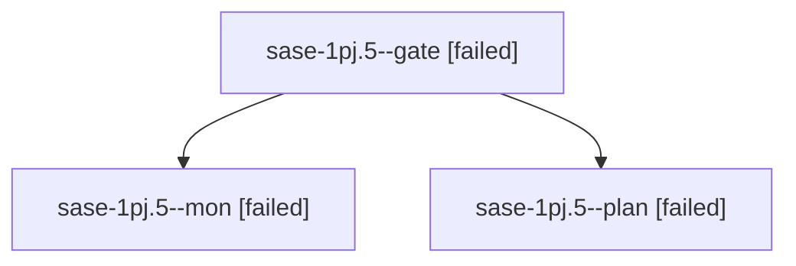

# Session: sase-1pj.5

[Agent Hoods](../README.md) / [bbugyi200](../users/bbugyi200/README.md) / [athena](../users/bbugyi200/machines/athena/README.md) / [sase-1pj](../users/bbugyi200/machines/athena/hoods/sase-1pj/README.md) / sase-1pj.5

Owner: `bbugyi200.athena` · Hood: `sase-1pj` · Members: 3 · Bead: [sase-1pj.5](https://github.com/sase-org/sase--beads/blob/main/pages/sase-1pj/sase-1pj.5.md)

## Lineage

The diagram is an optional enhancement; the ordered table below contains the same lineage in accessible text.

| Role | Agent | State | Model / provider | Timing | Commits | Prompt | Chat |
|---|---|---|---|---|---:|---|---|
| gate | sase-1pj.5--gate | failed | gpt-6-astra / codex | 2026-10-29T18:37:51.547255+00:00 → 2026-10-29T18:43:35.053011+00:00 | 0 | — | [Chat](../agents/bbugyi200.athena.sase-1pj.5--gate/chat.md) |
| mon | sase-1pj.5--mon | failed | gpt-6-astra / codex | 2026-10-29T18:43:26.745435+00:00 → 2026-10-29T18:57:48.468857+00:00 | 0 | — | [Chat](../agents/bbugyi200.athena.sase-1pj.5--mon/chat.md) |
| plan | sase-1pj.5--plan | failed | gpt-6-astra / codex | 2026-10-29T18:26:23.056039+00:00 → 2026-10-29T18:44:35.332386+00:00 | 0 | [Prompt](../agents/bbugyi200.athena.sase-1pj.5--plan/prompt.md) | [Chat](../agents/bbugyi200.athena.sase-1pj.5--plan/chat.md) |

## Neighbors

| Agent | Relation | State |
|---|---|---|
| [sase-1pj.5.1.1](bbugyi200.athena.sase-1pj.5.1.1.md) (session · 5) | descendant | completed 3, failed 2 |
| [sase-1pj.5.1.2](bbugyi200.athena.sase-1pj.5.1.2.md) (session · 17) | descendant | completed 9, failed 8 |
| [sase-1pj.5.1.3](../agents/bbugyi200.athena.sase-1pj.5.1.3/README.md) | descendant | completed |
| [sase-1pj.5.1.4](../agents/bbugyi200.athena.sase-1pj.5.1.4/README.md) | descendant | completed |
| [sase-1pj.5.1.land](bbugyi200.athena.sase-1pj.5.1.land.md) (session · 3) | descendant | completed 2, failed 1 |
| [sase-1pj.5.1.land](../agents/bbugyi200.athena.sase-1pj.5.1.land/README.md) | descendant | completed |
| [sase-1pj.1](bbugyi200.athena.sase-1pj.1.md) (session · 3) | sase-1pj hood | failed 3 |
| [sase-1pj.1.1.1](../agents/bbugyi200.athena.sase-1pj.1.1.1/README.md) | sase-1pj hood | active |
| [sase-1pj.1.1.2](../agents/bbugyi200.athena.sase-1pj.1.1.2/README.md) | sase-1pj hood | active |
| [sase-1pj.1.1.3](bbugyi200.athena.sase-1pj.1.1.3.md) (session · 3) | sase-1pj hood | active 3 |
| [sase-1pj.1.1.4](bbugyi200.athena.sase-1pj.1.1.4.md) (session · 3) | sase-1pj hood | active 3 |
| [sase-1pj.1.1.5](../agents/bbugyi200.athena.sase-1pj.1.1.5/README.md) | sase-1pj hood | active |
| [sase-1pj.1.1.land](bbugyi200.athena.sase-1pj.1.1.land.md) (session · 3) | sase-1pj hood | active 2, completed 1 |
| [sase-1pj.2](bbugyi200.athena.sase-1pj.2.md) (session · 3) | sase-1pj hood | failed 3 |
| [sase-1pj.2.1.1](bbugyi200.athena.sase-1pj.2.1.1.md) (session · 3) | sase-1pj hood | completed 2, failed 1 |
| [sase-1pj.2.1.2](../agents/bbugyi200.athena.sase-1pj.2.1.2/README.md) | sase-1pj hood | completed |
| [sase-1pj.2.1.3](../agents/bbugyi200.athena.sase-1pj.2.1.3/README.md) | sase-1pj hood | completed |
| [sase-1pj.2.1.4](../agents/bbugyi200.athena.sase-1pj.2.1.4/README.md) | sase-1pj hood | completed |
| [sase-1pj.2.1.5](bbugyi200.athena.sase-1pj.2.1.5.md) (session · 3) | sase-1pj hood | completed 2, failed 1 |
| [sase-1pj.2.1.land](../agents/bbugyi200.athena.sase-1pj.2.1.land/README.md) | sase-1pj hood | completed |
| [sase-1pj.3](../agents/bbugyi200.athena.sase-1pj.3/README.md) | sase-1pj hood | completed |
| [sase-1pj.4](bbugyi200.athena.sase-1pj.4.md) (session · 3) | sase-1pj hood | failed 3 |
| [sase-1pj.4.1.1](bbugyi200.athena.sase-1pj.4.1.1.md) (session · 3) | sase-1pj hood | completed 2, failed 1 |
| [sase-1pj.4.1.2](../agents/bbugyi200.athena.sase-1pj.4.1.2/README.md) | sase-1pj hood | completed |
| [sase-1pj.4.1.3](../agents/bbugyi200.athena.sase-1pj.4.1.3/README.md) | sase-1pj hood | completed |
| [sase-1pj.4.1.4](../agents/bbugyi200.athena.sase-1pj.4.1.4/README.md) | sase-1pj hood | completed |
| [sase-1pj.4.1.5](bbugyi200.athena.sase-1pj.4.1.5.md) (session · 3) | sase-1pj hood | completed 2, failed 1 |
| [sase-1pj.4.1.6](../agents/bbugyi200.athena.sase-1pj.4.1.6/README.md) | sase-1pj hood | completed |
| [sase-1pj.4.1.land](../agents/bbugyi200.athena.sase-1pj.4.1.land/README.md) | sase-1pj hood | completed |
| [sase-1pj.6](bbugyi200.athena.sase-1pj.6.md) (session · 3) | sase-1pj hood | failed 3 |
| [sase-1pj.6.1.1](bbugyi200.athena.sase-1pj.6.1.1.md) (session · 5) | sase-1pj hood | completed 3, failed 2 |
| [sase-1pj.6.1.2](../agents/bbugyi200.athena.sase-1pj.6.1.2/README.md) | sase-1pj hood | completed |
| [sase-1pj.6.1.3](../agents/bbugyi200.athena.sase-1pj.6.1.3/README.md) | sase-1pj hood | completed |
| [sase-1pj.6.1.4](../agents/bbugyi200.athena.sase-1pj.6.1.4/README.md) | sase-1pj hood | completed |
| [sase-1pj.6.1.5](../agents/bbugyi200.athena.sase-1pj.6.1.5/README.md) | sase-1pj hood | completed |
| [sase-1pj.6.1.6](../agents/bbugyi200.athena.sase-1pj.6.1.6/README.md) | sase-1pj hood | waiting |
| [sase-1pj.6.1.7](../agents/bbugyi200.athena.sase-1pj.6.1.7/README.md) | sase-1pj hood | active |
| [sase-1pj.6.1.8](../agents/bbugyi200.athena.sase-1pj.6.1.8/README.md) | sase-1pj hood | waiting |
| [sase-1pj.6.1.land](../agents/bbugyi200.athena.sase-1pj.6.1.land/README.md) | sase-1pj hood | waiting |
| [sase-1pj.7](bbugyi200.athena.sase-1pj.7.md) (session · 3) | sase-1pj hood | failed 3 |
| [sase-1pj.7.1.1](../agents/bbugyi200.athena.sase-1pj.7.1.1/README.md) | sase-1pj hood | active |
| [sase-1pj.7.1.2](../agents/bbugyi200.athena.sase-1pj.7.1.2/README.md) | sase-1pj hood | waiting |
| [sase-1pj.7.1.3](../agents/bbugyi200.athena.sase-1pj.7.1.3/README.md) | sase-1pj hood | waiting |
| [sase-1pj.7.1.4](../agents/bbugyi200.athena.sase-1pj.7.1.4/README.md) | sase-1pj hood | waiting |
| [sase-1pj.7.1.land](../agents/bbugyi200.athena.sase-1pj.7.1.land/README.md) | sase-1pj hood | waiting |
| [sase-1pj.8](../agents/bbugyi200.athena.sase-1pj.8/README.md) | sase-1pj hood | waiting |
| [sase-1pj.9](../agents/bbugyi200.athena.sase-1pj.9/README.md) | sase-1pj hood | waiting |
| [sase-1pj.land](../agents/bbugyi200.athena.sase-1pj.land/README.md) | sase-1pj hood | waiting |
