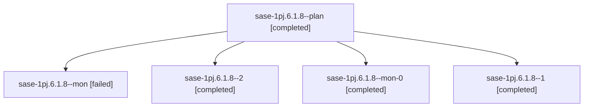

# Session: sase-1pj.6.1.8

[Agent Hoods](../README.md) / [bbugyi200](../users/bbugyi200/README.md) / [athena](../users/bbugyi200/machines/athena/README.md) / [sase-1pj](../users/bbugyi200/machines/athena/hoods/sase-1pj/README.md) / sase-1pj.6.1.8

Owner: `bbugyi200.athena` · Hood: `sase-1pj` · Members: 5 · Bead: [sase-1pj.6.1.8](https://github.com/sase-org/sase--beads/blob/main/pages/sase-1pj/sase-1pj.6.1.8.md)

## Lineage

The diagram is an optional enhancement; the ordered table below contains the same lineage in accessible text.

| Role | Agent | State | Model / provider | Timing | Commits | Prompt | Chat |
|---|---|---|---|---|---:|---|---|
| plan | sase-1pj.6.1.8--plan | completed | gpt-6-astra / codex | 2026-11-01T16:26:03.736859+00:00 → 2026-11-01T17:01:47.650692+00:00 | 0 | [Prompt](../agents/bbugyi200.athena.sase-1pj.6.1.8--plan/prompt.md) | [Chat](../agents/bbugyi200.athena.sase-1pj.6.1.8--plan/chat.md) |
| mon | sase-1pj.6.1.8--mon | failed | gpt-6-astra / codex | 2026-11-01T17:01:32.929217+00:00 → 2026-11-01T17:10:13.647811+00:00 | 0 | — | [Chat](../agents/bbugyi200.athena.sase-1pj.6.1.8--mon/chat.md) |
| 2 | sase-1pj.6.1.8--2 | completed | gpt-6-astra / codex | 2026-11-01T17:50:25.474913+00:00 → 2026-11-01T18:15:39.302482+00:00 | [1](../agents/bbugyi200.athena.sase-1pj.6.1.8--2/README.md#commits) | [Prompt](../agents/bbugyi200.athena.sase-1pj.6.1.8--2/prompt.md) | [Chat](../agents/bbugyi200.athena.sase-1pj.6.1.8--2/chat.md) |
| mon-0 | sase-1pj.6.1.8--mon-0 | completed | gpt-6-astra / codex | 2026-11-01T17:13:34.902875+00:00 → 2026-11-01T17:47:47.985146+00:00 | 0 | — | [Chat](../agents/bbugyi200.athena.sase-1pj.6.1.8--mon-0/chat.md) |
| 1 | sase-1pj.6.1.8--1 | completed | gpt-6-astra / codex | 2026-11-01T17:09:53.853959+00:00 → 2026-11-01T17:13:41.744161+00:00 | 0 | [Prompt](../agents/bbugyi200.athena.sase-1pj.6.1.8--1/prompt.md) | [Chat](../agents/bbugyi200.athena.sase-1pj.6.1.8--1/chat.md) |

## Commits

| Role | Repo | Commit | Subject | Committed |
|---|---|---|---|---|
| 2 | sase | [`a19243c`](https://github.com/sase-org/sase/commit/a19243cdf64785ef222b7ada4d0d8a9cda7dcf01) | feat(staged-handoff): reconcile abandoned finalized stages | 2026-11-01 13:13:39 EST |

## Neighbors

| Agent | Relation | State |
|---|---|---|
| [sase-1pj.6](bbugyi200.athena.sase-1pj.6.md) (session · 3) | ancestor | failed 3 |
| [sase-1pj.6.1.1](bbugyi200.athena.sase-1pj.6.1.1.md) (session · 5) | sase-1pj.6.1 hood | completed 3, failed 2 |
| [sase-1pj.6.1.2](../agents/bbugyi200.athena.sase-1pj.6.1.2/README.md) | sase-1pj.6.1 hood | completed |
| [sase-1pj.6.1.3](../agents/bbugyi200.athena.sase-1pj.6.1.3/README.md) | sase-1pj.6.1 hood | completed |
| [sase-1pj.6.1.4](../agents/bbugyi200.athena.sase-1pj.6.1.4/README.md) | sase-1pj.6.1 hood | completed |
| [sase-1pj.6.1.5](../agents/bbugyi200.athena.sase-1pj.6.1.5/README.md) | sase-1pj.6.1 hood | completed |
| [sase-1pj.6.1.6](bbugyi200.athena.sase-1pj.6.1.6.md) (session · 3) | sase-1pj.6.1 hood | completed 2, failed 1 |
| [sase-1pj.6.1.7](../agents/bbugyi200.athena.sase-1pj.6.1.7/README.md) | sase-1pj.6.1 hood | completed |
| [sase-1pj.6.1.land](bbugyi200.athena.sase-1pj.6.1.land.md) (session · 5) | sase-1pj.6.1 hood | completed 5 |
| [sase-1pj.1](bbugyi200.athena.sase-1pj.1.md) (session · 3) | sase-1pj hood | failed 3 |
| [sase-1pj.1.1.1](../agents/bbugyi200.athena.sase-1pj.1.1.1/README.md) | sase-1pj hood | active |
| [sase-1pj.1.1.2](../agents/bbugyi200.athena.sase-1pj.1.1.2/README.md) | sase-1pj hood | active |
| [sase-1pj.1.1.3](bbugyi200.athena.sase-1pj.1.1.3.md) (session · 3) | sase-1pj hood | active 3 |
| [sase-1pj.1.1.4](bbugyi200.athena.sase-1pj.1.1.4.md) (session · 3) | sase-1pj hood | active 3 |
| [sase-1pj.1.1.5](../agents/bbugyi200.athena.sase-1pj.1.1.5/README.md) | sase-1pj hood | active |
| [sase-1pj.1.1.land](bbugyi200.athena.sase-1pj.1.1.land.md) (session · 3) | sase-1pj hood | active 2, completed 1 |
| [sase-1pj.2](bbugyi200.athena.sase-1pj.2.md) (session · 3) | sase-1pj hood | failed 3 |
| [sase-1pj.2.1.1](bbugyi200.athena.sase-1pj.2.1.1.md) (session · 3) | sase-1pj hood | completed 2, failed 1 |
| [sase-1pj.2.1.2](../agents/bbugyi200.athena.sase-1pj.2.1.2/README.md) | sase-1pj hood | completed |
| [sase-1pj.2.1.3](../agents/bbugyi200.athena.sase-1pj.2.1.3/README.md) | sase-1pj hood | completed |
| [sase-1pj.2.1.4](../agents/bbugyi200.athena.sase-1pj.2.1.4/README.md) | sase-1pj hood | completed |
| [sase-1pj.2.1.5](bbugyi200.athena.sase-1pj.2.1.5.md) (session · 3) | sase-1pj hood | completed 2, failed 1 |
| [sase-1pj.2.1.land](../agents/bbugyi200.athena.sase-1pj.2.1.land/README.md) | sase-1pj hood | completed |
| [sase-1pj.3](../agents/bbugyi200.athena.sase-1pj.3/README.md) | sase-1pj hood | completed |
| [sase-1pj.4](bbugyi200.athena.sase-1pj.4.md) (session · 3) | sase-1pj hood | failed 3 |
| [sase-1pj.4.1.1](bbugyi200.athena.sase-1pj.4.1.1.md) (session · 3) | sase-1pj hood | completed 2, failed 1 |
| [sase-1pj.4.1.2](../agents/bbugyi200.athena.sase-1pj.4.1.2/README.md) | sase-1pj hood | completed |
| [sase-1pj.4.1.3](../agents/bbugyi200.athena.sase-1pj.4.1.3/README.md) | sase-1pj hood | completed |
| [sase-1pj.4.1.4](../agents/bbugyi200.athena.sase-1pj.4.1.4/README.md) | sase-1pj hood | completed |
| [sase-1pj.4.1.5](bbugyi200.athena.sase-1pj.4.1.5.md) (session · 3) | sase-1pj hood | completed 2, failed 1 |
| [sase-1pj.4.1.6](../agents/bbugyi200.athena.sase-1pj.4.1.6/README.md) | sase-1pj hood | completed |
| [sase-1pj.4.1.land](../agents/bbugyi200.athena.sase-1pj.4.1.land/README.md) | sase-1pj hood | completed |
| [sase-1pj.5](bbugyi200.athena.sase-1pj.5.md) (session · 3) | sase-1pj hood | failed 3 |
| [sase-1pj.5.1.1](bbugyi200.athena.sase-1pj.5.1.1.md) (session · 5) | sase-1pj hood | completed 3, failed 2 |
| [sase-1pj.5.1.2](bbugyi200.athena.sase-1pj.5.1.2.md) (session · 17) | sase-1pj hood | completed 9, failed 8 |
| [sase-1pj.5.1.3](../agents/bbugyi200.athena.sase-1pj.5.1.3/README.md) | sase-1pj hood | completed |
| [sase-1pj.5.1.4](../agents/bbugyi200.athena.sase-1pj.5.1.4/README.md) | sase-1pj hood | completed |
| [sase-1pj.5.1.land](bbugyi200.athena.sase-1pj.5.1.land.md) (session · 3) | sase-1pj hood | completed 2, failed 1 |
| [sase-1pj.5.1.land](../agents/bbugyi200.athena.sase-1pj.5.1.land/README.md) | sase-1pj hood | completed |
| [sase-1pj.7](bbugyi200.athena.sase-1pj.7.md) (session · 3) | sase-1pj hood | failed 3 |
| [sase-1pj.7.1.1](../agents/bbugyi200.athena.sase-1pj.7.1.1/README.md) | sase-1pj hood | completed |
| [sase-1pj.7.1.2](../agents/bbugyi200.athena.sase-1pj.7.1.2/README.md) | sase-1pj hood | completed |
| [sase-1pj.7.1.3](../agents/bbugyi200.athena.sase-1pj.7.1.3/README.md) | sase-1pj hood | completed |
| [sase-1pj.7.1.4](bbugyi200.athena.sase-1pj.7.1.4.md) (session · 11) | sase-1pj hood | completed 8, failed 3 |
| [sase-1pj.7.1.land](../agents/bbugyi200.athena.sase-1pj.7.1.land/README.md) | sase-1pj hood | waiting |
| [sase-1pj.8](../agents/bbugyi200.athena.sase-1pj.8/README.md) | sase-1pj hood | waiting |
| [sase-1pj.9](../agents/bbugyi200.athena.sase-1pj.9/README.md) | sase-1pj hood | waiting |
| [sase-1pj.land](../agents/bbugyi200.athena.sase-1pj.land/README.md) | sase-1pj hood | waiting |
