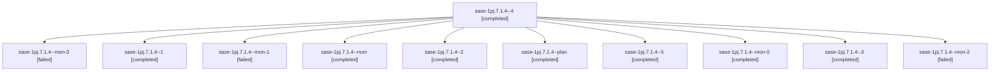

# Session: sase-1pj.7.1.4

[Agent Hoods](../README.md) / [bbugyi200](../users/bbugyi200/README.md) / [athena](../users/bbugyi200/machines/athena/README.md) / [sase-1pj](../users/bbugyi200/machines/athena/hoods/sase-1pj/README.md) / sase-1pj.7.1.4

Owner: `bbugyi200.athena` · Hood: `sase-1pj` · Members: 11 · Bead: [sase-1pj.7.1.4](https://github.com/sase-org/sase--beads/blob/main/pages/sase-1pj/sase-1pj.7.1.4.md)

## Lineage

The diagram is an optional enhancement; the ordered table below contains the same lineage in accessible text.

| Role | Agent | State | Model / provider | Timing | Commits | Prompt | Chat |
|---|---|---|---|---|---:|---|---|
| 4 | sase-1pj.7.1.4--4 | completed | gpt-6-luna / codex | 2026-11-01T17:08:14.573920+00:00 → 2026-11-01T17:41:35.771136+00:00 | 0 | [Prompt](../agents/bbugyi200.athena.sase-1pj.7.1.4--4/prompt.md) | [Chat](../agents/bbugyi200.athena.sase-1pj.7.1.4--4/chat.md) |
| mon-3 | sase-1pj.7.1.4--mon-3 | failed | gpt-6-luna / codex | 2026-11-01T17:40:48.421172+00:00 → 2026-11-01T18:27:41.844773+00:00 | 0 | — | [Chat](../agents/bbugyi200.athena.sase-1pj.7.1.4--mon-3/chat.md) |
| 1 | sase-1pj.7.1.4--1 | completed | gpt-6-astra / codex | 2026-11-02T21:11:36.139791+00:00 → 2026-11-02T21:43:02.496740+00:00 | [1](../agents/bbugyi200.athena.sase-1pj.7.1.4--1/README.md#commits) | [Prompt](../agents/bbugyi200.athena.sase-1pj.7.1.4--1/prompt.md) | [Chat](../agents/bbugyi200.athena.sase-1pj.7.1.4--1/chat.md) |
| mon-1 | sase-1pj.7.1.4--mon-1 | failed | gpt-6-luna / codex | 2026-11-01T16:49:20.011195+00:00 → 2026-11-01T16:51:26.294716+00:00 | 0 | — | [Chat](../agents/bbugyi200.athena.sase-1pj.7.1.4--mon-1/chat.md) |
| mon | sase-1pj.7.1.4--mon | completed | gpt-6-astra / codex | 2026-11-02T20:52:37.979297+00:00 → 2026-11-02T21:10:32.351698+00:00 | 0 | — | [Chat](../agents/bbugyi200.athena.sase-1pj.7.1.4--mon/chat.md) |
| 2 | sase-1pj.7.1.4--2 | completed | gpt-6-luna / codex | 2026-11-01T16:34:40.011863+00:00 → 2026-11-01T16:49:33.637718+00:00 | 0 | [Prompt](../agents/bbugyi200.athena.sase-1pj.7.1.4--2/prompt.md) | [Chat](../agents/bbugyi200.athena.sase-1pj.7.1.4--2/chat.md) |
| plan | sase-1pj.7.1.4--plan | completed | gpt-6-astra / codex | 2026-11-02T20:47:17.473654+00:00 → 2026-11-02T20:52:46.219654+00:00 | 0 | [Prompt](../agents/bbugyi200.athena.sase-1pj.7.1.4--plan/prompt.md) | [Chat](../agents/bbugyi200.athena.sase-1pj.7.1.4--plan/chat.md) |
| 5 | sase-1pj.7.1.4--5 | completed | muse-spark-1.3-contributor / muse | 2026-11-01T18:29:15.455653+00:00 → 2026-11-01T22:37:09.704758+00:00 | [1](../agents/bbugyi200.athena.sase-1pj.7.1.4--5/README.md#commits) | [Prompt](../agents/bbugyi200.athena.sase-1pj.7.1.4--5/prompt.md) | [Chat](../agents/bbugyi200.athena.sase-1pj.7.1.4--5/chat.md) |
| mon-0 | sase-1pj.7.1.4--mon-0 | completed | gpt-6-luna / codex | 2026-11-01T16:30:34.474864+00:00 → 2026-11-01T16:33:43.092639+00:00 | 0 | — | [Chat](../agents/bbugyi200.athena.sase-1pj.7.1.4--mon-0/chat.md) |
| 3 | sase-1pj.7.1.4--3 | completed | gpt-6-luna / codex | 2026-11-01T16:53:15.867661+00:00 → 2026-11-01T16:55:27.361445+00:00 | 0 | [Prompt](../agents/bbugyi200.athena.sase-1pj.7.1.4--3/prompt.md) | [Chat](../agents/bbugyi200.athena.sase-1pj.7.1.4--3/chat.md) |
| mon-2 | sase-1pj.7.1.4--mon-2 | failed | gpt-6-luna / codex | 2026-11-01T16:55:11.709090+00:00 → 2026-11-01T17:06:06.365073+00:00 | 0 | — | [Chat](../agents/bbugyi200.athena.sase-1pj.7.1.4--mon-2/chat.md) |

## Commits

| Role | Repo | Commit | Subject | Committed |
|---|---|---|---|---|
| 5 | sase | [`31a28d9`](https://github.com/sase-org/sase/commit/31a28d9618d20ff656ae57c4a4268cf82f4abaf8) | feat(stranded-work): retain held workspace as stranded unless live successor owns | 2026-11-01 17:33:50 EST |
| 1 | sase | [`d206188`](https://github.com/sase-org/sase/commit/d2061888ecf5be62ce2dc616e26830d7e7a8dee0) | fix(recovery): settle staged workspace holds and honor expiry | 2026-11-02 16:41:16 EST |

## Neighbors

| Agent | Relation | State |
|---|---|---|
| [sase-1pj.7](bbugyi200.athena.sase-1pj.7.md) (session · 3) | ancestor | failed 3 |
| [sase-1pj.7.1.1](../agents/bbugyi200.athena.sase-1pj.7.1.1/README.md) | sase-1pj.7.1 hood | completed |
| [sase-1pj.7.1.2](../agents/bbugyi200.athena.sase-1pj.7.1.2/README.md) | sase-1pj.7.1 hood | completed |
| [sase-1pj.7.1.3](../agents/bbugyi200.athena.sase-1pj.7.1.3/README.md) | sase-1pj.7.1 hood | completed |
| [sase-1pj.7.1.land](bbugyi200.athena.sase-1pj.7.1.land.md) (session · 3) | sase-1pj.7.1 hood | active 2, completed 1 |
| [sase-1pj.1](bbugyi200.athena.sase-1pj.1.md) (session · 3) | sase-1pj hood | failed 3 |
| [sase-1pj.1.1.1](../agents/bbugyi200.athena.sase-1pj.1.1.1/README.md) | sase-1pj hood | active |
| [sase-1pj.1.1.2](../agents/bbugyi200.athena.sase-1pj.1.1.2/README.md) | sase-1pj hood | active |
| [sase-1pj.1.1.3](bbugyi200.athena.sase-1pj.1.1.3.md) (session · 3) | sase-1pj hood | active 3 |
| [sase-1pj.1.1.4](bbugyi200.athena.sase-1pj.1.1.4.md) (session · 3) | sase-1pj hood | active 3 |
| [sase-1pj.1.1.5](../agents/bbugyi200.athena.sase-1pj.1.1.5/README.md) | sase-1pj hood | active |
| [sase-1pj.1.1.land](bbugyi200.athena.sase-1pj.1.1.land.md) (session · 3) | sase-1pj hood | active 2, completed 1 |
| [sase-1pj.2](bbugyi200.athena.sase-1pj.2.md) (session · 3) | sase-1pj hood | failed 3 |
| [sase-1pj.2.1.1](bbugyi200.athena.sase-1pj.2.1.1.md) (session · 3) | sase-1pj hood | completed 2, failed 1 |
| [sase-1pj.2.1.2](../agents/bbugyi200.athena.sase-1pj.2.1.2/README.md) | sase-1pj hood | completed |
| [sase-1pj.2.1.3](../agents/bbugyi200.athena.sase-1pj.2.1.3/README.md) | sase-1pj hood | completed |
| [sase-1pj.2.1.4](../agents/bbugyi200.athena.sase-1pj.2.1.4/README.md) | sase-1pj hood | completed |
| [sase-1pj.2.1.5](bbugyi200.athena.sase-1pj.2.1.5.md) (session · 3) | sase-1pj hood | completed 2, failed 1 |
| [sase-1pj.2.1.land](../agents/bbugyi200.athena.sase-1pj.2.1.land/README.md) | sase-1pj hood | completed |
| [sase-1pj.3](../agents/bbugyi200.athena.sase-1pj.3/README.md) | sase-1pj hood | completed |
| [sase-1pj.4](bbugyi200.athena.sase-1pj.4.md) (session · 3) | sase-1pj hood | failed 3 |
| [sase-1pj.4.1.1](bbugyi200.athena.sase-1pj.4.1.1.md) (session · 3) | sase-1pj hood | completed 2, failed 1 |
| [sase-1pj.4.1.2](../agents/bbugyi200.athena.sase-1pj.4.1.2/README.md) | sase-1pj hood | completed |
| [sase-1pj.4.1.3](../agents/bbugyi200.athena.sase-1pj.4.1.3/README.md) | sase-1pj hood | completed |
| [sase-1pj.4.1.4](../agents/bbugyi200.athena.sase-1pj.4.1.4/README.md) | sase-1pj hood | completed |
| [sase-1pj.4.1.5](bbugyi200.athena.sase-1pj.4.1.5.md) (session · 3) | sase-1pj hood | completed 2, failed 1 |
| [sase-1pj.4.1.6](../agents/bbugyi200.athena.sase-1pj.4.1.6/README.md) | sase-1pj hood | completed |
| [sase-1pj.4.1.land](../agents/bbugyi200.athena.sase-1pj.4.1.land/README.md) | sase-1pj hood | completed |
| [sase-1pj.5](bbugyi200.athena.sase-1pj.5.md) (session · 3) | sase-1pj hood | failed 3 |
| [sase-1pj.5.1.1](bbugyi200.athena.sase-1pj.5.1.1.md) (session · 5) | sase-1pj hood | completed 3, failed 2 |
| [sase-1pj.5.1.2](bbugyi200.athena.sase-1pj.5.1.2.md) (session · 17) | sase-1pj hood | completed 9, failed 8 |
| [sase-1pj.5.1.3](../agents/bbugyi200.athena.sase-1pj.5.1.3/README.md) | sase-1pj hood | completed |
| [sase-1pj.5.1.4](../agents/bbugyi200.athena.sase-1pj.5.1.4/README.md) | sase-1pj hood | completed |
| [sase-1pj.5.1.land](bbugyi200.athena.sase-1pj.5.1.land.md) (session · 3) | sase-1pj hood | completed 2, failed 1 |
| [sase-1pj.5.1.land](../agents/bbugyi200.athena.sase-1pj.5.1.land/README.md) | sase-1pj hood | completed |
| [sase-1pj.6](bbugyi200.athena.sase-1pj.6.md) (session · 3) | sase-1pj hood | failed 3 |
| [sase-1pj.6.1.1](bbugyi200.athena.sase-1pj.6.1.1.md) (session · 5) | sase-1pj hood | completed 3, failed 2 |
| [sase-1pj.6.1.2](../agents/bbugyi200.athena.sase-1pj.6.1.2/README.md) | sase-1pj hood | completed |
| [sase-1pj.6.1.3](../agents/bbugyi200.athena.sase-1pj.6.1.3/README.md) | sase-1pj hood | completed |
| [sase-1pj.6.1.4](../agents/bbugyi200.athena.sase-1pj.6.1.4/README.md) | sase-1pj hood | completed |
| [sase-1pj.6.1.5](../agents/bbugyi200.athena.sase-1pj.6.1.5/README.md) | sase-1pj hood | completed |
| [sase-1pj.6.1.6](bbugyi200.athena.sase-1pj.6.1.6.md) (session · 3) | sase-1pj hood | completed 2, failed 1 |
| [sase-1pj.6.1.7](../agents/bbugyi200.athena.sase-1pj.6.1.7/README.md) | sase-1pj hood | completed |
| [sase-1pj.6.1.8](bbugyi200.athena.sase-1pj.6.1.8.md) (session · 5) | sase-1pj hood | completed 4, failed 1 |
| [sase-1pj.6.1.8](../agents/bbugyi200.athena.sase-1pj.6.1.8/README.md) | sase-1pj hood | active |
| [sase-1pj.6.1.land](bbugyi200.athena.sase-1pj.6.1.land.md) (session · 5) | sase-1pj hood | completed 5 |
| [sase-1pj.8](../agents/bbugyi200.athena.sase-1pj.8/README.md) | sase-1pj hood | waiting |
| [sase-1pj.9](../agents/bbugyi200.athena.sase-1pj.9/README.md) | sase-1pj hood | waiting |
| [sase-1pj.land](../agents/bbugyi200.athena.sase-1pj.land/README.md) | sase-1pj hood | waiting |
