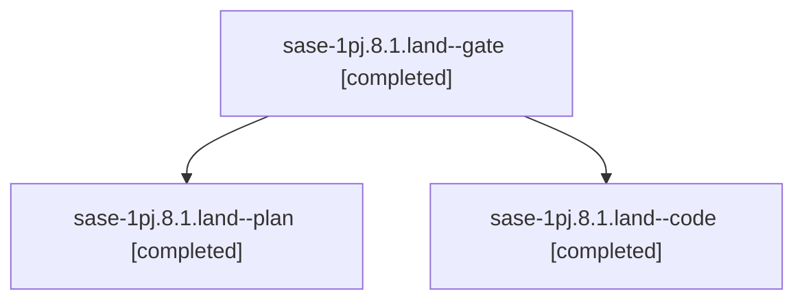

# Session: sase-1pj.8.1.land

[Agent Hoods](../README.md) / [bbugyi200](../users/bbugyi200/README.md) / [athena](../users/bbugyi200/machines/athena/README.md) / [sase-1pj](../users/bbugyi200/machines/athena/hoods/sase-1pj/README.md) / sase-1pj.8.1.land

Owner: `bbugyi200.athena` · Hood: `sase-1pj` · Members: 3 · Bead: [sase-1pj.8.1](https://github.com/sase-org/sase--beads/blob/main/pages/sase-1pj/sase-1pj.8.1.md)

## Lineage

The diagram is an optional enhancement; the ordered table below contains the same lineage in accessible text.

| Role | Agent | State | Model / provider | Timing | Commits | Prompt | Chat |
|---|---|---|---|---|---:|---|---|
| gate | sase-1pj.8.1.land--gate | completed | opus / claude | 2026-11-03T15:17:13.141629+00:00 → 2026-11-03T15:17:44.879643+00:00 | 0 | — | [Chat](../agents/bbugyi200.athena.sase-1pj.8.1.land--gate/chat.md) |
| plan | sase-1pj.8.1.land--plan | completed | opus / claude | 2026-11-03T14:56:48.724687+00:00 → 2026-11-03T15:55:12.392193+00:00 | 0 | [Prompt](../agents/bbugyi200.athena.sase-1pj.8.1.land--plan/prompt.md) | [Chat](../agents/bbugyi200.athena.sase-1pj.8.1.land--plan/chat.md) |
| code | sase-1pj.8.1.land--code | completed | muse-spark-1.3-contributor / muse | 2026-11-03T15:18:22.429133+00:00 → 2026-11-03T15:55:12.392193+00:00 | [1](../agents/bbugyi200.athena.sase-1pj.8.1.land--code/README.md#commits) | — | [Chat](../agents/bbugyi200.athena.sase-1pj.8.1.land--code/chat.md) |

## Commits

| Role | Repo | Commit | Subject | Committed |
|---|---|---|---|---|
| code | sase | [`ced5901`](https://github.com/sase-org/sase/commit/ced5901dd5612f00f767b3e7bc695a0936bdc14f) | feat(axe): finish staged-handoff kill-path landing | 2026-11-03 10:50:37 EST |

## Neighbors

| Agent | Relation | State |
|---|---|---|
| [sase-1pj.8](bbugyi200.athena.sase-1pj.8.md) (session · 3) | ancestor | active 1, completed 2 |
| [sase-1pj.8.1.1](../agents/bbugyi200.athena.sase-1pj.8.1.1/README.md) | sase-1pj.8.1 hood | completed |
| [sase-1pj.8.1.2](bbugyi200.athena.sase-1pj.8.1.2.md) (session · 5) | sase-1pj.8.1 hood | completed 4, failed 1 |
| [sase-1pj.8.1.3](bbugyi200.athena.sase-1pj.8.1.3.md) (session · 5) | sase-1pj.8.1 hood | completed 4, failed 1 |
| [sase-1pj.8.1.4](../agents/bbugyi200.athena.sase-1pj.8.1.4/README.md) | sase-1pj.8.1 hood | completed |
| [sase-1pj.8.1.5](../agents/bbugyi200.athena.sase-1pj.8.1.5/README.md) | sase-1pj.8.1 hood | completed |
| [sase-1pj.8.1.6](../agents/bbugyi200.athena.sase-1pj.8.1.6/README.md) | sase-1pj.8.1 hood | completed |
| [sase-1pj.8.1.7](bbugyi200.athena.sase-1pj.8.1.7.md) (session · 3) | sase-1pj.8.1 hood | completed 3 |
| [sase-1pj.8.1.7](../agents/bbugyi200.athena.sase-1pj.8.1.7/README.md) | sase-1pj.8.1 hood | waiting |
| [sase-1pj.1](bbugyi200.athena.sase-1pj.1.md) (session · 3) | sase-1pj hood | failed 3 |
| [sase-1pj.1.1.1](../agents/bbugyi200.athena.sase-1pj.1.1.1/README.md) | sase-1pj hood | active |
| [sase-1pj.1.1.2](../agents/bbugyi200.athena.sase-1pj.1.1.2/README.md) | sase-1pj hood | active |
| [sase-1pj.1.1.3](bbugyi200.athena.sase-1pj.1.1.3.md) (session · 3) | sase-1pj hood | active 3 |
| [sase-1pj.1.1.4](bbugyi200.athena.sase-1pj.1.1.4.md) (session · 3) | sase-1pj hood | active 3 |
| [sase-1pj.1.1.5](../agents/bbugyi200.athena.sase-1pj.1.1.5/README.md) | sase-1pj hood | active |
| [sase-1pj.1.1.land](bbugyi200.athena.sase-1pj.1.1.land.md) (session · 3) | sase-1pj hood | active 2, completed 1 |
| [sase-1pj.2](bbugyi200.athena.sase-1pj.2.md) (session · 3) | sase-1pj hood | failed 3 |
| [sase-1pj.2.1.1](bbugyi200.athena.sase-1pj.2.1.1.md) (session · 3) | sase-1pj hood | completed 2, failed 1 |
| [sase-1pj.2.1.2](../agents/bbugyi200.athena.sase-1pj.2.1.2/README.md) | sase-1pj hood | completed |
| [sase-1pj.2.1.3](../agents/bbugyi200.athena.sase-1pj.2.1.3/README.md) | sase-1pj hood | completed |
| [sase-1pj.2.1.4](../agents/bbugyi200.athena.sase-1pj.2.1.4/README.md) | sase-1pj hood | completed |
| [sase-1pj.2.1.5](bbugyi200.athena.sase-1pj.2.1.5.md) (session · 3) | sase-1pj hood | completed 2, failed 1 |
| [sase-1pj.2.1.land](../agents/bbugyi200.athena.sase-1pj.2.1.land/README.md) | sase-1pj hood | completed |
| [sase-1pj.3](../agents/bbugyi200.athena.sase-1pj.3/README.md) | sase-1pj hood | completed |
| [sase-1pj.4](bbugyi200.athena.sase-1pj.4.md) (session · 3) | sase-1pj hood | failed 3 |
| [sase-1pj.4.1.1](bbugyi200.athena.sase-1pj.4.1.1.md) (session · 3) | sase-1pj hood | completed 2, failed 1 |
| [sase-1pj.4.1.2](../agents/bbugyi200.athena.sase-1pj.4.1.2/README.md) | sase-1pj hood | completed |
| [sase-1pj.4.1.3](../agents/bbugyi200.athena.sase-1pj.4.1.3/README.md) | sase-1pj hood | completed |
| [sase-1pj.4.1.4](../agents/bbugyi200.athena.sase-1pj.4.1.4/README.md) | sase-1pj hood | completed |
| [sase-1pj.4.1.5](bbugyi200.athena.sase-1pj.4.1.5.md) (session · 3) | sase-1pj hood | completed 2, failed 1 |
| [sase-1pj.4.1.6](../agents/bbugyi200.athena.sase-1pj.4.1.6/README.md) | sase-1pj hood | completed |
| [sase-1pj.4.1.land](../agents/bbugyi200.athena.sase-1pj.4.1.land/README.md) | sase-1pj hood | completed |
| [sase-1pj.5](bbugyi200.athena.sase-1pj.5.md) (session · 3) | sase-1pj hood | failed 3 |
| [sase-1pj.5.1.1](bbugyi200.athena.sase-1pj.5.1.1.md) (session · 5) | sase-1pj hood | completed 3, failed 2 |
| [sase-1pj.5.1.2](bbugyi200.athena.sase-1pj.5.1.2.md) (session · 17) | sase-1pj hood | completed 9, failed 8 |
| [sase-1pj.5.1.3](../agents/bbugyi200.athena.sase-1pj.5.1.3/README.md) | sase-1pj hood | completed |
| [sase-1pj.5.1.4](../agents/bbugyi200.athena.sase-1pj.5.1.4/README.md) | sase-1pj hood | completed |
| [sase-1pj.5.1.land](bbugyi200.athena.sase-1pj.5.1.land.md) (session · 3) | sase-1pj hood | completed 2, failed 1 |
| [sase-1pj.5.1.land](../agents/bbugyi200.athena.sase-1pj.5.1.land/README.md) | sase-1pj hood | completed |
| [sase-1pj.6](bbugyi200.athena.sase-1pj.6.md) (session · 3) | sase-1pj hood | failed 3 |
| [sase-1pj.6.1.1](bbugyi200.athena.sase-1pj.6.1.1.md) (session · 5) | sase-1pj hood | completed 3, failed 2 |
| [sase-1pj.6.1.2](../agents/bbugyi200.athena.sase-1pj.6.1.2/README.md) | sase-1pj hood | completed |
| [sase-1pj.6.1.3](../agents/bbugyi200.athena.sase-1pj.6.1.3/README.md) | sase-1pj hood | completed |
| [sase-1pj.6.1.4](../agents/bbugyi200.athena.sase-1pj.6.1.4/README.md) | sase-1pj hood | completed |
| [sase-1pj.6.1.5](../agents/bbugyi200.athena.sase-1pj.6.1.5/README.md) | sase-1pj hood | completed |
| [sase-1pj.6.1.6](bbugyi200.athena.sase-1pj.6.1.6.md) (session · 3) | sase-1pj hood | completed 2, failed 1 |
| [sase-1pj.6.1.7](../agents/bbugyi200.athena.sase-1pj.6.1.7/README.md) | sase-1pj hood | completed |
| [sase-1pj.6.1.8](bbugyi200.athena.sase-1pj.6.1.8.md) (session · 5) | sase-1pj hood | completed 4, failed 1 |
| [sase-1pj.6.1.8](../agents/bbugyi200.athena.sase-1pj.6.1.8/README.md) | sase-1pj hood | active |
| [sase-1pj.6.1.land](bbugyi200.athena.sase-1pj.6.1.land.md) (session · 5) | sase-1pj hood | completed 5 |
| [sase-1pj.7](bbugyi200.athena.sase-1pj.7.md) (session · 3) | sase-1pj hood | failed 3 |
| [sase-1pj.7.1.1](../agents/bbugyi200.athena.sase-1pj.7.1.1/README.md) | sase-1pj hood | completed |
| [sase-1pj.7.1.2](../agents/bbugyi200.athena.sase-1pj.7.1.2/README.md) | sase-1pj hood | completed |
| [sase-1pj.7.1.3](../agents/bbugyi200.athena.sase-1pj.7.1.3/README.md) | sase-1pj hood | completed |
| [sase-1pj.7.1.4](bbugyi200.athena.sase-1pj.7.1.4.md) (session · 11) | sase-1pj hood | completed 8, failed 3 |
| [sase-1pj.7.1.5.1](../agents/bbugyi200.athena.sase-1pj.7.1.5.1/README.md) | sase-1pj hood | completed |
| [sase-1pj.7.1.5.2](../agents/bbugyi200.athena.sase-1pj.7.1.5.2/README.md) | sase-1pj hood | completed |
| [sase-1pj.7.1.5.3](bbugyi200.athena.sase-1pj.7.1.5.3.md) (session · 5) | sase-1pj hood | completed 4, failed 1 |
| [sase-1pj.7.1.5.land](bbugyi200.athena.sase-1pj.7.1.5.land.md) (session · 3) | sase-1pj hood | completed 3 |
| … and 3 more in the [hood roster](../users/bbugyi200/machines/athena/hoods/sase-1pj/README.md) | sase-1pj hood | — |
