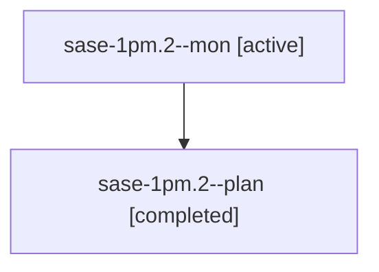

# Session: sase-1pm.2

[Agent Hoods](../README.md) / [bbugyi200](../users/bbugyi200/README.md) / [athena](../users/bbugyi200/machines/athena/README.md) / [sase-1pm](../users/bbugyi200/machines/athena/hoods/sase-1pm/README.md) / sase-1pm.2

Owner: `bbugyi200.athena` · Hood: `sase-1pm` · Members: 2 · Bead: [sase-1pm.2](https://github.com/sase-org/sase--beads/blob/main/pages/sase-1pm/sase-1pm.2.md)

## Lineage

The diagram is an optional enhancement; the ordered table below contains the same lineage in accessible text.

| Role | Agent | State | Model / provider | Timing | Commits | Prompt | Chat |
|---|---|---|---|---|---:|---|---|
| mon | sase-1pm.2--mon | active | grok-4.6 / grok | 2026-10-29T05:57:28.538926+00:00 | 0 | — | — |
| plan | sase-1pm.2--plan | completed | grok-4.6 / grok | 2026-10-29T05:49:27.634326+00:00 → 2026-10-29T05:58:08.829635+00:00 | 0 | [Prompt](../agents/bbugyi200.athena.sase-1pm.2--plan/prompt.md) | [Chat](../agents/bbugyi200.athena.sase-1pm.2--plan/chat.md) |

## Neighbors

| Agent | Relation | State |
|---|---|---|
| [sase-1pm.1](../agents/bbugyi200.athena.sase-1pm.1/README.md) | sase-1pm hood | active |
| [sase-1pm.3](../agents/bbugyi200.athena.sase-1pm.3/README.md) | sase-1pm hood | completed |
| [sase-1pm.4](bbugyi200.athena.sase-1pm.4.md) (session · 3) | sase-1pm hood | active 1, completed 1, failed 1 |
| [sase-1pm.5](bbugyi200.athena.sase-1pm.5.md) (session · 3) | sase-1pm hood | failed 3 |
| [sase-1pm.5.1.1](../agents/bbugyi200.athena.sase-1pm.5.1.1/README.md) | sase-1pm hood | active |
| [sase-1pm.5.1.2](../agents/bbugyi200.athena.sase-1pm.5.1.2/README.md) | sase-1pm hood | waiting |
| [sase-1pm.5.1.3](../agents/bbugyi200.athena.sase-1pm.5.1.3/README.md) | sase-1pm hood | waiting |
| [sase-1pm.5.1.4](../agents/bbugyi200.athena.sase-1pm.5.1.4/README.md) | sase-1pm hood | waiting |
| [sase-1pm.5.1.land](../agents/bbugyi200.athena.sase-1pm.5.1.land/README.md) | sase-1pm hood | waiting |
| [sase-1pm.land](../agents/bbugyi200.athena.sase-1pm.land/README.md) | sase-1pm hood | waiting |
