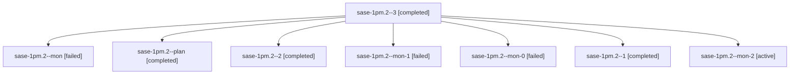

# Session: sase-1pm.2

[Agent Hoods](../README.md) / [bbugyi200](../users/bbugyi200/README.md) / [athena](../users/bbugyi200/machines/athena/README.md) / [sase-1pm](../users/bbugyi200/machines/athena/hoods/sase-1pm/README.md) / sase-1pm.2

Owner: `bbugyi200.athena` · Hood: `sase-1pm` · Members: 8 · Bead: [sase-1pm.2](https://github.com/sase-org/sase--beads/blob/main/pages/sase-1pm/sase-1pm.2.md)

## Lineage

The diagram is an optional enhancement; the ordered table below contains the same lineage in accessible text.

| Role | Agent | State | Model / provider | Timing | Commits | Prompt | Chat |
|---|---|---|---|---|---:|---|---|
| 3 | sase-1pm.2--3 | completed | grok-4.6 / grok | 2026-10-29T09:27:38.110413+00:00 → 2026-10-29T09:36:39.215956+00:00 | 0 | [Prompt](../agents/bbugyi200.athena.sase-1pm.2--3/prompt.md) | [Chat](../agents/bbugyi200.athena.sase-1pm.2--3/chat.md) |
| mon | sase-1pm.2--mon | failed | grok-4.6 / grok | 2026-10-29T05:57:28.538926+00:00 → 2026-10-29T06:59:42.066911+00:00 | 0 | — | [Chat](../agents/bbugyi200.athena.sase-1pm.2--mon/chat.md) |
| plan | sase-1pm.2--plan | completed | grok-4.6 / grok | 2026-10-29T05:49:27.634326+00:00 → 2026-10-29T05:58:08.829635+00:00 | 0 | [Prompt](../agents/bbugyi200.athena.sase-1pm.2--plan/prompt.md) | [Chat](../agents/bbugyi200.athena.sase-1pm.2--plan/chat.md) |
| 2 | sase-1pm.2--2 | completed | grok-4.6 / grok | 2026-10-29T09:12:10.532422+00:00 → 2026-10-29T09:20:27.563124+00:00 | 0 | [Prompt](../agents/bbugyi200.athena.sase-1pm.2--2/prompt.md) | [Chat](../agents/bbugyi200.athena.sase-1pm.2--2/chat.md) |
| mon-1 | sase-1pm.2--mon-1 | failed | grok-4.6 / grok | 2026-10-29T09:19:40.511461+00:00 → 2026-10-29T09:25:12.570326+00:00 | 0 | — | [Chat](../agents/bbugyi200.athena.sase-1pm.2--mon-1/chat.md) |
| mon-0 | sase-1pm.2--mon-0 | failed | grok-4.6 / grok | 2026-10-29T07:08:31.624498+00:00 → 2026-10-29T09:10:55.186445+00:00 | 0 | — | [Chat](../agents/bbugyi200.athena.sase-1pm.2--mon-0/chat.md) |
| 1 | sase-1pm.2--1 | completed | grok-4.6 / grok | 2026-10-29T07:02:16.358082+00:00 → 2026-10-29T07:10:39.777344+00:00 | 0 | [Prompt](../agents/bbugyi200.athena.sase-1pm.2--1/prompt.md) | [Chat](../agents/bbugyi200.athena.sase-1pm.2--1/chat.md) |
| mon-2 | sase-1pm.2--mon-2 | active | grok-4.6 / grok | 2026-10-29T09:35:38.878022+00:00 | 0 | — | — |

## Neighbors

| Agent | Relation | State |
|---|---|---|
| [sase-1pm.1](../agents/bbugyi200.athena.sase-1pm.1/README.md) | sase-1pm hood | completed |
| [sase-1pm.3](../agents/bbugyi200.athena.sase-1pm.3/README.md) | sase-1pm hood | completed |
| [sase-1pm.4](bbugyi200.athena.sase-1pm.4.md) (session · 3) | sase-1pm hood | completed 2, failed 1 |
| [sase-1pm.5](bbugyi200.athena.sase-1pm.5.md) (session · 3) | sase-1pm hood | failed 3 |
| [sase-1pm.5.1.1](../agents/bbugyi200.athena.sase-1pm.5.1.1/README.md) | sase-1pm hood | completed |
| [sase-1pm.5.1.2](bbugyi200.athena.sase-1pm.5.1.2.md) (session · 3) | sase-1pm hood | completed 2, failed 1 |
| [sase-1pm.5.1.3](bbugyi200.athena.sase-1pm.5.1.3.md) (session · 9) | sase-1pm hood | active 1, completed 4, failed 4 |
| [sase-1pm.5.1.4](../agents/bbugyi200.athena.sase-1pm.5.1.4/README.md) | sase-1pm hood | waiting |
| [sase-1pm.5.1.land](../agents/bbugyi200.athena.sase-1pm.5.1.land/README.md) | sase-1pm hood | waiting |
| [sase-1pm.land](../agents/bbugyi200.athena.sase-1pm.land/README.md) | sase-1pm hood | waiting |
