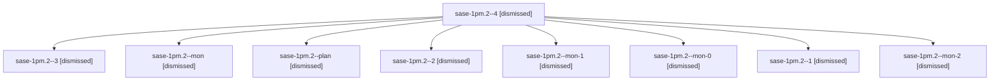

# Session: sase-1pm.2

[Agent Hoods](../README.md) / [bbugyi200](../users/bbugyi200/README.md) / [athena](../users/bbugyi200/machines/athena/README.md) / [sase-1pm](../users/bbugyi200/machines/athena/hoods/sase-1pm/README.md) / sase-1pm.2

Owner: `bbugyi200.athena` · Hood: `sase-1pm` · Members: 9 · Bead: [sase-1pm.2](https://github.com/sase-org/sase--beads/blob/main/pages/sase-1pm/sase-1pm.2.md)

## Lineage

The diagram is an optional enhancement; the ordered table below contains the same lineage in accessible text.

| Role | Agent | State | Model / provider | Timing | Commits | Prompt | Chat |
|---|---|---|---|---|---:|---|---|
| 4 | sase-1pm.2--4 | dismissed | grok-4.6 / grok | 2026-10-29T05:59:04.105943 → 2026-10-29T06:14:22.632232 | [1](../agents/bbugyi200.athena.sase-1pm.2--4/README.md#commits) | [Prompt](../agents/bbugyi200.athena.sase-1pm.2--4/prompt.md) | [Chat](../agents/bbugyi200.athena.sase-1pm.2--4/chat.md) |
| 3 | sase-1pm.2--3 | dismissed | grok-4.6 / grok | 2026-10-29T05:27:38.110413 → 2026-10-29T05:36:39.234961 | 0 | [Prompt](../agents/bbugyi200.athena.sase-1pm.2--3/prompt.md) | [Chat](../agents/bbugyi200.athena.sase-1pm.2--3/chat.md) |
| mon | sase-1pm.2--mon | dismissed | grok-4.6 / grok | 2026-10-29T01:57:28.538926 → 2026-10-29T02:57:35.294942 | 0 | — | [Chat](../agents/bbugyi200.athena.sase-1pm.2--mon/chat.md) |
| plan | sase-1pm.2--plan | dismissed | grok-4.6 / grok | 2026-10-29T01:49:27.634326 → 2026-10-29T01:58:08.853115 | 0 | [Prompt](../agents/bbugyi200.athena.sase-1pm.2--plan/prompt.md) | [Chat](../agents/bbugyi200.athena.sase-1pm.2--plan/chat.md) |
| 2 | sase-1pm.2--2 | dismissed | grok-4.6 / grok | 2026-10-29T05:12:10.532422 → 2026-10-29T05:20:27.580496 | 0 | [Prompt](../agents/bbugyi200.athena.sase-1pm.2--2/prompt.md) | [Chat](../agents/bbugyi200.athena.sase-1pm.2--2/chat.md) |
| mon-1 | sase-1pm.2--mon-1 | dismissed | grok-4.6 / grok | 2026-10-29T05:19:40.511461 → 2026-10-29T05:23:32.634156 | 0 | — | [Chat](../agents/bbugyi200.athena.sase-1pm.2--mon-1/chat.md) |
| mon-0 | sase-1pm.2--mon-0 | dismissed | grok-4.6 / grok | 2026-10-29T03:08:31.624498 → 2026-10-29T05:08:38.636481 | 0 | — | [Chat](../agents/bbugyi200.athena.sase-1pm.2--mon-0/chat.md) |
| 1 | sase-1pm.2--1 | dismissed | grok-4.6 / grok | 2026-10-29T03:02:16.358082 → 2026-10-29T03:10:39.896687 | 0 | [Prompt](../agents/bbugyi200.athena.sase-1pm.2--1/prompt.md) | [Chat](../agents/bbugyi200.athena.sase-1pm.2--1/chat.md) |
| mon-2 | sase-1pm.2--mon-2 | dismissed | grok-4.6 / grok | 2026-10-29T05:35:38.878022 → 2026-10-29T05:55:28.620319 | 0 | — | [Chat](../agents/bbugyi200.athena.sase-1pm.2--mon-2/chat.md) |

## Commits

| Role | Repo | Commit | Subject | Committed |
|---|---|---|---|---|
| 4 | — | `bcddb9e` | test: pin TERM so rendering contracts ignore ambient dumb terminals | 2026-10-29 06:09:16 EDT |

## Neighbors

| Agent | Relation | State |
|---|---|---|
| [sase-1pm.1](../agents/bbugyi200.athena.sase-1pm.1/README.md) | sase-1pm hood | dismissed |
| [sase-1pm.3](../agents/bbugyi200.athena.sase-1pm.3/README.md) | sase-1pm hood | dismissed |
| [sase-1pm.4](bbugyi200.athena.sase-1pm.4.md) (session · 3) | sase-1pm hood | dismissed 3 |
| [sase-1pm.5](bbugyi200.athena.sase-1pm.5.md) (session · 3) | sase-1pm hood | dismissed 3 |
| [sase-1pm.5.1.1](../agents/bbugyi200.athena.sase-1pm.5.1.1/README.md) | sase-1pm hood | dismissed |
| [sase-1pm.5.1.2](bbugyi200.athena.sase-1pm.5.1.2.md) (session · 3) | sase-1pm hood | dismissed 3 |
| [sase-1pm.5.1.3](bbugyi200.athena.sase-1pm.5.1.3.md) (session · 9) | sase-1pm hood | dismissed 9 |
| [sase-1pm.5.1.4](../agents/bbugyi200.athena.sase-1pm.5.1.4/README.md) | sase-1pm hood | dismissed |
| [sase-1pm.5.1.land](bbugyi200.athena.sase-1pm.5.1.land.md) (session · 13) | sase-1pm hood | completed 1, dismissed 11, failed 1 |
| [sase-1pm.land](bbugyi200.athena.sase-1pm.land.md) (session · 3) | sase-1pm hood | dismissed 3 |
