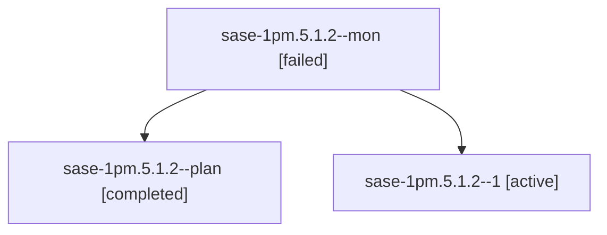

# Session: sase-1pm.5.1.2

[Agent Hoods](../README.md) / [bbugyi200](../users/bbugyi200/README.md) / [athena](../users/bbugyi200/machines/athena/README.md) / [sase-1pm](../users/bbugyi200/machines/athena/hoods/sase-1pm/README.md) / sase-1pm.5.1.2

Owner: `bbugyi200.athena` · Hood: `sase-1pm` · Members: 3 · Bead: [sase-1pm.5.1.2](https://github.com/sase-org/sase--beads/blob/main/pages/sase-1pm/sase-1pm.5.1.2.md)

## Lineage

The diagram is an optional enhancement; the ordered table below contains the same lineage in accessible text.

| Role | Agent | State | Model / provider | Timing | Commits | Prompt | Chat |
|---|---|---|---|---|---:|---|---|
| mon | sase-1pm.5.1.2--mon | failed | muse-spark-1.3-contributor / muse | 2026-10-29T08:19:27.286694+00:00 → 2026-10-29T09:06:30.410391+00:00 | 0 | — | [Chat](../agents/bbugyi200.athena.sase-1pm.5.1.2--mon/chat.md) |
| plan | sase-1pm.5.1.2--plan | completed | muse-spark-1.3-contributor / muse | 2026-10-29T07:46:16.435653+00:00 → 2026-10-29T08:21:22.847615+00:00 | 0 | [Prompt](../agents/bbugyi200.athena.sase-1pm.5.1.2--plan/prompt.md) | [Chat](../agents/bbugyi200.athena.sase-1pm.5.1.2--plan/chat.md) |
| 1 | sase-1pm.5.1.2--1 | active | muse-spark-1.3-contributor / muse | 2026-10-29T09:08:21.370811+00:00 | [1](../agents/bbugyi200.athena.sase-1pm.5.1.2--1/README.md#commits) | [Prompt](../agents/bbugyi200.athena.sase-1pm.5.1.2--1/prompt.md) | — |

## Commits

| Role | Repo | Commit | Subject | Committed |
|---|---|---|---|---|
| 1 | sase | [`bb5653c`](https://github.com/sase-org/sase/commit/bb5653cb7dcd7c75cab77ccaf9b6c3144db10ca2) | feat(commit): add configurable rebase gate runner with hard deadline | 2026-10-29 05:13:42 EDT |

## Neighbors

| Agent | Relation | State |
|---|---|---|
| [sase-1pm.5](bbugyi200.athena.sase-1pm.5.md) (session · 3) | ancestor | failed 3 |
| [sase-1pm.5.1.1](../agents/bbugyi200.athena.sase-1pm.5.1.1/README.md) | sase-1pm.5.1 hood | completed |
| [sase-1pm.5.1.3](bbugyi200.athena.sase-1pm.5.1.3.md) (session · 8) | sase-1pm.5.1 hood | active 1, completed 4, failed 3 |
| [sase-1pm.5.1.4](../agents/bbugyi200.athena.sase-1pm.5.1.4/README.md) | sase-1pm.5.1 hood | waiting |
| [sase-1pm.5.1.land](../agents/bbugyi200.athena.sase-1pm.5.1.land/README.md) | sase-1pm.5.1 hood | waiting |
| [sase-1pm.1](../agents/bbugyi200.athena.sase-1pm.1/README.md) | sase-1pm hood | completed |
| [sase-1pm.2](bbugyi200.athena.sase-1pm.2.md) (session · 5) | sase-1pm hood | active 1, completed 2, failed 2 |
| [sase-1pm.3](../agents/bbugyi200.athena.sase-1pm.3/README.md) | sase-1pm hood | completed |
| [sase-1pm.4](bbugyi200.athena.sase-1pm.4.md) (session · 3) | sase-1pm hood | completed 2, failed 1 |
| [sase-1pm.land](../agents/bbugyi200.athena.sase-1pm.land/README.md) | sase-1pm hood | waiting |
