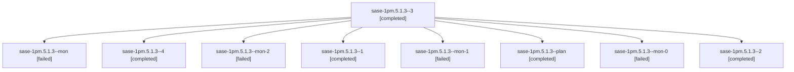

# Session: sase-1pm.5.1.3

[Agent Hoods](../README.md) / [bbugyi200](../users/bbugyi200/README.md) / [athena](../users/bbugyi200/machines/athena/README.md) / [sase-1pm](../users/bbugyi200/machines/athena/hoods/sase-1pm/README.md) / sase-1pm.5.1.3

Owner: `bbugyi200.athena` · Hood: `sase-1pm` · Members: 9 · Bead: [sase-1pm.5.1.3](https://github.com/sase-org/sase--beads/blob/main/pages/sase-1pm/sase-1pm.5.1.3.md)

## Lineage

The diagram is an optional enhancement; the ordered table below contains the same lineage in accessible text.

| Role | Agent | State | Model / provider | Timing | Commits | Prompt | Chat |
|---|---|---|---|---|---:|---|---|
| 3 | sase-1pm.5.1.3--3 | completed | grok-4.6 / grok | 2026-10-29T09:04:53.391680+00:00 → 2026-10-29T09:11:36.084219+00:00 | 0 | [Prompt](../agents/bbugyi200.athena.sase-1pm.5.1.3--3/prompt.md) | [Chat](../agents/bbugyi200.athena.sase-1pm.5.1.3--3/chat.md) |
| mon | sase-1pm.5.1.3--mon | failed | grok-4.6 / grok | 2026-10-29T08:08:11.714215+00:00 → 2026-10-29T08:13:03.670440+00:00 | 0 | — | [Chat](../agents/bbugyi200.athena.sase-1pm.5.1.3--mon/chat.md) |
| 4 | sase-1pm.5.1.3--4 | completed | grok-4.6 / grok | 2026-10-29T09:22:19.638155+00:00 → 2026-10-29T09:45:40.260588+00:00 | [1](../agents/bbugyi200.athena.sase-1pm.5.1.3--4/README.md#commits) | [Prompt](../agents/bbugyi200.athena.sase-1pm.5.1.3--4/prompt.md) | [Chat](../agents/bbugyi200.athena.sase-1pm.5.1.3--4/chat.md) |
| mon-2 | sase-1pm.5.1.3--mon-2 | failed | grok-4.6 / grok | 2026-10-29T09:10:47.126054+00:00 → 2026-10-29T09:20:20.521564+00:00 | 0 | — | [Chat](../agents/bbugyi200.athena.sase-1pm.5.1.3--mon-2/chat.md) |
| 1 | sase-1pm.5.1.3--1 | completed | grok-4.6 / grok | 2026-10-29T08:15:42.828911+00:00 → 2026-10-29T08:24:32.323034+00:00 | 0 | [Prompt](../agents/bbugyi200.athena.sase-1pm.5.1.3--1/prompt.md) | [Chat](../agents/bbugyi200.athena.sase-1pm.5.1.3--1/chat.md) |
| mon-1 | sase-1pm.5.1.3--mon-1 | failed | grok-4.6 / grok | 2026-10-29T08:53:24.791802+00:00 → 2026-10-29T09:02:56.506556+00:00 | 0 | — | [Chat](../agents/bbugyi200.athena.sase-1pm.5.1.3--mon-1/chat.md) |
| plan | sase-1pm.5.1.3--plan | completed | grok-4.6 / grok | 2026-10-29T07:46:32.540891+00:00 → 2026-10-29T08:09:06.957952+00:00 | 0 | [Prompt](../agents/bbugyi200.athena.sase-1pm.5.1.3--plan/prompt.md) | [Chat](../agents/bbugyi200.athena.sase-1pm.5.1.3--plan/chat.md) |
| mon-0 | sase-1pm.5.1.3--mon-0 | failed | grok-4.6 / grok | 2026-10-29T08:23:17.923231+00:00 → 2026-10-29T08:45:15.196209+00:00 | 0 | — | [Chat](../agents/bbugyi200.athena.sase-1pm.5.1.3--mon-0/chat.md) |
| 2 | sase-1pm.5.1.3--2 | completed | grok-4.6 / grok | 2026-10-29T08:47:06.090076+00:00 → 2026-10-29T08:54:23.105269+00:00 | 0 | [Prompt](../agents/bbugyi200.athena.sase-1pm.5.1.3--2/prompt.md) | [Chat](../agents/bbugyi200.athena.sase-1pm.5.1.3--2/chat.md) |

## Commits

| Role | Repo | Commit | Subject | Committed |
|---|---|---|---|---|
| 4 | sase | [`475b204`](https://github.com/sase-org/sase/commit/475b2048ea9728229abbf3dc25c48545ed111dac) | feat(tools): add after-rebase first-party import checker | 2026-10-29 05:39:46 EDT |

## Neighbors

| Agent | Relation | State |
|---|---|---|
| [sase-1pm.5](bbugyi200.athena.sase-1pm.5.md) (session · 3) | ancestor | failed 3 |
| [sase-1pm.5.1.1](../agents/bbugyi200.athena.sase-1pm.5.1.1/README.md) | sase-1pm.5.1 hood | completed |
| [sase-1pm.5.1.2](bbugyi200.athena.sase-1pm.5.1.2.md) (session · 3) | sase-1pm.5.1 hood | completed 2, failed 1 |
| [sase-1pm.5.1.4](../agents/bbugyi200.athena.sase-1pm.5.1.4/README.md) | sase-1pm.5.1 hood | active |
| [sase-1pm.5.1.land](../agents/bbugyi200.athena.sase-1pm.5.1.land/README.md) | sase-1pm.5.1 hood | waiting |
| [sase-1pm.1](../agents/bbugyi200.athena.sase-1pm.1/README.md) | sase-1pm hood | completed |
| [sase-1pm.2](bbugyi200.athena.sase-1pm.2.md) (session · 9) | sase-1pm hood | active 1, completed 4, failed 4 |
| [sase-1pm.3](../agents/bbugyi200.athena.sase-1pm.3/README.md) | sase-1pm hood | completed |
| [sase-1pm.4](bbugyi200.athena.sase-1pm.4.md) (session · 3) | sase-1pm hood | completed 2, failed 1 |
| [sase-1pm.land](../agents/bbugyi200.athena.sase-1pm.land/README.md) | sase-1pm hood | waiting |
