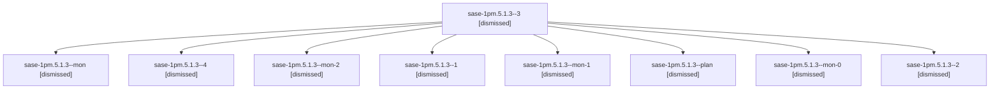

# Session: sase-1pm.5.1.3

[Agent Hoods](../README.md) / [bbugyi200](../users/bbugyi200/README.md) / [athena](../users/bbugyi200/machines/athena/README.md) / [sase-1pm](../users/bbugyi200/machines/athena/hoods/sase-1pm/README.md) / sase-1pm.5.1.3

Owner: `bbugyi200.athena` · Hood: `sase-1pm` · Members: 9 · Bead: [sase-1pm.5.1.3](https://github.com/sase-org/sase--beads/blob/main/pages/sase-1pm/sase-1pm.5.1.3.md)

## Lineage

The diagram is an optional enhancement; the ordered table below contains the same lineage in accessible text.

| Role | Agent | State | Model / provider | Timing | Commits | Prompt | Chat |
|---|---|---|---|---|---:|---|---|
| 3 | sase-1pm.5.1.3--3 | dismissed | grok-4.6 / grok | 2026-10-29T05:04:53.391680 → 2026-10-29T05:11:36.104133 | 0 | [Prompt](../agents/bbugyi200.athena.sase-1pm.5.1.3--3/prompt.md) | [Chat](../agents/bbugyi200.athena.sase-1pm.5.1.3--3/chat.md) |
| mon | sase-1pm.5.1.3--mon | dismissed | grok-4.6 / grok | 2026-10-29T04:08:11.714215 → 2026-10-29T04:11:27.654426 | 0 | — | [Chat](../agents/bbugyi200.athena.sase-1pm.5.1.3--mon/chat.md) |
| 4 | sase-1pm.5.1.3--4 | dismissed | grok-4.6 / grok | 2026-10-29T05:22:19.638155 → 2026-10-29T05:45:40.284681 | [1](../agents/bbugyi200.athena.sase-1pm.5.1.3--4/README.md#commits) | [Prompt](../agents/bbugyi200.athena.sase-1pm.5.1.3--4/prompt.md) | [Chat](../agents/bbugyi200.athena.sase-1pm.5.1.3--4/chat.md) |
| mon-2 | sase-1pm.5.1.3--mon-2 | dismissed | grok-4.6 / grok | 2026-10-29T05:10:47.126054 → 2026-10-29T05:18:38.702526 | 0 | — | [Chat](../agents/bbugyi200.athena.sase-1pm.5.1.3--mon-2/chat.md) |
| 1 | sase-1pm.5.1.3--1 | dismissed | grok-4.6 / grok | 2026-10-29T04:15:42.828911 → 2026-10-29T04:24:32.366926 | 0 | [Prompt](../agents/bbugyi200.athena.sase-1pm.5.1.3--1/prompt.md) | [Chat](../agents/bbugyi200.athena.sase-1pm.5.1.3--1/chat.md) |
| mon-1 | sase-1pm.5.1.3--mon-1 | dismissed | grok-4.6 / grok | 2026-10-29T04:53:24.791802 → 2026-10-29T05:01:03.418704 | 0 | — | [Chat](../agents/bbugyi200.athena.sase-1pm.5.1.3--mon-1/chat.md) |
| plan | sase-1pm.5.1.3--plan | dismissed | grok-4.6 / grok | 2026-10-29T03:46:32.540891 → 2026-10-29T04:09:06.968695 | 0 | [Prompt](../agents/bbugyi200.athena.sase-1pm.5.1.3--plan/prompt.md) | [Chat](../agents/bbugyi200.athena.sase-1pm.5.1.3--plan/chat.md) |
| mon-0 | sase-1pm.5.1.3--mon-0 | dismissed | grok-4.6 / grok | 2026-10-29T04:23:17.923231 → 2026-10-29T04:43:35.588006 | 0 | — | [Chat](../agents/bbugyi200.athena.sase-1pm.5.1.3--mon-0/chat.md) |
| 2 | sase-1pm.5.1.3--2 | dismissed | grok-4.6 / grok | 2026-10-29T04:47:06.090076 → 2026-10-29T04:54:23.118793 | 0 | [Prompt](../agents/bbugyi200.athena.sase-1pm.5.1.3--2/prompt.md) | [Chat](../agents/bbugyi200.athena.sase-1pm.5.1.3--2/chat.md) |

## Commits

| Role | Repo | Commit | Subject | Committed |
|---|---|---|---|---|
| 4 | — | `475b204` | feat(tools): add after-rebase first-party import checker | 2026-10-29 05:39:46 EDT |

## Neighbors

| Agent | Relation | State |
|---|---|---|
| [sase-1pm.5](bbugyi200.athena.sase-1pm.5.md) (session · 3) | ancestor | dismissed 3 |
| [sase-1pm.5.1.1](../agents/bbugyi200.athena.sase-1pm.5.1.1/README.md) | sase-1pm.5.1 hood | dismissed |
| [sase-1pm.5.1.2](bbugyi200.athena.sase-1pm.5.1.2.md) (session · 3) | sase-1pm.5.1 hood | dismissed 3 |
| [sase-1pm.5.1.4](../agents/bbugyi200.athena.sase-1pm.5.1.4/README.md) | sase-1pm.5.1 hood | dismissed |
| [sase-1pm.5.1.land](bbugyi200.athena.sase-1pm.5.1.land.md) (session · 13) | sase-1pm.5.1 hood | completed 1, dismissed 11, failed 1 |
| [sase-1pm.1](../agents/bbugyi200.athena.sase-1pm.1/README.md) | sase-1pm hood | dismissed |
| [sase-1pm.2](bbugyi200.athena.sase-1pm.2.md) (session · 9) | sase-1pm hood | dismissed 9 |
| [sase-1pm.3](../agents/bbugyi200.athena.sase-1pm.3/README.md) | sase-1pm hood | dismissed |
| [sase-1pm.4](bbugyi200.athena.sase-1pm.4.md) (session · 3) | sase-1pm hood | dismissed 3 |
| [sase-1pm.land](bbugyi200.athena.sase-1pm.land.md) (session · 3) | sase-1pm hood | dismissed 3 |
