# Session: sase-1pm.5.1.land

[Agent Hoods](../README.md) / [bbugyi200](../users/bbugyi200/README.md) / [athena](../users/bbugyi200/machines/athena/README.md) / [sase-1pm](../users/bbugyi200/machines/athena/hoods/sase-1pm/README.md) / sase-1pm.5.1.land

Owner: `bbugyi200.athena` · Hood: `sase-1pm` · Members: 13 · Bead: [sase-1pm.5.1](https://github.com/sase-org/sase--beads/blob/main/pages/sase-1pm/sase-1pm.5.1.md)

## Lineage

```mermaid
flowchart TD
  n0["sase-1pm.5.1.land--5 [active]"]
  n1["sase-1pm.5.1.land--mon [failed]"]
  n0 --> n1
  n2["sase-1pm.5.1.land--1 [active]"]
  n0 --> n2
  n3["sase-1pm.5.1.land--plan [active]"]
  n0 --> n3
  n4["sase-1pm.5.1.land--3 [active]"]
  n0 --> n4
  n5["sase-1pm.5.1.land--mon-0 [active]"]
  n0 --> n5
  n6["sase-1pm.5.1.land--2 [active]"]
  n0 --> n6
  n7["sase-1pm.5.1.land--mon-2 [active]"]
  n0 --> n7
  n8["sase-1pm.5.1.land--mon-3 [active]"]
  n0 --> n8
  n9["sase-1pm.5.1.land--gate [active]"]
  n0 --> n9
  n10["sase-1pm.5.1.land--code [completed]"]
  n0 --> n10
  n11["sase-1pm.5.1.land--4 [active]"]
  n0 --> n11
  n12["sase-1pm.5.1.land--mon-1 [active]"]
  n0 --> n12
```



The diagram is an optional enhancement; the ordered table below contains the same lineage in accessible text.

| Role | Agent | State | Model / provider | Timing | Commits | Prompt | Chat |
|---|---|---|---|---|---:|---|---|
| <a id="member-5"></a>5 | sase-1pm.5.1.land--5 | active | gpt-6-luna / codex | 2026-10-29T13:24:17.683104+00:00 | [1](../agents/bbugyi200.athena.sase-1pm.5.1.land--5/README.md#commits) | [Prompt](../agents/bbugyi200.athena.sase-1pm.5.1.land--5/prompt.md) | [Chat](../agents/bbugyi200.athena.sase-1pm.5.1.land--5/chat.md) |
| <a id="member-mon"></a>mon | sase-1pm.5.1.land--mon | failed | gpt-6-luna / codex | 2026-10-29T11:19:33.955360+00:00 → 2026-10-29T11:41:37.991234+00:00 | 0 | — | [Chat](../agents/bbugyi200.athena.sase-1pm.5.1.land--mon/chat.md) |
| <a id="member-1"></a>1 | sase-1pm.5.1.land--1 | active | gpt-6-luna / codex | 2026-10-29T11:43:30.855858+00:00 | 0 | [Prompt](../agents/bbugyi200.athena.sase-1pm.5.1.land--1/prompt.md) | [Chat](../agents/bbugyi200.athena.sase-1pm.5.1.land--1/chat.md) |
| <a id="member-plan"></a>plan | sase-1pm.5.1.land--plan | active | gpt-6-astra / codex | 2026-10-29T10:39:36.153201+00:00 | 0 | [Prompt](../agents/bbugyi200.athena.sase-1pm.5.1.land--plan/prompt.md) | [Chat](../agents/bbugyi200.athena.sase-1pm.5.1.land--plan/chat.md) |
| <a id="member-3"></a>3 | sase-1pm.5.1.land--3 | active | gpt-6-luna / codex | 2026-10-29T12:18:13.341647+00:00 | 0 | [Prompt](../agents/bbugyi200.athena.sase-1pm.5.1.land--3/prompt.md) | [Chat](../agents/bbugyi200.athena.sase-1pm.5.1.land--3/chat.md) |
| <a id="member-mon-0"></a>mon-0 | sase-1pm.5.1.land--mon-0 | active | gpt-6-luna / codex | 2026-10-29T11:49:10.740457+00:00 | 0 | — | [Chat](../agents/bbugyi200.athena.sase-1pm.5.1.land--mon-0/chat.md) |
| <a id="member-2"></a>2 | sase-1pm.5.1.land--2 | active | gpt-6-luna / codex | 2026-10-29T12:12:01.681313+00:00 | 0 | [Prompt](../agents/bbugyi200.athena.sase-1pm.5.1.land--2/prompt.md) | [Chat](../agents/bbugyi200.athena.sase-1pm.5.1.land--2/chat.md) |
| <a id="member-mon-2"></a>mon-2 | sase-1pm.5.1.land--mon-2 | active | gpt-6-luna / codex | 2026-10-29T12:21:00.446875+00:00 | 0 | — | [Chat](../agents/bbugyi200.athena.sase-1pm.5.1.land--mon-2/chat.md) |
| <a id="member-mon-3"></a>mon-3 | sase-1pm.5.1.land--mon-3 | active | gpt-6-luna / codex | 2026-10-29T13:10:32.610801+00:00 | 0 | — | [Chat](../agents/bbugyi200.athena.sase-1pm.5.1.land--mon-3/chat.md) |
| <a id="member-gate"></a>gate | sase-1pm.5.1.land--gate | active | gpt-6-astra / codex | 2026-10-29T10:55:47.694372+00:00 | 0 | — | [Chat](../agents/bbugyi200.athena.sase-1pm.5.1.land--gate/chat.md) |
| <a id="member-code"></a>code | sase-1pm.5.1.land--code | completed | gpt-6-luna / codex | 2026-10-29T10:57:53.098818+00:00 → 2026-10-29T11:20:32.766459+00:00 | 0 | — | [Chat](../agents/bbugyi200.athena.sase-1pm.5.1.land--code/chat.md) |
| <a id="member-4"></a>4 | sase-1pm.5.1.land--4 | active | gpt-6-luna / codex | 2026-10-29T12:27:40.641922+00:00 | 0 | [Prompt](../agents/bbugyi200.athena.sase-1pm.5.1.land--4/prompt.md) | [Chat](../agents/bbugyi200.athena.sase-1pm.5.1.land--4/chat.md) |
| <a id="member-mon-1"></a>mon-1 | sase-1pm.5.1.land--mon-1 | active | gpt-6-luna / codex | 2026-10-29T12:13:52.499167+00:00 | 0 | — | [Chat](../agents/bbugyi200.athena.sase-1pm.5.1.land--mon-1/chat.md) |

## Commits

| Role | Repo | Commit | Subject | Committed |
|---|---|---|---|---|
| 5 | sase | [`cddea47`](https://github.com/sase-org/sase/commit/cddea47cc6a684aa50c0eb564af3f672cf9aea5e) | fix(vcs): block broken imports after rebase | 2026-10-29 10:22:41 EDT |

## Variables

| Role | Variable | Value |
|---|---|---|
| plan | `artifacts` | \[{bead: sase-1pm.5.1, kind: file, label: Rebase gate epic landing audit and reproductions, path: /home/bryan/.sase/artifacts/agents/gh\_sase-org\_\_sase/20261029021504/rebased\_stitch\_landing\_audit-7d9c7… |

#### artifacts

**Role:** `plan`

```yaml
- bead: sase-1pm.5.1
  kind: file
  label: Rebase gate epic landing audit and reproductions
  path: /home/bryan/.sase/artifacts/agents/gh_sase-org__sase/20261029021504/rebased_stitch_landing_audit-7d9c7119a369.txt
  ref: file:explicit:116bb80ebf009ce33ea6bebd
  source_path: /home/bryan/.local/state/sase/workspaces/sase-org/sase/sase_14/.sase/rebased_stitch_landing_audit.txt
```

Values are truncated for display; see each member's agent meta.json for the full values.

## Neighbors

| Agent | Relation | State |
|---|---|---|
| [sase-1pm.5](bbugyi200.athena.sase-1pm.5.md) (session · 3) | ancestor | active 3 |
| [sase-1pm.5.1.1](../agents/bbugyi200.athena.sase-1pm.5.1.1/README.md) | sase-1pm.5.1 hood | active |
| [sase-1pm.5.1.2](bbugyi200.athena.sase-1pm.5.1.2.md) (session · 3) | sase-1pm.5.1 hood | active 3 |
| [sase-1pm.5.1.3](bbugyi200.athena.sase-1pm.5.1.3.md) (session · 9) | sase-1pm.5.1 hood | active 9 |
| [sase-1pm.5.1.4](../agents/bbugyi200.athena.sase-1pm.5.1.4/README.md) | sase-1pm.5.1 hood | active |
| [sase-1pm.1](../agents/bbugyi200.athena.sase-1pm.1/README.md) | sase-1pm hood | active |
| [sase-1pm.2](bbugyi200.athena.sase-1pm.2.md) (session · 9) | sase-1pm hood | active 9 |
| [sase-1pm.3](../agents/bbugyi200.athena.sase-1pm.3/README.md) | sase-1pm hood | active |
| [sase-1pm.4](bbugyi200.athena.sase-1pm.4.md) (session · 3) | sase-1pm hood | active 3 |
| [sase-1pm.land](bbugyi200.athena.sase-1pm.land.md) (session · 3) | sase-1pm hood | active 3 |
