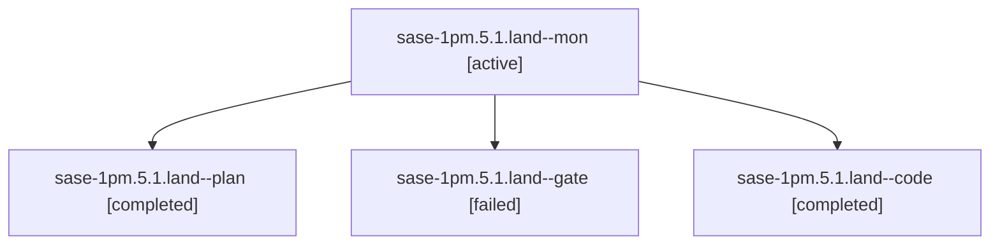

# Session: sase-1pm.5.1.land

[Agent Hoods](../README.md) / [bbugyi200](../users/bbugyi200/README.md) / [athena](../users/bbugyi200/machines/athena/README.md) / [sase-1pm](../users/bbugyi200/machines/athena/hoods/sase-1pm/README.md) / sase-1pm.5.1.land

Owner: `bbugyi200.athena` · Hood: `sase-1pm` · Members: 4 · Bead: [sase-1pm.5.1](https://github.com/sase-org/sase--beads/blob/main/pages/sase-1pm/sase-1pm.5.1.md)

## Lineage



The diagram is an optional enhancement; the ordered table below contains the same lineage in accessible text.

| Role | Agent | State | Model / provider | Timing | Commits | Prompt | Chat |
|---|---|---|---|---|---:|---|---|
| <a id="member-mon"></a>mon | sase-1pm.5.1.land--mon | active | gpt-6-luna / codex | 2026-10-29T11:19:33.955360+00:00 | 0 | — | — |
| <a id="member-plan"></a>plan | sase-1pm.5.1.land--plan | completed | gpt-6-astra / codex | 2026-10-29T10:39:36.153201+00:00 → 2026-10-29T11:20:32.766459+00:00 | 0 | [Prompt](../agents/bbugyi200.athena.sase-1pm.5.1.land--plan/prompt.md) | [Chat](../agents/bbugyi200.athena.sase-1pm.5.1.land--plan/chat.md) |
| <a id="member-gate"></a>gate | sase-1pm.5.1.land--gate | failed | gpt-6-astra / codex | 2026-10-29T10:55:47.694372+00:00 → 2026-10-29T10:57:03.894403+00:00 | 0 | — | [Chat](../agents/bbugyi200.athena.sase-1pm.5.1.land--gate/chat.md) |
| <a id="member-code"></a>code | sase-1pm.5.1.land--code | completed | gpt-6-luna / codex | 2026-10-29T10:57:53.098818+00:00 → 2026-10-29T11:20:32.766459+00:00 | 0 | — | [Chat](../agents/bbugyi200.athena.sase-1pm.5.1.land--code/chat.md) |

## Variables

| Role | Variable | Value |
|---|---|---|
| plan | `artifacts` | \[{bead: sase-1pm.5.1, kind: file, label: Rebase gate epic landing audit and reproductions, path: /home/bryan/.sase/artifacts/agents/gh\_sase-org\_\_sase/20261029021504/rebased\_stitch\_landing\_audit-7d9c7… |

#### artifacts

**Role:** `plan`

```yaml
- bead: sase-1pm.5.1
  kind: file
  label: Rebase gate epic landing audit and reproductions
  path: /home/bryan/.sase/artifacts/agents/gh_sase-org__sase/20261029021504/rebased_stitch_landing_audit-7d9c7119a369.txt
  ref: file:explicit:116bb80ebf009ce33ea6bebd
  source_path: /home/bryan/.local/state/sase/workspaces/sase-org/sase/sase_14/.sase/rebased_stitch_landing_audit.txt
```

Values are truncated for display; see each member's agent meta.json for the full values.

## Neighbors

| Agent | Relation | State |
|---|---|---|
| [sase-1pm.5](bbugyi200.athena.sase-1pm.5.md) (session · 3) | ancestor | failed 3 |
| [sase-1pm.5.1.1](../agents/bbugyi200.athena.sase-1pm.5.1.1/README.md) | sase-1pm.5.1 hood | completed |
| [sase-1pm.5.1.2](bbugyi200.athena.sase-1pm.5.1.2.md) (session · 3) | sase-1pm.5.1 hood | completed 2, failed 1 |
| [sase-1pm.5.1.3](bbugyi200.athena.sase-1pm.5.1.3.md) (session · 9) | sase-1pm.5.1 hood | completed 5, failed 4 |
| [sase-1pm.5.1.4](../agents/bbugyi200.athena.sase-1pm.5.1.4/README.md) | sase-1pm.5.1 hood | completed |
| [sase-1pm.1](../agents/bbugyi200.athena.sase-1pm.1/README.md) | sase-1pm hood | completed |
| [sase-1pm.2](bbugyi200.athena.sase-1pm.2.md) (session · 9) | sase-1pm hood | completed 5, failed 4 |
| [sase-1pm.3](../agents/bbugyi200.athena.sase-1pm.3/README.md) | sase-1pm hood | completed |
| [sase-1pm.4](bbugyi200.athena.sase-1pm.4.md) (session · 3) | sase-1pm hood | completed 2, failed 1 |
| [sase-1pm.land](../agents/bbugyi200.athena.sase-1pm.land/README.md) | sase-1pm hood | waiting |
