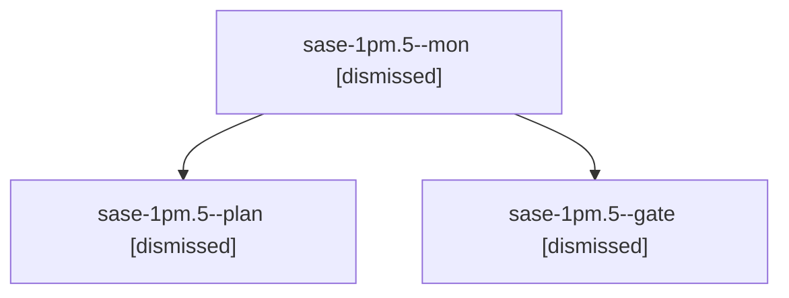

# Session: sase-1pm.5

[Agent Hoods](../README.md) / [bbugyi200](../users/bbugyi200/README.md) / [athena](../users/bbugyi200/machines/athena/README.md) / [sase-1pm](../users/bbugyi200/machines/athena/hoods/sase-1pm/README.md) / sase-1pm.5

Owner: `bbugyi200.athena` · Hood: `sase-1pm` · Members: 3 · Bead: [sase-1pm.5](https://github.com/sase-org/sase--beads/blob/main/pages/sase-1pm/sase-1pm.5.md)

## Lineage

The diagram is an optional enhancement; the ordered table below contains the same lineage in accessible text.

| Role | Agent | State | Model / provider | Timing | Commits | Prompt | Chat |
|---|---|---|---|---|---:|---|---|
| mon | sase-1pm.5--mon | dismissed | gpt-6-astra / codex | 2026-10-29T02:12:50.184699 → 2026-10-29T02:16:37.948173 | 0 | — | [Chat](../agents/bbugyi200.athena.sase-1pm.5--mon/chat.md) |
| plan | sase-1pm.5--plan | dismissed | gpt-6-astra / codex | 2026-10-29T02:01:42.463691 → 2026-10-29T02:13:30.915209 | 0 | [Prompt](../agents/bbugyi200.athena.sase-1pm.5--plan/prompt.md) | [Chat](../agents/bbugyi200.athena.sase-1pm.5--plan/chat.md) |
| gate | sase-1pm.5--gate | dismissed | gpt-6-astra / codex | 2026-10-29T02:10:44.308765 → 2026-10-29T02:12:53 | 0 | — | [Chat](../agents/bbugyi200.athena.sase-1pm.5--gate/chat.md) |

## Neighbors

| Agent | Relation | State |
|---|---|---|
| [sase-1pm.5.1.1](../agents/bbugyi200.athena.sase-1pm.5.1.1/README.md) | descendant | dismissed |
| [sase-1pm.5.1.2](bbugyi200.athena.sase-1pm.5.1.2.md) (session · 3) | descendant | dismissed 3 |
| [sase-1pm.5.1.3](bbugyi200.athena.sase-1pm.5.1.3.md) (session · 9) | descendant | dismissed 9 |
| [sase-1pm.5.1.4](../agents/bbugyi200.athena.sase-1pm.5.1.4/README.md) | descendant | dismissed |
| [sase-1pm.5.1.land](bbugyi200.athena.sase-1pm.5.1.land.md) (session · 13) | descendant | completed 1, dismissed 11, failed 1 |
| [sase-1pm.1](../agents/bbugyi200.athena.sase-1pm.1/README.md) | sase-1pm hood | dismissed |
| [sase-1pm.2](bbugyi200.athena.sase-1pm.2.md) (session · 9) | sase-1pm hood | dismissed 9 |
| [sase-1pm.3](../agents/bbugyi200.athena.sase-1pm.3/README.md) | sase-1pm hood | dismissed |
| [sase-1pm.4](bbugyi200.athena.sase-1pm.4.md) (session · 3) | sase-1pm hood | dismissed 3 |
| [sase-1pm.land](bbugyi200.athena.sase-1pm.land.md) (session · 3) | sase-1pm hood | dismissed 3 |
