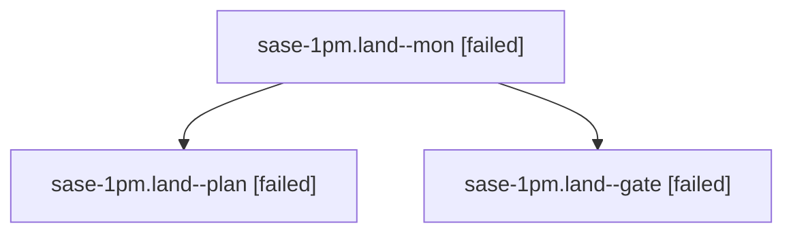

# Session: sase-1pm.land

[Agent Hoods](../README.md) / [bbugyi200](../users/bbugyi200/README.md) / [athena](../users/bbugyi200/machines/athena/README.md) / [sase-1pm](../users/bbugyi200/machines/athena/hoods/sase-1pm/README.md) / sase-1pm.land

Owner: `bbugyi200.athena` · Hood: `sase-1pm` · Members: 3 · Bead: [sase-1pm](https://github.com/sase-org/sase--beads/blob/main/pages/sase-1pm/README.md)

## Lineage

The diagram is an optional enhancement; the ordered table below contains the same lineage in accessible text.

| Role | Agent | State | Model / provider | Timing | Commits | Prompt | Chat |
|---|---|---|---|---|---:|---|---|
| mon | sase-1pm.land--mon | failed | opus / claude | 2026-10-29T14:44:02.261503+00:00 → 2026-10-29T14:47:36.959438+00:00 | 0 | — | [Chat](../agents/bbugyi200.athena.sase-1pm.land--mon/chat.md) |
| plan | sase-1pm.land--plan | failed | opus / claude | 2026-10-29T13:33:16.971329+00:00 → 2026-10-29T14:44:35.236185+00:00 | 0 | [Prompt](../agents/bbugyi200.athena.sase-1pm.land--plan/prompt.md) | [Chat](../agents/bbugyi200.athena.sase-1pm.land--plan/chat.md) |
| gate | sase-1pm.land--gate | failed | opus / claude | 2026-10-29T14:42:04.964057+00:00 → 2026-10-29T14:44:03.663524+00:00 | 0 | — | [Chat](../agents/bbugyi200.athena.sase-1pm.land--gate/chat.md) |

## Neighbors

| Agent | Relation | State |
|---|---|---|
| [sase-1pm.1](../agents/bbugyi200.athena.sase-1pm.1/README.md) | sase-1pm hood | completed |
| [sase-1pm.2](bbugyi200.athena.sase-1pm.2.md) (session · 9) | sase-1pm hood | completed 5, failed 4 |
| [sase-1pm.3](../agents/bbugyi200.athena.sase-1pm.3/README.md) | sase-1pm hood | completed |
| [sase-1pm.4](bbugyi200.athena.sase-1pm.4.md) (session · 3) | sase-1pm hood | completed 2, failed 1 |
| [sase-1pm.5](bbugyi200.athena.sase-1pm.5.md) (session · 3) | sase-1pm hood | failed 3 |
| [sase-1pm.5.1.1](../agents/bbugyi200.athena.sase-1pm.5.1.1/README.md) | sase-1pm hood | active |
| [sase-1pm.5.1.2](bbugyi200.athena.sase-1pm.5.1.2.md) (session · 3) | sase-1pm hood | active 3 |
| [sase-1pm.5.1.3](bbugyi200.athena.sase-1pm.5.1.3.md) (session · 9) | sase-1pm hood | active 9 |
| [sase-1pm.5.1.4](../agents/bbugyi200.athena.sase-1pm.5.1.4/README.md) | sase-1pm hood | active |
| [sase-1pm.5.1.land](bbugyi200.athena.sase-1pm.5.1.land.md) (session · 13) | sase-1pm hood | active 10, completed 2, failed 1 |
