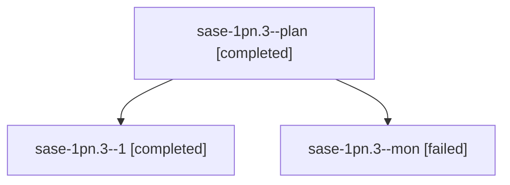

# Session: sase-1pn.3

[Agent Hoods](../README.md) / [bbugyi200](../users/bbugyi200/README.md) / [athena](../users/bbugyi200/machines/athena/README.md) / [sase-1pn](../users/bbugyi200/machines/athena/hoods/sase-1pn/README.md) / sase-1pn.3

Owner: `bbugyi200.athena` · Hood: `sase-1pn` · Members: 3 · Bead: [sase-1pn.3](https://github.com/sase-org/sase--beads/blob/main/pages/sase-1pn/sase-1pn.3.md)

## Lineage

The diagram is an optional enhancement; the ordered table below contains the same lineage in accessible text.

| Role | Agent | State | Model / provider | Timing | Commits | Prompt | Chat |
|---|---|---|---|---|---:|---|---|
| plan | sase-1pn.3--plan | completed | muse-spark-1.3-contributor / muse | 2026-10-29T14:48:43.548545+00:00 → 2026-10-29T16:11:27.982313+00:00 | 0 | [Prompt](../agents/bbugyi200.athena.sase-1pn.3--plan/prompt.md) | [Chat](../agents/bbugyi200.athena.sase-1pn.3--plan/chat.md) |
| 1 | sase-1pn.3--1 | completed | muse-spark-1.3-contributor / muse | 2026-10-29T16:15:39.740092+00:00 → 2026-10-29T16:34:26.744211+00:00 | [1](../agents/bbugyi200.athena.sase-1pn.3--1/README.md#commits) | [Prompt](../agents/bbugyi200.athena.sase-1pn.3--1/prompt.md) | [Chat](../agents/bbugyi200.athena.sase-1pn.3--1/chat.md) |
| mon | sase-1pn.3--mon | failed | muse-spark-1.3-contributor / muse | 2026-10-29T16:09:28.649609+00:00 → 2026-10-29T16:13:03.431014+00:00 | 0 | — | [Chat](../agents/bbugyi200.athena.sase-1pn.3--mon/chat.md) |

## Commits

| Role | Repo | Commit | Subject | Committed |
|---|---|---|---|---|
| 1 | sase | [`8bea2e8`](https://github.com/sase-org/sase/commit/8bea2e84144a1a449b337c725a75b3c1c252cc8a) | feat(bead): include default-branch Justfile epic-symbol rows in close guard | 2026-10-29 12:26:49 EDT |

## Neighbors

| Agent | Relation | State |
|---|---|---|
| [sase-1pn.1](../agents/bbugyi200.athena.sase-1pn.1/README.md) | sase-1pn hood | completed |
| [sase-1pn.2](../agents/bbugyi200.athena.sase-1pn.2/README.md) | sase-1pn hood | completed |
| [sase-1pn.4](../agents/bbugyi200.athena.sase-1pn.4/README.md) | sase-1pn hood | completed |
| [sase-1pn.land](bbugyi200.athena.sase-1pn.land.md) (session · 3) | sase-1pn hood | active 2, failed 1 |
