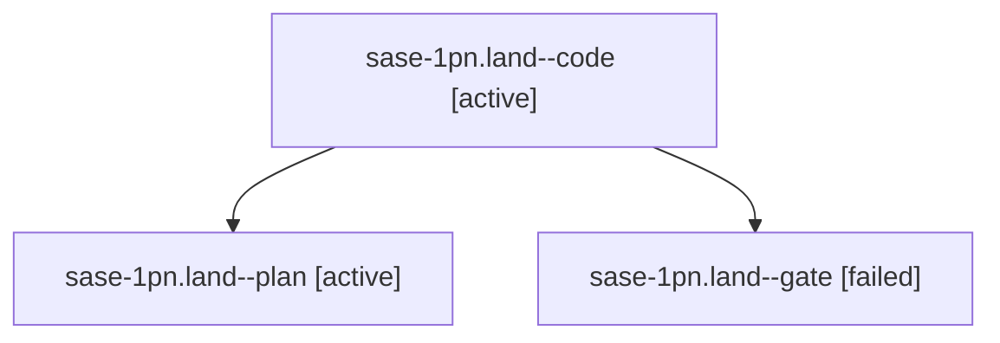

# Session: sase-1pn.land

[Agent Hoods](../README.md) / [bbugyi200](../users/bbugyi200/README.md) / [athena](../users/bbugyi200/machines/athena/README.md) / [sase-1pn](../users/bbugyi200/machines/athena/hoods/sase-1pn/README.md) / sase-1pn.land

Owner: `bbugyi200.athena` · Hood: `sase-1pn` · Members: 3 · Bead: [sase-1pn](https://github.com/sase-org/sase--beads/blob/main/pages/sase-1pn/README.md)

## Lineage



The diagram is an optional enhancement; the ordered table below contains the same lineage in accessible text.

| Role | Agent | State | Model / provider | Timing | Commits | Prompt | Chat |
|---|---|---|---|---|---:|---|---|
| <a id="member-code"></a>code | sase-1pn.land--code | active | gpt-6-luna / codex | 2026-10-29T20:31:30.111540+00:00 | 0 | — | — |
| <a id="member-plan"></a>plan | sase-1pn.land--plan | active | gpt-6-astra / codex | 2026-10-29T20:04:04.161410+00:00 | 0 | [Prompt](../agents/bbugyi200.athena.sase-1pn.land--plan/prompt.md) | [Chat](../agents/bbugyi200.athena.sase-1pn.land--plan/chat.md) |
| <a id="member-gate"></a>gate | sase-1pn.land--gate | failed | gpt-6-astra / codex | 2026-10-29T20:28:58.616850+00:00 → 2026-10-29T20:30:39.738029+00:00 | 0 | — | [Chat](../agents/bbugyi200.athena.sase-1pn.land--gate/chat.md) |

## Variables

| Role | Variable | Value |
|---|---|---|
| plan | `artifacts` | \[{bead: sase-1pn, kind: file, label: sase-1pn phase follow-up failure evidence, path: /home/bryan/.sase/artifacts/agents/gh\_sase-org\_\_sase/20261029104613/sase-1pn-followup-evidence-d2a656c09618.txt,… |

#### artifacts

**Role:** `plan`

```yaml
- bead: sase-1pn
  kind: file
  label: sase-1pn phase follow-up failure evidence
  path: /home/bryan/.sase/artifacts/agents/gh_sase-org__sase/20261029104613/sase-1pn-followup-evidence-d2a656c09618.txt
  ref: file:explicit:fa4e166bf4135802647a61a0
  source_path: /tmp/sase-1pn-followup-evidence.txt
```

Values are truncated for display; see each member's agent meta.json for the full values.

## Neighbors

| Agent | Relation | State |
|---|---|---|
| [sase-1pn.1](../agents/bbugyi200.athena.sase-1pn.1/README.md) | sase-1pn hood | completed |
| [sase-1pn.2](../agents/bbugyi200.athena.sase-1pn.2/README.md) | sase-1pn hood | completed |
| [sase-1pn.3](bbugyi200.athena.sase-1pn.3.md) (session · 3) | sase-1pn hood | completed 2, failed 1 |
| [sase-1pn.4](../agents/bbugyi200.athena.sase-1pn.4/README.md) | sase-1pn hood | completed |
