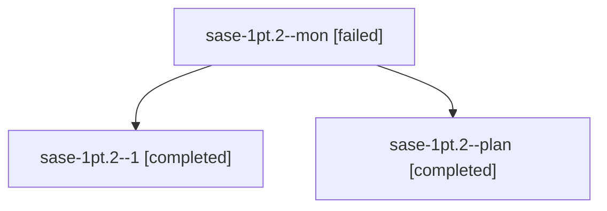

# Session: sase-1pt.2

[Agent Hoods](../README.md) / [bbugyi200](../users/bbugyi200/README.md) / [athena](../users/bbugyi200/machines/athena/README.md) / [sase-1pt](../users/bbugyi200/machines/athena/hoods/sase-1pt/README.md) / sase-1pt.2

Owner: `bbugyi200.athena` · Hood: `sase-1pt` · Members: 3 · Bead: [sase-1pt.2](https://github.com/sase-org/sase--beads/blob/main/pages/sase-1pt/sase-1pt.2.md)

## Lineage

The diagram is an optional enhancement; the ordered table below contains the same lineage in accessible text.

| Role | Agent | State | Model / provider | Timing | Commits | Prompt | Chat |
|---|---|---|---|---|---:|---|---|
| mon | sase-1pt.2--mon | failed | gpt-6-luna / codex | 2026-10-29T22:18:59.775136+00:00 → 2026-10-29T22:23:06.377740+00:00 | 0 | — | [Chat](../agents/bbugyi200.athena.sase-1pt.2--mon/chat.md) |
| 1 | sase-1pt.2--1 | completed | gpt-6-luna / codex | 2026-10-29T22:34:59.787388+00:00 → 2026-10-30T00:29:07.381862+00:00 | [1](../agents/bbugyi200.athena.sase-1pt.2--1/README.md#commits) | [Prompt](../agents/bbugyi200.athena.sase-1pt.2--1/prompt.md) | [Chat](../agents/bbugyi200.athena.sase-1pt.2--1/chat.md) |
| plan | sase-1pt.2--plan | completed | gpt-6-luna / codex | 2026-10-29T22:15:50.195614+00:00 → 2026-10-29T22:20:53.348934+00:00 | 0 | [Prompt](../agents/bbugyi200.athena.sase-1pt.2--plan/prompt.md) | [Chat](../agents/bbugyi200.athena.sase-1pt.2--plan/chat.md) |

## Commits

| Role | Repo | Commit | Subject | Committed |
|---|---|---|---|---|
| 1 | sase | [`4f1a5e0`](https://github.com/sase-org/sase/commit/4f1a5e0760aae7904372148fb4fbf3f041a1a30f) | feat(finalizers): report commit publication timings | 2026-10-29 20:22:44 EDT |

## Neighbors

| Agent | Relation | State |
|---|---|---|
| [sase-1pt.1](../agents/bbugyi200.athena.sase-1pt.1/README.md) | sase-1pt hood | active |
| [sase-1pt.3](../agents/bbugyi200.athena.sase-1pt.3/README.md) | sase-1pt hood | completed |
| [sase-1pt.4](../agents/bbugyi200.athena.sase-1pt.4/README.md) | sase-1pt hood | completed |
| [sase-1pt.5](../agents/bbugyi200.athena.sase-1pt.5/README.md) | sase-1pt hood | waiting |
| [sase-1pt.6](../agents/bbugyi200.athena.sase-1pt.6/README.md) | sase-1pt hood | waiting |
| [sase-1pt.7](../agents/bbugyi200.athena.sase-1pt.7/README.md) | sase-1pt hood | waiting |
| [sase-1pt.8](../agents/bbugyi200.athena.sase-1pt.8/README.md) | sase-1pt hood | waiting |
| [sase-1pt.land](../agents/bbugyi200.athena.sase-1pt.land/README.md) | sase-1pt hood | waiting |
