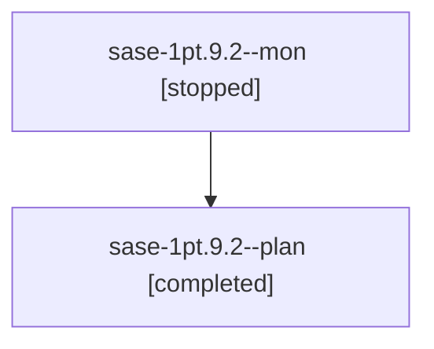

# Session: sase-1pt.9.2

[Agent Hoods](../README.md) / [bbugyi200](../users/bbugyi200/README.md) / [athena](../users/bbugyi200/machines/athena/README.md) / [sase-1pt](../users/bbugyi200/machines/athena/hoods/sase-1pt/README.md) / sase-1pt.9.2

Owner: `bbugyi200.athena` · Hood: `sase-1pt` · Members: 2 · Bead: [sase-1pt.9.2](https://github.com/sase-org/sase--beads/blob/main/pages/sase-1pt/sase-1pt.9.2.md)

## Lineage



The diagram is an optional enhancement; the ordered table below contains the same lineage in accessible text.

| Role | Agent | State | Model / provider | Timing | Commits | Prompt | Chat |
|---|---|---|---|---|---:|---|---|
| <a id="member-mon"></a>mon | sase-1pt.9.2--mon | stopped | gpt-6-astra / codex | 2026-10-30T13:27:07.090386+00:00 → 2026-11-01T12:26:51.678847+00:00 | 0 | — | [Chat](../agents/bbugyi200.athena.sase-1pt.9.2--mon/chat.md) |
| <a id="member-plan"></a>plan | sase-1pt.9.2--plan | completed | gpt-6-astra / codex | 2026-10-30T13:14:47.997833+00:00 → 2026-10-30T13:27:15.247137+00:00 | 0 | [Prompt](../agents/bbugyi200.athena.sase-1pt.9.2--plan/prompt.md) | [Chat](../agents/bbugyi200.athena.sase-1pt.9.2--plan/chat.md) |

## Variables

| Role | Variable | Value |
|---|---|---|
| plan | `artifacts` | \[{bead: sase-1pt.9.2, kind: file, label: sase-1pt.9.2 installed proof collection checkpoint, path: /home/bryan/.sase/artifacts/agents/gh\_sase-org\_\_sase/20261030091257/checkpoint-02e567a4d0a7.json, re… |

#### artifacts

**Role:** `plan`

```yaml
- bead: sase-1pt.9.2
  kind: file
  label: sase-1pt.9.2 installed proof collection checkpoint
  path: /home/bryan/.sase/artifacts/agents/gh_sase-org__sase/20261030091257/checkpoint-02e567a4d0a7.json
  ref: file:explicit:7016ae2d8528704b800b8bff
  source_path: /home/bryan/.sase/projects/gh_sase-org__sase/artifacts/ace-run/202610/30/20261030091257/installed-reprove/checkpoint.json
```

Values are truncated for display; see each member's agent meta.json for the full values.

## Neighbors

| Agent | Relation | State |
|---|---|---|
| [sase-1pt.9.2.f0](../agents/bbugyi200.athena.sase-1pt.9.2.f0/README.md) | descendant | active |
| [sase-1pt.9.1](../agents/bbugyi200.athena.sase-1pt.9.1/README.md) | sase-1pt.9 hood | completed |
| [sase-1pt.9.land](bbugyi200.athena.sase-1pt.9.land.md) (session · 3) | sase-1pt.9 hood | completed 3 |
| [sase-1pt.9.land](../agents/bbugyi200.athena.sase-1pt.9.land/README.md) | sase-1pt.9 hood | waiting |
| [sase-1pt.1](../agents/bbugyi200.athena.sase-1pt.1/README.md) | sase-1pt hood | completed |
| [sase-1pt.2](bbugyi200.athena.sase-1pt.2.md) (session · 3) | sase-1pt hood | completed 2, failed 1 |
| [sase-1pt.3](../agents/bbugyi200.athena.sase-1pt.3/README.md) | sase-1pt hood | completed |
| [sase-1pt.4](../agents/bbugyi200.athena.sase-1pt.4/README.md) | sase-1pt hood | completed |
| [sase-1pt.5](../agents/bbugyi200.athena.sase-1pt.5/README.md) | sase-1pt hood | completed |
| [sase-1pt.6](../agents/bbugyi200.athena.sase-1pt.6/README.md) | sase-1pt hood | completed |
| [sase-1pt.7](../agents/bbugyi200.athena.sase-1pt.7/README.md) | sase-1pt hood | completed |
| [sase-1pt.8](../agents/bbugyi200.athena.sase-1pt.8/README.md) | sase-1pt hood | completed |
| [sase-1pt.land](bbugyi200.athena.sase-1pt.land.md) (session · 3) | sase-1pt hood | failed 3 |
