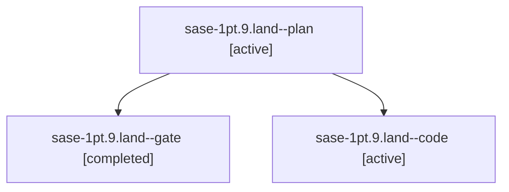

# Session: sase-1pt.9.land

[Agent Hoods](../README.md) / [bbugyi200](../users/bbugyi200/README.md) / [athena](../users/bbugyi200/machines/athena/README.md) / [sase-1pt](../users/bbugyi200/machines/athena/hoods/sase-1pt/README.md) / sase-1pt.9.land

Owner: `bbugyi200.athena` · Hood: `sase-1pt` · Members: 3 · Bead: [sase-1pt.9](https://github.com/sase-org/sase--beads/blob/main/pages/sase-1pt/sase-1pt.9.md)

## Lineage

The diagram is an optional enhancement; the ordered table below contains the same lineage in accessible text.

| Role | Agent | State | Model / provider | Timing | Commits | Prompt | Chat |
|---|---|---|---|---|---:|---|---|
| plan | sase-1pt.9.land--plan | active | opus / claude | 2026-11-02T21:13:20.705992+00:00 | 0 | [Prompt](../agents/bbugyi200.athena.sase-1pt.9.land--plan/prompt.md) | [Chat](../agents/bbugyi200.athena.sase-1pt.9.land--plan/chat.md) |
| gate | sase-1pt.9.land--gate | completed | opus / claude | 2026-11-02T21:22:01.934535+00:00 → 2026-11-02T21:22:23.660613+00:00 | 0 | — | [Chat](../agents/bbugyi200.athena.sase-1pt.9.land--gate/chat.md) |
| code | sase-1pt.9.land--code | active | muse-spark-1.3-contributor / muse | 2026-11-02T21:22:46.452766+00:00 | 0 | — | — |

## Neighbors

| Agent | Relation | State |
|---|---|---|
| [sase-1pt.9.1](../agents/bbugyi200.athena.sase-1pt.9.1/README.md) | sase-1pt.9 hood | completed |
| [sase-1pt.9.2](bbugyi200.athena.sase-1pt.9.2.md) (session · 2) | sase-1pt.9 hood | completed 1, stopped 1 |
| [sase-1pt.9.2](../agents/bbugyi200.athena.sase-1pt.9.2/README.md) | sase-1pt.9 hood | waiting |
| [sase-1pt.9.2.f0](../agents/bbugyi200.athena.sase-1pt.9.2.f0/README.md) | sase-1pt.9 hood | active |
| [sase-1pt.1](../agents/bbugyi200.athena.sase-1pt.1/README.md) | sase-1pt hood | completed |
| [sase-1pt.2](bbugyi200.athena.sase-1pt.2.md) (session · 3) | sase-1pt hood | completed 2, failed 1 |
| [sase-1pt.3](../agents/bbugyi200.athena.sase-1pt.3/README.md) | sase-1pt hood | completed |
| [sase-1pt.4](../agents/bbugyi200.athena.sase-1pt.4/README.md) | sase-1pt hood | completed |
| [sase-1pt.5](../agents/bbugyi200.athena.sase-1pt.5/README.md) | sase-1pt hood | completed |
| [sase-1pt.6](../agents/bbugyi200.athena.sase-1pt.6/README.md) | sase-1pt hood | completed |
| [sase-1pt.7](../agents/bbugyi200.athena.sase-1pt.7/README.md) | sase-1pt hood | completed |
| [sase-1pt.8](../agents/bbugyi200.athena.sase-1pt.8/README.md) | sase-1pt hood | completed |
| [sase-1pt.land](bbugyi200.athena.sase-1pt.land.md) (session · 3) | sase-1pt hood | failed 3 |
