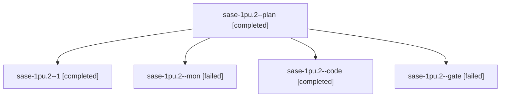

# Session: sase-1pu.2

[Agent Hoods](../README.md) / [bbugyi200](../users/bbugyi200/README.md) / [athena](../users/bbugyi200/machines/athena/README.md) / [sase-1pu](../users/bbugyi200/machines/athena/hoods/sase-1pu/README.md) / sase-1pu.2

Owner: `bbugyi200.athena` · Hood: `sase-1pu` · Members: 5 · Bead: [sase-1pu.2](https://github.com/sase-org/sase--beads/blob/main/pages/sase-1pu/sase-1pu.2.md)

## Lineage

The diagram is an optional enhancement; the ordered table below contains the same lineage in accessible text.

| Role | Agent | State | Model / provider | Timing | Commits | Prompt | Chat |
|---|---|---|---|---|---:|---|---|
| plan | sase-1pu.2--plan | completed | gpt-6-astra / codex | 2026-10-29T23:23:37.825209+00:00 → 2026-10-30T01:05:34.788852+00:00 | 0 | [Prompt](../agents/bbugyi200.athena.sase-1pu.2--plan/prompt.md) | [Chat](../agents/bbugyi200.athena.sase-1pu.2--plan/chat.md) |
| 1 | sase-1pu.2--1 | completed | gpt-6-luna / codex | 2026-10-30T01:18:34.350253+00:00 → 2026-10-30T01:31:12.054835+00:00 | [1](../agents/bbugyi200.athena.sase-1pu.2--1/README.md#commits) | [Prompt](../agents/bbugyi200.athena.sase-1pu.2--1/prompt.md) | [Chat](../agents/bbugyi200.athena.sase-1pu.2--1/chat.md) |
| mon | sase-1pu.2--mon | failed | gpt-6-luna / codex | 2026-10-30T01:03:44.160666+00:00 → 2026-10-30T01:15:23.773086+00:00 | 0 | — | [Chat](../agents/bbugyi200.athena.sase-1pu.2--mon/chat.md) |
| code | sase-1pu.2--code | completed | gpt-6-luna / codex | 2026-10-29T23:37:58.785124+00:00 → 2026-10-30T01:05:34.788852+00:00 | 0 | — | [Chat](../agents/bbugyi200.athena.sase-1pu.2--code/chat.md) |
| gate | sase-1pu.2--gate | failed | gpt-6-astra / codex | 2026-10-29T23:33:53.038262+00:00 → 2026-10-29T23:36:20.098624+00:00 | 0 | — | [Chat](../agents/bbugyi200.athena.sase-1pu.2--gate/chat.md) |

## Commits

| Role | Repo | Commit | Subject | Committed |
|---|---|---|---|---|
| 1 | sase | [`188073f`](https://github.com/sase-org/sase/commit/188073fe063976592272847ff383578229d1aabf) | test(axe): cover waiter name recovery after refresh | 2026-10-29 21:24:01 EDT |

## Neighbors

| Agent | Relation | State |
|---|---|---|
| [sase-1pu.1](../agents/bbugyi200.athena.sase-1pu.1/README.md) | sase-1pu hood | completed |
| [sase-1pu.3](bbugyi200.athena.sase-1pu.3.md) (session · 3) | sase-1pu hood | completed 2, failed 1 |
| [sase-1pu.4](bbugyi200.athena.sase-1pu.4.md) (session · 5) | sase-1pu hood | active 1, completed 2, failed 2 |
| [sase-1pu.5](bbugyi200.athena.sase-1pu.5.md) (session · 3) | sase-1pu hood | failed 3 |
| [sase-1pu.5.1.1](bbugyi200.athena.sase-1pu.5.1.1.md) (session · 3) | sase-1pu hood | completed 2, failed 1 |
| [sase-1pu.5.1.2](bbugyi200.athena.sase-1pu.5.1.2.md) (session · 2) | sase-1pu hood | active 1, completed 1 |
| [sase-1pu.5.1.3](../agents/bbugyi200.athena.sase-1pu.5.1.3/README.md) | sase-1pu hood | waiting |
| [sase-1pu.5.1.4](../agents/bbugyi200.athena.sase-1pu.5.1.4/README.md) | sase-1pu hood | waiting |
| [sase-1pu.5.1.land](../agents/bbugyi200.athena.sase-1pu.5.1.land/README.md) | sase-1pu hood | waiting |
| [sase-1pu.land](../agents/bbugyi200.athena.sase-1pu.land/README.md) | sase-1pu hood | waiting |
