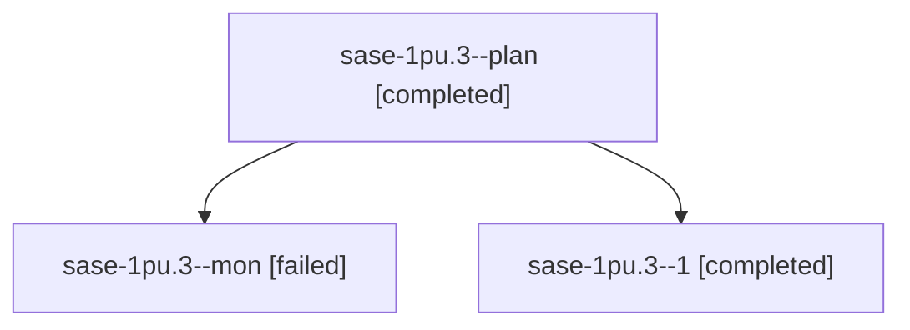

# Session: sase-1pu.3

[Agent Hoods](../README.md) / [bbugyi200](../users/bbugyi200/README.md) / [athena](../users/bbugyi200/machines/athena/README.md) / [sase-1pu](../users/bbugyi200/machines/athena/hoods/sase-1pu/README.md) / sase-1pu.3

Owner: `bbugyi200.athena` · Hood: `sase-1pu` · Members: 3 · Bead: [sase-1pu.3](https://github.com/sase-org/sase--beads/blob/main/pages/sase-1pu/sase-1pu.3.md)

## Lineage

The diagram is an optional enhancement; the ordered table below contains the same lineage in accessible text.

| Role | Agent | State | Model / provider | Timing | Commits | Prompt | Chat |
|---|---|---|---|---|---:|---|---|
| plan | sase-1pu.3--plan | completed | muse-spark-1.3-contributor / muse | 2026-10-29T23:24:46.789918+00:00 → 2026-10-29T23:57:02.188120+00:00 | 0 | [Prompt](../agents/bbugyi200.athena.sase-1pu.3--plan/prompt.md) | [Chat](../agents/bbugyi200.athena.sase-1pu.3--plan/chat.md) |
| mon | sase-1pu.3--mon | failed | muse-spark-1.3-contributor / muse | 2026-10-29T23:55:43.545974+00:00 → 2026-10-30T00:30:00.891840+00:00 | 0 | — | [Chat](../agents/bbugyi200.athena.sase-1pu.3--mon/chat.md) |
| 1 | sase-1pu.3--1 | completed | muse-spark-1.3-contributor / muse | 2026-10-30T00:33:23.779172+00:00 → 2026-10-30T00:46:13.776851+00:00 | [1](../agents/bbugyi200.athena.sase-1pu.3--1/README.md#commits) | [Prompt](../agents/bbugyi200.athena.sase-1pu.3--1/prompt.md) | [Chat](../agents/bbugyi200.athena.sase-1pu.3--1/chat.md) |

## Commits

| Role | Repo | Commit | Subject | Committed |
|---|---|---|---|---|
| 1 | sase | [`fd8882c`](https://github.com/sase-org/sase/commit/fd8882c6af267424c4f3e1e131634264a2b59b74) | feat(scope): select marker audits for marker-writer changes | 2026-10-29 20:39:45 EDT |

## Neighbors

| Agent | Relation | State |
|---|---|---|
| [sase-1pu.1](../agents/bbugyi200.athena.sase-1pu.1/README.md) | sase-1pu hood | completed |
| [sase-1pu.2](bbugyi200.athena.sase-1pu.2.md) (session · 5) | sase-1pu hood | completed 3, failed 2 |
| [sase-1pu.4](bbugyi200.athena.sase-1pu.4.md) (session · 5) | sase-1pu hood | active 1, completed 2, failed 2 |
| [sase-1pu.5](bbugyi200.athena.sase-1pu.5.md) (session · 3) | sase-1pu hood | failed 3 |
| [sase-1pu.5.1.1](bbugyi200.athena.sase-1pu.5.1.1.md) (session · 3) | sase-1pu hood | active 1, completed 1, failed 1 |
| [sase-1pu.5.1.2](../agents/bbugyi200.athena.sase-1pu.5.1.2/README.md) | sase-1pu hood | waiting |
| [sase-1pu.5.1.3](../agents/bbugyi200.athena.sase-1pu.5.1.3/README.md) | sase-1pu hood | waiting |
| [sase-1pu.5.1.4](../agents/bbugyi200.athena.sase-1pu.5.1.4/README.md) | sase-1pu hood | waiting |
| [sase-1pu.5.1.land](../agents/bbugyi200.athena.sase-1pu.5.1.land/README.md) | sase-1pu hood | waiting |
| [sase-1pu.land](../agents/bbugyi200.athena.sase-1pu.land/README.md) | sase-1pu hood | waiting |
