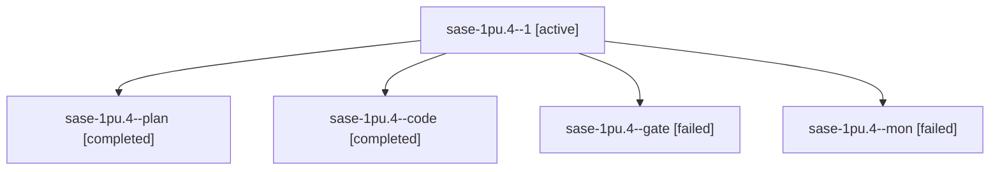

# Session: sase-1pu.4

[Agent Hoods](../README.md) / [bbugyi200](../users/bbugyi200/README.md) / [athena](../users/bbugyi200/machines/athena/README.md) / [sase-1pu](../users/bbugyi200/machines/athena/hoods/sase-1pu/README.md) / sase-1pu.4

Owner: `bbugyi200.athena` · Hood: `sase-1pu` · Members: 5 · Bead: [sase-1pu.4](https://github.com/sase-org/sase--beads/blob/main/pages/sase-1pu/sase-1pu.4.md)

## Lineage

The diagram is an optional enhancement; the ordered table below contains the same lineage in accessible text.

| Role | Agent | State | Model / provider | Timing | Commits | Prompt | Chat |
|---|---|---|---|---|---:|---|---|
| 1 | sase-1pu.4--1 | active | grok-4.6 / grok | 2026-10-30T02:06:38.977280+00:00 | [1](../agents/bbugyi200.athena.sase-1pu.4--1/README.md#commits) | [Prompt](../agents/bbugyi200.athena.sase-1pu.4--1/prompt.md) | — |
| plan | sase-1pu.4--plan | completed | gpt-6-astra / codex | 2026-10-30T00:08:52.179552+00:00 → 2026-10-30T01:15:13.782125+00:00 | 0 | [Prompt](../agents/bbugyi200.athena.sase-1pu.4--plan/prompt.md) | [Chat](../agents/bbugyi200.athena.sase-1pu.4--plan/chat.md) |
| code | sase-1pu.4--code | completed | grok-4.6 / grok | 2026-10-30T00:17:43.594515+00:00 → 2026-10-30T01:15:13.782125+00:00 | 0 | — | [Chat](../agents/bbugyi200.athena.sase-1pu.4--code/chat.md) |
| gate | sase-1pu.4--gate | failed | gpt-6-astra / codex | 2026-10-30T00:14:51.369146+00:00 → 2026-10-30T00:17:03.697417+00:00 | 0 | — | [Chat](../agents/bbugyi200.athena.sase-1pu.4--gate/chat.md) |
| mon | sase-1pu.4--mon | failed | grok-4.6 / grok | 2026-10-30T01:13:37.223815+00:00 → 2026-10-30T02:04:07.667956+00:00 | 0 | — | [Chat](../agents/bbugyi200.athena.sase-1pu.4--mon/chat.md) |

## Commits

| Role | Repo | Commit | Subject | Committed |
|---|---|---|---|---|
| 1 | sase | [`5437e0b`](https://github.com/sase-org/sase/commit/5437e0baaa60ab862ac7810a79ab776d74e3a93f) | test(sdd): isolate empty-home git identity nested pytest | 2026-10-29 22:24:48 EDT |

## Neighbors

| Agent | Relation | State |
|---|---|---|
| [sase-1pu.1](../agents/bbugyi200.athena.sase-1pu.1/README.md) | sase-1pu hood | completed |
| [sase-1pu.2](bbugyi200.athena.sase-1pu.2.md) (session · 5) | sase-1pu hood | completed 3, failed 2 |
| [sase-1pu.3](bbugyi200.athena.sase-1pu.3.md) (session · 3) | sase-1pu hood | completed 2, failed 1 |
| [sase-1pu.5](bbugyi200.athena.sase-1pu.5.md) (session · 3) | sase-1pu hood | failed 3 |
| [sase-1pu.5.1.1](bbugyi200.athena.sase-1pu.5.1.1.md) (session · 3) | sase-1pu hood | completed 2, failed 1 |
| [sase-1pu.5.1.2](../agents/bbugyi200.athena.sase-1pu.5.1.2/README.md) | sase-1pu hood | active |
| [sase-1pu.5.1.3](../agents/bbugyi200.athena.sase-1pu.5.1.3/README.md) | sase-1pu hood | waiting |
| [sase-1pu.5.1.4](../agents/bbugyi200.athena.sase-1pu.5.1.4/README.md) | sase-1pu hood | waiting |
| [sase-1pu.5.1.land](../agents/bbugyi200.athena.sase-1pu.5.1.land/README.md) | sase-1pu hood | waiting |
| [sase-1pu.land](../agents/bbugyi200.athena.sase-1pu.land/README.md) | sase-1pu hood | waiting |
