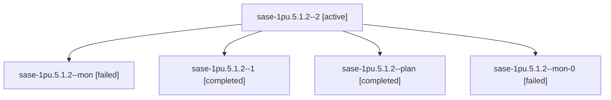

# Session: sase-1pu.5.1.2

[Agent Hoods](../README.md) / [bbugyi200](../users/bbugyi200/README.md) / [athena](../users/bbugyi200/machines/athena/README.md) / [sase-1pu](../users/bbugyi200/machines/athena/hoods/sase-1pu/README.md) / sase-1pu.5.1.2

Owner: `bbugyi200.athena` · Hood: `sase-1pu` · Members: 5 · Bead: [sase-1pu.5.1.2](https://github.com/sase-org/sase--beads/blob/main/pages/sase-1pu/sase-1pu.5.1.2.md)

## Lineage

The diagram is an optional enhancement; the ordered table below contains the same lineage in accessible text.

| Role | Agent | State | Model / provider | Timing | Commits | Prompt | Chat |
|---|---|---|---|---|---:|---|---|
| 2 | sase-1pu.5.1.2--2 | active | muse-spark-1.3-contributor / muse | 2026-10-30T04:03:05.515998+00:00 | [1](../agents/bbugyi200.athena.sase-1pu.5.1.2--2/README.md#commits) | [Prompt](../agents/bbugyi200.athena.sase-1pu.5.1.2--2/prompt.md) | — |
| mon | sase-1pu.5.1.2--mon | failed | muse-spark-1.3-contributor / muse | 2026-10-30T02:27:15.590585+00:00 → 2026-10-30T02:32:44.293990+00:00 | 0 | — | [Chat](../agents/bbugyi200.athena.sase-1pu.5.1.2--mon/chat.md) |
| 1 | sase-1pu.5.1.2--1 | completed | muse-spark-1.3-contributor / muse | 2026-10-30T02:35:01.674524+00:00 → 2026-10-30T03:08:19.646712+00:00 | 0 | [Prompt](../agents/bbugyi200.athena.sase-1pu.5.1.2--1/prompt.md) | [Chat](../agents/bbugyi200.athena.sase-1pu.5.1.2--1/chat.md) |
| plan | sase-1pu.5.1.2--plan | completed | muse-spark-1.3-contributor / muse | 2026-10-30T02:15:26.421130+00:00 → 2026-10-30T02:29:45.077724+00:00 | 0 | [Prompt](../agents/bbugyi200.athena.sase-1pu.5.1.2--plan/prompt.md) | [Chat](../agents/bbugyi200.athena.sase-1pu.5.1.2--plan/chat.md) |
| mon-0 | sase-1pu.5.1.2--mon-0 | failed | muse-spark-1.3-contributor / muse | 2026-10-30T03:08:06.055194+00:00 → 2026-10-30T04:00:10.072217+00:00 | 0 | — | [Chat](../agents/bbugyi200.athena.sase-1pu.5.1.2--mon-0/chat.md) |

## Commits

| Role | Repo | Commit | Subject | Committed |
|---|---|---|---|---|
| 2 | sase | [`1d1c462`](https://github.com/sase-org/sase/commit/1d1c46262ac1a51b86af68d3dbc9cbb932e5a941) | feat(agents-sync): preserve terminal run state in hood publishers | 2026-10-30 00:09:44 EDT |

## Neighbors

| Agent | Relation | State |
|---|---|---|
| [sase-1pu.5](bbugyi200.athena.sase-1pu.5.md) (session · 3) | ancestor | failed 3 |
| [sase-1pu.5.1.1](bbugyi200.athena.sase-1pu.5.1.1.md) (session · 3) | sase-1pu.5.1 hood | completed 2, failed 1 |
| [sase-1pu.5.1.3](../agents/bbugyi200.athena.sase-1pu.5.1.3/README.md) | sase-1pu.5.1 hood | waiting |
| [sase-1pu.5.1.4](../agents/bbugyi200.athena.sase-1pu.5.1.4/README.md) | sase-1pu.5.1 hood | waiting |
| [sase-1pu.5.1.land](../agents/bbugyi200.athena.sase-1pu.5.1.land/README.md) | sase-1pu.5.1 hood | waiting |
| [sase-1pu.1](../agents/bbugyi200.athena.sase-1pu.1/README.md) | sase-1pu hood | completed |
| [sase-1pu.2](bbugyi200.athena.sase-1pu.2.md) (session · 5) | sase-1pu hood | completed 3, failed 2 |
| [sase-1pu.3](bbugyi200.athena.sase-1pu.3.md) (session · 3) | sase-1pu hood | completed 2, failed 1 |
| [sase-1pu.4](bbugyi200.athena.sase-1pu.4.md) (session · 5) | sase-1pu hood | completed 3, failed 2 |
| [sase-1pu.land](../agents/bbugyi200.athena.sase-1pu.land/README.md) | sase-1pu hood | waiting |
