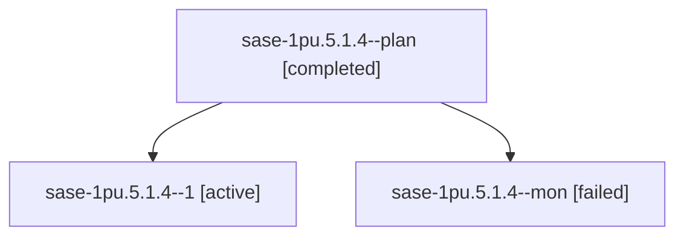

# Session: sase-1pu.5.1.4

[Agent Hoods](../README.md) / [bbugyi200](../users/bbugyi200/README.md) / [athena](../users/bbugyi200/machines/athena/README.md) / [sase-1pu](../users/bbugyi200/machines/athena/hoods/sase-1pu/README.md) / sase-1pu.5.1.4

Owner: `bbugyi200.athena` · Hood: `sase-1pu` · Members: 3 · Bead: [sase-1pu.5.1.4](https://github.com/sase-org/sase--beads/blob/main/pages/sase-1pu/sase-1pu.5.1.4.md)

## Lineage

The diagram is an optional enhancement; the ordered table below contains the same lineage in accessible text.

| Role | Agent | State | Model / provider | Timing | Commits | Prompt | Chat |
|---|---|---|---|---|---:|---|---|
| plan | sase-1pu.5.1.4--plan | completed | muse-spark-1.3-contributor / muse | 2026-10-30T07:09:55.140100+00:00 → 2026-10-30T07:46:35.541339+00:00 | 0 | [Prompt](../agents/bbugyi200.athena.sase-1pu.5.1.4--plan/prompt.md) | [Chat](../agents/bbugyi200.athena.sase-1pu.5.1.4--plan/chat.md) |
| 1 | sase-1pu.5.1.4--1 | active | muse-spark-1.3-contributor / muse | 2026-10-30T08:50:36.755235+00:00 | [1](../agents/bbugyi200.athena.sase-1pu.5.1.4--1/README.md#commits) | [Prompt](../agents/bbugyi200.athena.sase-1pu.5.1.4--1/prompt.md) | — |
| mon | sase-1pu.5.1.4--mon | failed | muse-spark-1.3-contributor / muse | 2026-10-30T07:46:12.729451+00:00 → 2026-10-30T08:48:02.470640+00:00 | 0 | — | [Chat](../agents/bbugyi200.athena.sase-1pu.5.1.4--mon/chat.md) |

## Commits

| Role | Repo | Commit | Subject | Committed |
|---|---|---|---|---|
| 1 | sase | [`b161834`](https://github.com/sase-org/sase/commit/b1618348d44078a3d5f8ee52ff7d4cc0b70f441d) | feat(agents-sync): schedule bounded reconciliation and document owner-local backfill | 2026-10-30 06:04:22 EDT |

## Neighbors

| Agent | Relation | State |
|---|---|---|
| [sase-1pu.5](bbugyi200.athena.sase-1pu.5.md) (session · 3) | ancestor | failed 3 |
| [sase-1pu.5.1.1](bbugyi200.athena.sase-1pu.5.1.1.md) (session · 3) | sase-1pu.5.1 hood | completed 2, failed 1 |
| [sase-1pu.5.1.2](bbugyi200.athena.sase-1pu.5.1.2.md) (session · 5) | sase-1pu.5.1 hood | completed 3, failed 2 |
| [sase-1pu.5.1.3](bbugyi200.athena.sase-1pu.5.1.3.md) (session · 3) | sase-1pu.5.1 hood | completed 2, failed 1 |
| [sase-1pu.5.1.land](../agents/bbugyi200.athena.sase-1pu.5.1.land/README.md) | sase-1pu.5.1 hood | waiting |
| [sase-1pu.1](../agents/bbugyi200.athena.sase-1pu.1/README.md) | sase-1pu hood | completed |
| [sase-1pu.2](bbugyi200.athena.sase-1pu.2.md) (session · 5) | sase-1pu hood | completed 3, failed 2 |
| [sase-1pu.3](bbugyi200.athena.sase-1pu.3.md) (session · 3) | sase-1pu hood | completed 2, failed 1 |
| [sase-1pu.4](bbugyi200.athena.sase-1pu.4.md) (session · 5) | sase-1pu hood | completed 3, failed 2 |
| [sase-1pu.land](../agents/bbugyi200.athena.sase-1pu.land/README.md) | sase-1pu hood | waiting |
