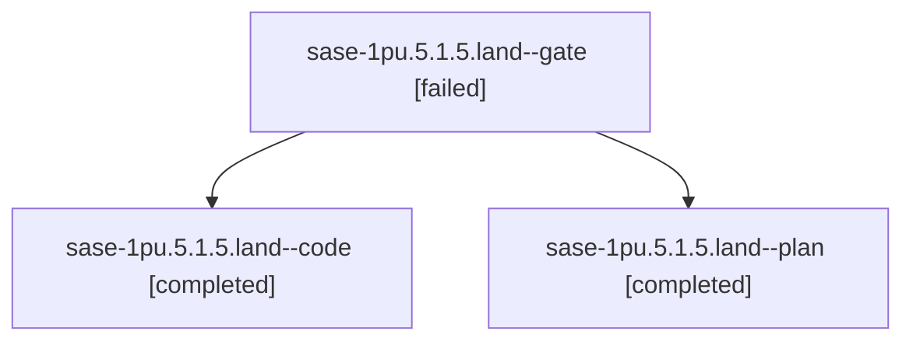

# Session: sase-1pu.5.1.5.land

[Agent Hoods](../README.md) / [bbugyi200](../users/bbugyi200/README.md) / [athena](../users/bbugyi200/machines/athena/README.md) / [sase-1pu](../users/bbugyi200/machines/athena/hoods/sase-1pu/README.md) / sase-1pu.5.1.5.land

Owner: `bbugyi200.athena` · Hood: `sase-1pu` · Members: 3 · Bead: [sase-1pu.5.1.5](https://github.com/sase-org/sase--beads/blob/main/pages/sase-1pu/sase-1pu.5.1.5.md)

## Lineage



The diagram is an optional enhancement; the ordered table below contains the same lineage in accessible text.

| Role | Agent | State | Model / provider | Timing | Commits | Prompt | Chat |
|---|---|---|---|---|---:|---|---|
| <a id="member-gate"></a>gate | sase-1pu.5.1.5.land--gate | failed | gpt-6-astra / codex | 2026-11-01T17:59:39.571293+00:00 → 2026-11-01T18:00:41.013753+00:00 | 0 | — | [Chat](../agents/bbugyi200.athena.sase-1pu.5.1.5.land--gate/chat.md) |
| <a id="member-code"></a>code | sase-1pu.5.1.5.land--code | completed | grok-4.6 / grok | 2026-11-01T18:01:26.794828+00:00 → 2026-11-01T19:19:54.188464+00:00 | [1](../agents/bbugyi200.athena.sase-1pu.5.1.5.land--code/README.md#commits) | — | [Chat](../agents/bbugyi200.athena.sase-1pu.5.1.5.land--code/chat.md) |
| <a id="member-plan"></a>plan | sase-1pu.5.1.5.land--plan | completed | gpt-6-astra / codex | 2026-11-01T17:40:59.765418+00:00 → 2026-11-01T19:19:54.188464+00:00 | 0 | [Prompt](../agents/bbugyi200.athena.sase-1pu.5.1.5.land--plan/prompt.md) | [Chat](../agents/bbugyi200.athena.sase-1pu.5.1.5.land--plan/chat.md) |

## Commits

| Role | Repo | Commit | Subject | Committed |
|---|---|---|---|---|
| code | sase | [`0547d23`](https://github.com/sase-org/sase/commit/0547d23ce368aa28e6c028a0335169fd8019d82d) | fix(agents-sync): bound exact-run identity and repair deadlines | 2026-11-01 14:16:33 EST |

## Variables

| Role | Variable | Value |
|---|---|---|
| plan | `artifacts` | \[{bead: sase-1pu.5.1.5, kind: file, label: Published-state landing gap reproducer, path: /home/bryan/.sase/artifacts/agents/gh\_sase-org\_\_sase/20261101101943/sase\_1pu\_landing\_probe-7e040af16532.py, re… |

#### artifacts

**Role:** `plan`

```yaml
- bead: sase-1pu.5.1.5
  kind: file
  label: Published-state landing gap reproducer
  path: /home/bryan/.sase/artifacts/agents/gh_sase-org__sase/20261101101943/sase_1pu_landing_probe-7e040af16532.py
  ref: file:explicit:ed35fecafbc1e54897ae808e
  source_path: /home/bryan/.local/state/sase/workspaces/sase-org/sase/sase_13/.pytest_cache/sase_1pu_landing_probe.py
- bead: sase-1pu.5.1.5
  kind: file
  label: Published-state landing gap evidence
  path: /home/bryan/.sase/artifacts/agents/gh_sase-org__sase/20261101101943/sase_1pu_landing_probe-0d1895fadb9e.log
  ref: file:explicit:80004e2a57ce240ac8f0ef75
  source_path: /home/bryan/.local/state/sase/workspaces/sase-org/sase/sase_13/.pytest_cache/sase_1pu_landing_probe.log
```

Values are truncated for display; see each member's agent meta.json for the full values.

## Neighbors

| Agent | Relation | State |
|---|---|---|
| [sase-1pu.5](bbugyi200.athena.sase-1pu.5.md) (session · 3) | ancestor | failed 3 |
| [sase-1pu.5.1.5.1](../agents/bbugyi200.athena.sase-1pu.5.1.5.1/README.md) | sase-1pu.5.1.5 hood | completed |
| [sase-1pu.5.1.5.2](../agents/bbugyi200.athena.sase-1pu.5.1.5.2/README.md) | sase-1pu.5.1.5 hood | completed |
| [sase-1pu.5.1.1](bbugyi200.athena.sase-1pu.5.1.1.md) (session · 3) | sase-1pu.5.1 hood | completed 2, failed 1 |
| [sase-1pu.5.1.2](bbugyi200.athena.sase-1pu.5.1.2.md) (session · 5) | sase-1pu.5.1 hood | completed 3, failed 2 |
| [sase-1pu.5.1.3](bbugyi200.athena.sase-1pu.5.1.3.md) (session · 3) | sase-1pu.5.1 hood | completed 2, failed 1 |
| [sase-1pu.5.1.4](bbugyi200.athena.sase-1pu.5.1.4.md) (session · 3) | sase-1pu.5.1 hood | completed 2, failed 1 |
| [sase-1pu.5.1.land](bbugyi200.athena.sase-1pu.5.1.land.md) (session · 3) | sase-1pu.5.1 hood | failed 3 |
| [sase-1pu.5.1.land](../agents/bbugyi200.athena.sase-1pu.5.1.land/README.md) | sase-1pu.5.1 hood | waiting |
| [sase-1pu.1](../agents/bbugyi200.athena.sase-1pu.1/README.md) | sase-1pu hood | completed |
| [sase-1pu.2](bbugyi200.athena.sase-1pu.2.md) (session · 5) | sase-1pu hood | completed 3, failed 2 |
| [sase-1pu.3](bbugyi200.athena.sase-1pu.3.md) (session · 3) | sase-1pu hood | completed 2, failed 1 |
| [sase-1pu.4](bbugyi200.athena.sase-1pu.4.md) (session · 5) | sase-1pu hood | completed 3, failed 2 |
| [sase-1pu.land](bbugyi200.athena.sase-1pu.land.md) (session · 3) | sase-1pu hood | active 2, completed 1 |
