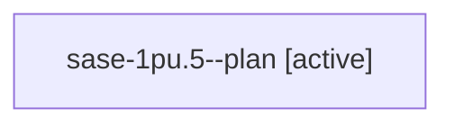

# Session: sase-1pu.5

[Agent Hoods](../README.md) / [bbugyi200](../users/bbugyi200/README.md) / [athena](../users/bbugyi200/machines/athena/README.md) / [sase-1pu](../users/bbugyi200/machines/athena/hoods/sase-1pu/README.md) / sase-1pu.5

Owner: `bbugyi200.athena` · Hood: `sase-1pu` · Members: 1 · Bead: [sase-1pu.5](https://github.com/sase-org/sase--beads/blob/main/pages/sase-1pu/sase-1pu.5.md)

## Lineage

The diagram is an optional enhancement; the ordered table below contains the same lineage in accessible text.

| Role | Agent | State | Model / provider | Timing | Commits | Prompt | Chat |
|---|---|---|---|---|---:|---|---|
| plan | sase-1pu.5--plan | active | gpt-6-astra / codex | 2026-10-30T00:22:31.713379+00:00 | 0 | [Prompt](../agents/bbugyi200.athena.sase-1pu.5--plan/prompt.md) | — |

## Neighbors

| Agent | Relation | State |
|---|---|---|
| [sase-1pu.1](../agents/bbugyi200.athena.sase-1pu.1/README.md) | sase-1pu hood | active |
| [sase-1pu.2](bbugyi200.athena.sase-1pu.2.md) (session · 3) | sase-1pu hood | active 2, failed 1 |
| [sase-1pu.3](bbugyi200.athena.sase-1pu.3.md) (session · 3) | sase-1pu hood | active 1, completed 1, failed 1 |
| [sase-1pu.4](bbugyi200.athena.sase-1pu.4.md) (session · 3) | sase-1pu hood | active 2, failed 1 |
| [sase-1pu.land](../agents/bbugyi200.athena.sase-1pu.land/README.md) | sase-1pu hood | waiting |
