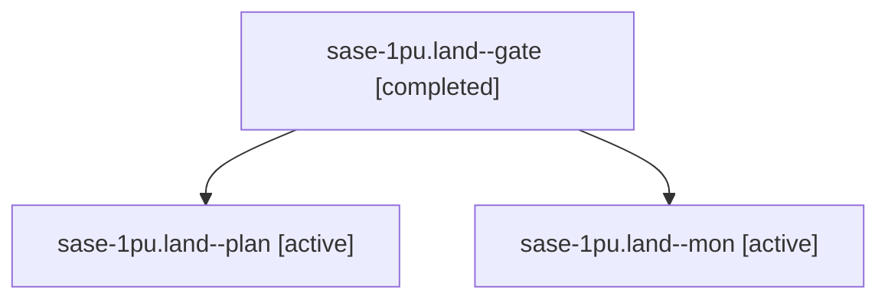

# Session: sase-1pu.land

[Agent Hoods](../README.md) / [bbugyi200](../users/bbugyi200/README.md) / [athena](../users/bbugyi200/machines/athena/README.md) / [sase-1pu](../users/bbugyi200/machines/athena/hoods/sase-1pu/README.md) / sase-1pu.land

Owner: `bbugyi200.athena` · Hood: `sase-1pu` · Members: 3 · Bead: [sase-1pu](https://github.com/sase-org/sase--beads/blob/main/pages/sase-1pu/README.md)

## Lineage

The diagram is an optional enhancement; the ordered table below contains the same lineage in accessible text.

| Role | Agent | State | Model / provider | Timing | Commits | Prompt | Chat |
|---|---|---|---|---|---:|---|---|
| gate | sase-1pu.land--gate | completed | opus / claude | 2026-11-01T19:32:53.805977+00:00 → 2026-11-01T19:34:41.495554+00:00 | 0 | — | [Chat](../agents/bbugyi200.athena.sase-1pu.land--gate/chat.md) |
| plan | sase-1pu.land--plan | active | opus / claude | 2026-11-01T19:13:02.841074+00:00 → 2026-11-01T19:34:48.613446+00:00 | 0 | [Prompt](../agents/bbugyi200.athena.sase-1pu.land--plan/prompt.md) | [Chat](../agents/bbugyi200.athena.sase-1pu.land--plan/chat.md) |
| mon | sase-1pu.land--mon | active | opus / claude | 2026-11-01T19:34:39.613909+00:00 | 0 | — | — |

## Neighbors

| Agent | Relation | State |
|---|---|---|
| [sase-1pu.1](../agents/bbugyi200.athena.sase-1pu.1/README.md) | sase-1pu hood | completed |
| [sase-1pu.2](bbugyi200.athena.sase-1pu.2.md) (session · 5) | sase-1pu hood | completed 3, failed 2 |
| [sase-1pu.3](bbugyi200.athena.sase-1pu.3.md) (session · 3) | sase-1pu hood | completed 2, failed 1 |
| [sase-1pu.4](bbugyi200.athena.sase-1pu.4.md) (session · 5) | sase-1pu hood | completed 3, failed 2 |
| [sase-1pu.5](bbugyi200.athena.sase-1pu.5.md) (session · 3) | sase-1pu hood | failed 3 |
| [sase-1pu.5.1.1](bbugyi200.athena.sase-1pu.5.1.1.md) (session · 3) | sase-1pu hood | completed 2, failed 1 |
| [sase-1pu.5.1.2](bbugyi200.athena.sase-1pu.5.1.2.md) (session · 5) | sase-1pu hood | completed 3, failed 2 |
| [sase-1pu.5.1.3](bbugyi200.athena.sase-1pu.5.1.3.md) (session · 3) | sase-1pu hood | completed 2, failed 1 |
| [sase-1pu.5.1.4](bbugyi200.athena.sase-1pu.5.1.4.md) (session · 3) | sase-1pu hood | completed 2, failed 1 |
| [sase-1pu.5.1.5.1](../agents/bbugyi200.athena.sase-1pu.5.1.5.1/README.md) | sase-1pu hood | completed |
| [sase-1pu.5.1.5.2](../agents/bbugyi200.athena.sase-1pu.5.1.5.2/README.md) | sase-1pu hood | completed |
| [sase-1pu.5.1.5.land](bbugyi200.athena.sase-1pu.5.1.5.land.md) (session · 3) | sase-1pu hood | completed 2, failed 1 |
| [sase-1pu.5.1.land](bbugyi200.athena.sase-1pu.5.1.land.md) (session · 3) | sase-1pu hood | failed 3 |
| [sase-1pu.5.1.land](../agents/bbugyi200.athena.sase-1pu.5.1.land/README.md) | sase-1pu hood | waiting |
