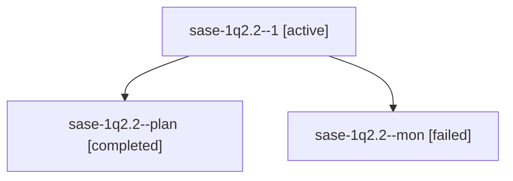

# Session: sase-1q2.2

[Agent Hoods](../README.md) / [bbugyi200](../users/bbugyi200/README.md) / [athena](../users/bbugyi200/machines/athena/README.md) / [sase-1q2](../users/bbugyi200/machines/athena/hoods/sase-1q2/README.md) / sase-1q2.2

Owner: `bbugyi200.athena` · Hood: `sase-1q2` · Members: 3 · Bead: [sase-1q2.2](https://github.com/sase-org/sase--beads/blob/main/pages/sase-1q2/sase-1q2.2.md)

## Lineage

The diagram is an optional enhancement; the ordered table below contains the same lineage in accessible text.

| Role | Agent | State | Model / provider | Timing | Commits | Prompt | Chat |
|---|---|---|---|---|---:|---|---|
| 1 | sase-1q2.2--1 | active | muse-spark-1.3-contributor / muse | 20261030140852 | 0 | [Prompt](../agents/bbugyi200.athena.sase-1q2.2--1/prompt.md) | — |
| plan | sase-1q2.2--plan | completed | muse-spark-1.3-contributor / muse | 2026-10-30T17:51:21.508683+00:00 → 2026-10-30T17:57:18.617415+00:00 | 0 | [Prompt](../agents/bbugyi200.athena.sase-1q2.2--plan/prompt.md) | [Chat](../agents/bbugyi200.athena.sase-1q2.2--plan/chat.md) |
| mon | sase-1q2.2--mon | failed | muse-spark-1.3-contributor / muse | 2026-10-30T17:57:06.615252+00:00 → 2026-10-30T18:09:53.012815+00:00 | 0 | — | [Chat](../agents/bbugyi200.athena.sase-1q2.2--mon/chat.md) |

## Neighbors

| Agent | Relation | State |
|---|---|---|
| [sase-1q2.1](../agents/bbugyi200.athena.sase-1q2.1/README.md) | sase-1q2 hood | completed |
| [sase-1q2.3](../agents/bbugyi200.athena.sase-1q2.3/README.md) | sase-1q2 hood | completed |
| [sase-1q2.4](../agents/bbugyi200.athena.sase-1q2.4/README.md) | sase-1q2 hood | active |
| [sase-1q2.5](../agents/bbugyi200.athena.sase-1q2.5/README.md) | sase-1q2 hood | completed |
| [sase-1q2.6](../agents/bbugyi200.athena.sase-1q2.6/README.md) | sase-1q2 hood | waiting |
| [sase-1q2.7](../agents/bbugyi200.athena.sase-1q2.7/README.md) | sase-1q2 hood | waiting |
| [sase-1q2.8](../agents/bbugyi200.athena.sase-1q2.8/README.md) | sase-1q2 hood | waiting |
| [sase-1q2.land](../agents/bbugyi200.athena.sase-1q2.land/README.md) | sase-1q2 hood | waiting |
