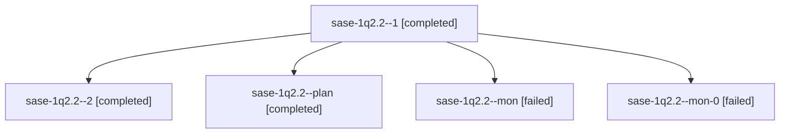

# Session: sase-1q2.2

[Agent Hoods](../README.md) / [bbugyi200](../users/bbugyi200/README.md) / [athena](../users/bbugyi200/machines/athena/README.md) / [sase-1q2](../users/bbugyi200/machines/athena/hoods/sase-1q2/README.md) / sase-1q2.2

Owner: `bbugyi200.athena` · Hood: `sase-1q2` · Members: 5 · Bead: [sase-1q2.2](https://github.com/sase-org/sase--beads/blob/main/pages/sase-1q2/sase-1q2.2.md)

## Lineage

The diagram is an optional enhancement; the ordered table below contains the same lineage in accessible text.

| Role | Agent | State | Model / provider | Timing | Commits | Prompt | Chat |
|---|---|---|---|---|---:|---|---|
| 1 | sase-1q2.2--1 | completed | muse-spark-1.3-contributor / muse | 2026-10-30T18:12:46.541806+00:00 → 2026-10-30T18:37:54.505117+00:00 | 0 | [Prompt](../agents/bbugyi200.athena.sase-1q2.2--1/prompt.md) | [Chat](../agents/bbugyi200.athena.sase-1q2.2--1/chat.md) |
| 2 | sase-1q2.2--2 | completed | muse-spark-1.3-contributor / muse | 2026-10-30T18:58:59.263420+00:00 → 2026-10-30T19:05:48.212735+00:00 | [1](../agents/bbugyi200.athena.sase-1q2.2--2/README.md#commits) | [Prompt](../agents/bbugyi200.athena.sase-1q2.2--2/prompt.md) | [Chat](../agents/bbugyi200.athena.sase-1q2.2--2/chat.md) |
| plan | sase-1q2.2--plan | completed | muse-spark-1.3-contributor / muse | 2026-10-30T17:51:21.508683+00:00 → 2026-10-30T17:57:18.617415+00:00 | 0 | [Prompt](../agents/bbugyi200.athena.sase-1q2.2--plan/prompt.md) | [Chat](../agents/bbugyi200.athena.sase-1q2.2--plan/chat.md) |
| mon | sase-1q2.2--mon | failed | muse-spark-1.3-contributor / muse | 2026-10-30T17:57:06.615252+00:00 → 2026-10-30T18:09:53.012815+00:00 | 0 | — | [Chat](../agents/bbugyi200.athena.sase-1q2.2--mon/chat.md) |
| mon-0 | sase-1q2.2--mon-0 | failed | muse-spark-1.3-contributor / muse | 2026-10-30T18:37:41.403642+00:00 → 2026-10-30T18:56:34.977822+00:00 | 0 | — | [Chat](../agents/bbugyi200.athena.sase-1q2.2--mon-0/chat.md) |

## Commits

| Role | Repo | Commit | Subject | Committed |
|---|---|---|---|---|
| 2 | sase | [`1a41907`](https://github.com/sase-org/sase/commit/1a419071c20f3953562b4576d432700745d4cea6) | chore(core): ratchet sase-core-rs to 0.43.2 | 2026-10-30 15:04:39 EDT |

## Neighbors

| Agent | Relation | State |
|---|---|---|
| [sase-1q2.1](../agents/bbugyi200.athena.sase-1q2.1/README.md) | sase-1q2 hood | completed |
| [sase-1q2.3](../agents/bbugyi200.athena.sase-1q2.3/README.md) | sase-1q2 hood | completed |
| [sase-1q2.4](bbugyi200.athena.sase-1q2.4.md) (session · 23) | sase-1q2 hood | completed 12, failed 11 |
| [sase-1q2.5](../agents/bbugyi200.athena.sase-1q2.5/README.md) | sase-1q2 hood | completed |
| [sase-1q2.6](bbugyi200.athena.sase-1q2.6.md) (session · 3) | sase-1q2 hood | completed 2, failed 1 |
| [sase-1q2.7](../agents/bbugyi200.athena.sase-1q2.7/README.md) | sase-1q2 hood | completed |
| [sase-1q2.8](../agents/bbugyi200.athena.sase-1q2.8/README.md) | sase-1q2 hood | completed |
| [sase-1q2.9.1](../agents/bbugyi200.athena.sase-1q2.9.1/README.md) | sase-1q2 hood | active |
| [sase-1q2.9.2](../agents/bbugyi200.athena.sase-1q2.9.2/README.md) | sase-1q2 hood | active |
| [sase-1q2.9.3](../agents/bbugyi200.athena.sase-1q2.9.3/README.md) | sase-1q2 hood | active |
| [sase-1q2.9.4](../agents/bbugyi200.athena.sase-1q2.9.4/README.md) | sase-1q2 hood | active |
| [sase-1q2.land](bbugyi200.athena.sase-1q2.land.md) (session · 3) | sase-1q2 hood | active 1, failed 2 |
