# Session: sase-1q2.4

[Agent Hoods](../README.md) / [bbugyi200](../users/bbugyi200/README.md) / [athena](../users/bbugyi200/machines/athena/README.md) / [sase-1q2](../users/bbugyi200/machines/athena/hoods/sase-1q2/README.md) / sase-1q2.4

Owner: `bbugyi200.athena` · Hood: `sase-1q2` · Members: 23 · Bead: [sase-1q2.4](https://github.com/sase-org/sase--beads/blob/main/pages/sase-1q2/sase-1q2.4.md)

## Lineage

```mermaid
flowchart TD
  n0["sase-1q2.4--mon-4 [failed]"]
  n1["sase-1q2.4--b [completed]"]
  n0 --> n1
  n2["sase-1q2.4--mon-0 [failed]"]
  n0 --> n2
  n3["sase-1q2.4--9 [completed]"]
  n0 --> n3
  n4["sase-1q2.4--2 [completed]"]
  n0 --> n4
  n5["sase-1q2.4--mon-7 [failed]"]
  n0 --> n5
  n6["sase-1q2.4--4 [completed]"]
  n0 --> n6
  n7["sase-1q2.4--8 [completed]"]
  n0 --> n7
  n8["sase-1q2.4--plan [completed]"]
  n0 --> n8
  n9["sase-1q2.4--mon [failed]"]
  n0 --> n9
  n10["sase-1q2.4--5 [completed]"]
  n0 --> n10
  n11["sase-1q2.4--6 [completed]"]
  n0 --> n11
  n12["sase-1q2.4--mon-1 [failed]"]
  n0 --> n12
  n13["sase-1q2.4--7 [completed]"]
  n0 --> n13
  n14["sase-1q2.4--3 [completed]"]
  n0 --> n14
  n15["sase-1q2.4--a [completed]"]
  n0 --> n15
  n16["sase-1q2.4--1 [completed]"]
  n0 --> n16
  n17["sase-1q2.4--mon-3 [failed]"]
  n0 --> n17
  n18["sase-1q2.4--mon-8 [failed]"]
  n0 --> n18
  n19["sase-1q2.4--mon-6 [failed]"]
  n0 --> n19
  n20["sase-1q2.4--mon-2 [failed]"]
  n0 --> n20
  n21["sase-1q2.4--mon-5 [failed]"]
  n0 --> n21
  n22["sase-1q2.4--mon-9 [failed]"]
  n0 --> n22
```

The diagram is an optional enhancement; the ordered table below contains the same lineage in accessible text.

| Role | Agent | State | Model / provider | Timing | Commits | Prompt | Chat |
|---|---|---|---|---|---:|---|---|
| mon-4 | sase-1q2.4--mon-4 | failed | gpt-6-luna / codex | 2026-10-31T01:18:43.394576+00:00 → 2026-10-31T01:31:43.369187+00:00 | 0 | — | [Chat](../agents/bbugyi200.athena.sase-1q2.4--mon-4/chat.md) |
| b | sase-1q2.4--b | completed | muse-spark-1.3-contributor / muse | 2026-10-31T05:33:19.989003+00:00 → 2026-10-31T05:46:33.183232+00:00 | [1](../agents/bbugyi200.athena.sase-1q2.4--b/README.md#commits) | [Prompt](../agents/bbugyi200.athena.sase-1q2.4--b/prompt.md) | [Chat](../agents/bbugyi200.athena.sase-1q2.4--b/chat.md) |
| mon-0 | sase-1q2.4--mon-0 | failed | gpt-6-luna / codex | 2026-10-30T21:42:16.818057+00:00 → 2026-10-30T22:54:32.371954+00:00 | 0 | — | [Chat](../agents/bbugyi200.athena.sase-1q2.4--mon-0/chat.md) |
| 9 | sase-1q2.4--9 | completed | gpt-6-luna / codex | 2026-10-31T03:57:39.757389+00:00 → 2026-10-31T04:03:51.578113+00:00 | 0 | [Prompt](../agents/bbugyi200.athena.sase-1q2.4--9/prompt.md) | [Chat](../agents/bbugyi200.athena.sase-1q2.4--9/chat.md) |
| 2 | sase-1q2.4--2 | completed | gpt-6-luna / codex | 2026-10-30T23:01:49.161360+00:00 → 2026-10-30T23:09:45.216327+00:00 | 0 | [Prompt](../agents/bbugyi200.athena.sase-1q2.4--2/prompt.md) | [Chat](../agents/bbugyi200.athena.sase-1q2.4--2/chat.md) |
| mon-7 | sase-1q2.4--mon-7 | failed | gpt-6-luna / codex | 2026-10-31T03:25:46.618370+00:00 → 2026-10-31T03:56:10.303301+00:00 | 0 | — | [Chat](../agents/bbugyi200.athena.sase-1q2.4--mon-7/chat.md) |
| 4 | sase-1q2.4--4 | completed | gpt-6-luna / codex | 2026-10-31T00:57:08.710722+00:00 → 2026-10-31T01:08:01.076453+00:00 | 0 | [Prompt](../agents/bbugyi200.athena.sase-1q2.4--4/prompt.md) | [Chat](../agents/bbugyi200.athena.sase-1q2.4--4/chat.md) |
| 8 | sase-1q2.4--8 | completed | gpt-6-luna / codex | 2026-10-31T03:19:04.920003+00:00 → 2026-10-31T03:27:54.843566+00:00 | 0 | [Prompt](../agents/bbugyi200.athena.sase-1q2.4--8/prompt.md) | [Chat](../agents/bbugyi200.athena.sase-1q2.4--8/chat.md) |
| plan | sase-1q2.4--plan | completed | gpt-6-luna / codex | 2026-10-30T16:56:44.713232+00:00 → 2026-10-30T20:43:11.091485+00:00 | 0 | [Prompt](../agents/bbugyi200.athena.sase-1q2.4--plan/prompt.md) | [Chat](../agents/bbugyi200.athena.sase-1q2.4--plan/chat.md) |
| mon | sase-1q2.4--mon | failed | gpt-6-luna / codex | 2026-10-30T20:41:09.318378+00:00 → 2026-10-30T20:56:48.662137+00:00 | 0 | — | [Chat](../agents/bbugyi200.athena.sase-1q2.4--mon/chat.md) |
| 5 | sase-1q2.4--5 | completed | gpt-6-luna / codex | 2026-10-31T01:12:14.236133+00:00 → 2026-10-31T01:20:44.460701+00:00 | 0 | [Prompt](../agents/bbugyi200.athena.sase-1q2.4--5/prompt.md) | [Chat](../agents/bbugyi200.athena.sase-1q2.4--5/chat.md) |
| 6 | sase-1q2.4--6 | completed | gpt-6-luna / codex | 2026-10-31T01:34:06.936752+00:00 → 2026-10-31T01:46:51.775239+00:00 | 0 | [Prompt](../agents/bbugyi200.athena.sase-1q2.4--6/prompt.md) | [Chat](../agents/bbugyi200.athena.sase-1q2.4--6/chat.md) |
| mon-1 | sase-1q2.4--mon-1 | failed | gpt-6-luna / codex | 2026-10-30T23:07:17.925964+00:00 → 2026-10-31T00:09:10.983475+00:00 | 0 | — | [Chat](../agents/bbugyi200.athena.sase-1q2.4--mon-1/chat.md) |
| 7 | sase-1q2.4--7 | completed | gpt-6-luna / codex | 2026-10-31T01:52:07.999312+00:00 → 2026-10-31T02:04:58.551752+00:00 | 0 | [Prompt](../agents/bbugyi200.athena.sase-1q2.4--7/prompt.md) | [Chat](../agents/bbugyi200.athena.sase-1q2.4--7/chat.md) |
| 3 | sase-1q2.4--3 | completed | gpt-6-luna / codex | 2026-10-31T00:11:53.988851+00:00 → 2026-10-31T00:38:57.381673+00:00 | 0 | [Prompt](../agents/bbugyi200.athena.sase-1q2.4--3/prompt.md) | [Chat](../agents/bbugyi200.athena.sase-1q2.4--3/chat.md) |
| a | sase-1q2.4--a | completed | muse-spark-1.3-contributor / muse | 2026-10-31T05:07:48.805270+00:00 → 2026-10-31T05:14:02.403579+00:00 | 0 | [Prompt](../agents/bbugyi200.athena.sase-1q2.4--a/prompt.md) | [Chat](../agents/bbugyi200.athena.sase-1q2.4--a/chat.md) |
| 1 | sase-1q2.4--1 | completed | gpt-6-luna / codex | 2026-10-30T20:58:59.707644+00:00 → 2026-10-30T21:44:20.504324+00:00 | 0 | [Prompt](../agents/bbugyi200.athena.sase-1q2.4--1/prompt.md) | [Chat](../agents/bbugyi200.athena.sase-1q2.4--1/chat.md) |
| mon-3 | sase-1q2.4--mon-3 | failed | gpt-6-luna / codex | 2026-10-31T01:02:43.151610+00:00 → 2026-10-31T01:09:33.492321+00:00 | 0 | — | [Chat](../agents/bbugyi200.athena.sase-1q2.4--mon-3/chat.md) |
| mon-8 | sase-1q2.4--mon-8 | failed | gpt-6-luna / codex | 2026-10-31T04:01:10.539893+00:00 → 2026-10-31T05:07:41.296333+00:00 | 0 | — | [Chat](../agents/bbugyi200.athena.sase-1q2.4--mon-8/chat.md) |
| mon-6 | sase-1q2.4--mon-6 | failed | gpt-6-luna / codex | 2026-10-31T02:02:53.286229+00:00 → 2026-10-31T03:17:36.651100+00:00 | 0 | — | [Chat](../agents/bbugyi200.athena.sase-1q2.4--mon-6/chat.md) |
| mon-2 | sase-1q2.4--mon-2 | failed | gpt-6-luna / codex | 2026-10-31T00:36:07.597876+00:00 → 2026-10-31T00:53:54.115817+00:00 | 0 | — | [Chat](../agents/bbugyi200.athena.sase-1q2.4--mon-2/chat.md) |
| mon-5 | sase-1q2.4--mon-5 | failed | gpt-6-luna / codex | 2026-10-31T01:44:54.834017+00:00 → 2026-10-31T01:49:59.277750+00:00 | 0 | — | [Chat](../agents/bbugyi200.athena.sase-1q2.4--mon-5/chat.md) |
| mon-9 | sase-1q2.4--mon-9 | failed | muse-spark-1.3-contributor / muse | 2026-10-31T05:11:52.044368+00:00 → 2026-10-31T05:31:29.134562+00:00 | 0 | — | [Chat](../agents/bbugyi200.athena.sase-1q2.4--mon-9/chat.md) |

## Commits

| Role | Repo | Commit | Subject | Committed |
|---|---|---|---|---|
| b | sase | [`e28334c`](https://github.com/sase-org/sase/commit/e28334c45a72ec02d10b0564b06909f6d14751bf) | fix(tui): clear pager, footprint, import-budget, and visual-lane reds | 2026-10-31 01:43:45 EDT |

## Neighbors

| Agent | Relation | State |
|---|---|---|
| [sase-1q2.1](../agents/bbugyi200.athena.sase-1q2.1/README.md) | sase-1q2 hood | completed |
| [sase-1q2.2](bbugyi200.athena.sase-1q2.2.md) (session · 5) | sase-1q2 hood | completed 3, failed 2 |
| [sase-1q2.3](../agents/bbugyi200.athena.sase-1q2.3/README.md) | sase-1q2 hood | completed |
| [sase-1q2.5](../agents/bbugyi200.athena.sase-1q2.5/README.md) | sase-1q2 hood | completed |
| [sase-1q2.6](bbugyi200.athena.sase-1q2.6.md) (session · 3) | sase-1q2 hood | completed 2, failed 1 |
| [sase-1q2.7](../agents/bbugyi200.athena.sase-1q2.7/README.md) | sase-1q2 hood | waiting |
| [sase-1q2.8](../agents/bbugyi200.athena.sase-1q2.8/README.md) | sase-1q2 hood | waiting |
| [sase-1q2.land](../agents/bbugyi200.athena.sase-1q2.land/README.md) | sase-1q2 hood | waiting |
