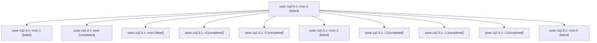

# Session: sase-1q2.9.1

[Agent Hoods](../README.md) / [bbugyi200](../users/bbugyi200/README.md) / [athena](../users/bbugyi200/machines/athena/README.md) / [sase-1q2](../users/bbugyi200/machines/athena/hoods/sase-1q2/README.md) / sase-1q2.9.1

Owner: `bbugyi200.athena` · Hood: `sase-1q2` · Members: 11 · Bead: [sase-1q2.9.1](https://github.com/sase-org/sase--beads/blob/main/pages/sase-1q2/sase-1q2.9.1.md)

## Lineage

The diagram is an optional enhancement; the ordered table below contains the same lineage in accessible text.

| Role | Agent | State | Model / provider | Timing | Commits | Prompt | Chat |
|---|---|---|---|---|---:|---|---|
| mon-2 | sase-1q2.9.1--mon-2 | failed | gpt-6-luna / codex | 2026-10-31T11:17:24.022453+00:00 → 2026-10-31T12:15:09.974351+00:00 | 0 | — | [Chat](../agents/bbugyi200.athena.sase-1q2.9.1--mon-2/chat.md) |
| mon-1 | sase-1q2.9.1--mon-1 | failed | gpt-6-luna / codex | 2026-10-31T11:11:37.270285+00:00 → 2026-10-31T11:13:35.393237+00:00 | 0 | — | [Chat](../agents/bbugyi200.athena.sase-1q2.9.1--mon-1/chat.md) |
| plan | sase-1q2.9.1--plan | completed | gpt-6-luna / codex | 2026-10-31T09:27:06.363992+00:00 → 2026-10-31T09:38:17.897547+00:00 | 0 | [Prompt](../agents/bbugyi200.athena.sase-1q2.9.1--plan/prompt.md) | [Chat](../agents/bbugyi200.athena.sase-1q2.9.1--plan/chat.md) |
| mon | sase-1q2.9.1--mon | failed | gpt-6-luna / codex | 2026-10-31T09:38:10.285051+00:00 → 2026-10-31T10:39:56.143650+00:00 | 0 | — | [Chat](../agents/bbugyi200.athena.sase-1q2.9.1--mon/chat.md) |
| 4 | sase-1q2.9.1--4 | completed | muse-spark-1.3-contributor / muse | 2026-10-31T12:16:37.531937+00:00 → 2026-10-31T12:36:43.881230+00:00 | 0 | [Prompt](../agents/bbugyi200.athena.sase-1q2.9.1--4/prompt.md) | [Chat](../agents/bbugyi200.athena.sase-1q2.9.1--4/chat.md) |
| 5 | sase-1q2.9.1--5 | completed | muse-spark-1.3-contributor / muse | 2026-10-31T12:53:47.740560+00:00 → 2026-10-31T13:01:42.584408+00:00 | [1](../agents/bbugyi200.athena.sase-1q2.9.1--5/README.md#commits) | [Prompt](../agents/bbugyi200.athena.sase-1q2.9.1--5/prompt.md) | [Chat](../agents/bbugyi200.athena.sase-1q2.9.1--5/chat.md) |
| mon-3 | sase-1q2.9.1--mon-3 | failed | muse-spark-1.3-contributor / muse | 2026-10-31T12:36:20.700742+00:00 → 2026-10-31T12:51:35.432980+00:00 | 0 | — | [Chat](../agents/bbugyi200.athena.sase-1q2.9.1--mon-3/chat.md) |
| 2 | sase-1q2.9.1--2 | completed | gpt-6-luna / codex | 2026-10-31T11:06:45.446785+00:00 → 2026-10-31T11:11:44.336627+00:00 | 0 | [Prompt](../agents/bbugyi200.athena.sase-1q2.9.1--2/prompt.md) | [Chat](../agents/bbugyi200.athena.sase-1q2.9.1--2/chat.md) |
| 1 | sase-1q2.9.1--1 | completed | gpt-6-luna / codex | 2026-10-31T10:41:06.732129+00:00 → 2026-10-31T10:47:13.401103+00:00 | 0 | [Prompt](../agents/bbugyi200.athena.sase-1q2.9.1--1/prompt.md) | [Chat](../agents/bbugyi200.athena.sase-1q2.9.1--1/chat.md) |
| 3 | sase-1q2.9.1--3 | completed | gpt-6-luna / codex | 2026-10-31T11:14:52.696777+00:00 → 2026-10-31T11:17:31.126770+00:00 | 0 | [Prompt](../agents/bbugyi200.athena.sase-1q2.9.1--3/prompt.md) | [Chat](../agents/bbugyi200.athena.sase-1q2.9.1--3/chat.md) |
| mon-0 | sase-1q2.9.1--mon-0 | failed | gpt-6-luna / codex | 2026-10-31T10:47:05.118154+00:00 → 2026-10-31T11:05:26.172234+00:00 | 0 | — | [Chat](../agents/bbugyi200.athena.sase-1q2.9.1--mon-0/chat.md) |

## Commits

| Role | Repo | Commit | Subject | Committed |
|---|---|---|---|---|
| 5 | sase | [`ddefc62`](https://github.com/sase-org/sase/commit/ddefc625e001ae255596f77a6461abb642f3929e) | perf(tui): keep footprint bump() under its 2us budget and fix hot-spare reveal subtitle race | 2026-10-31 09:00:25 EDT |

## Neighbors

| Agent | Relation | State |
|---|---|---|
| [sase-1q2.9.2](bbugyi200.athena.sase-1q2.9.2.md) (session · 2) | sase-1q2.9 hood | active 1, completed 1 |
| [sase-1q2.9.3](../agents/bbugyi200.athena.sase-1q2.9.3/README.md) | sase-1q2.9 hood | active |
| [sase-1q2.9.4](../agents/bbugyi200.athena.sase-1q2.9.4/README.md) | sase-1q2.9 hood | active |
| [sase-1q2.9.land](../agents/bbugyi200.athena.sase-1q2.9.land/README.md) | sase-1q2.9 hood | waiting |
| [sase-1q2.1](../agents/bbugyi200.athena.sase-1q2.1/README.md) | sase-1q2 hood | completed |
| [sase-1q2.2](bbugyi200.athena.sase-1q2.2.md) (session · 5) | sase-1q2 hood | completed 3, failed 2 |
| [sase-1q2.3](../agents/bbugyi200.athena.sase-1q2.3/README.md) | sase-1q2 hood | completed |
| [sase-1q2.4](bbugyi200.athena.sase-1q2.4.md) (session · 23) | sase-1q2 hood | completed 12, failed 11 |
| [sase-1q2.5](../agents/bbugyi200.athena.sase-1q2.5/README.md) | sase-1q2 hood | completed |
| [sase-1q2.6](bbugyi200.athena.sase-1q2.6.md) (session · 3) | sase-1q2 hood | completed 2, failed 1 |
| [sase-1q2.7](../agents/bbugyi200.athena.sase-1q2.7/README.md) | sase-1q2 hood | completed |
| [sase-1q2.8](../agents/bbugyi200.athena.sase-1q2.8/README.md) | sase-1q2 hood | completed |
| [sase-1q2.land](bbugyi200.athena.sase-1q2.land.md) (session · 3) | sase-1q2 hood | failed 3 |
