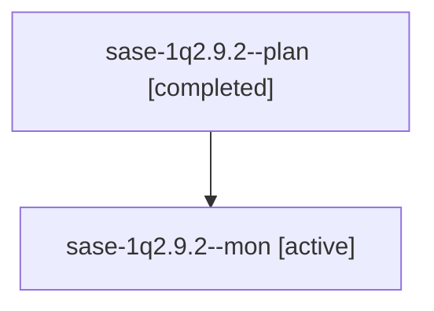

# Session: sase-1q2.9.2

[Agent Hoods](../README.md) / [bbugyi200](../users/bbugyi200/README.md) / [athena](../users/bbugyi200/machines/athena/README.md) / [sase-1q2](../users/bbugyi200/machines/athena/hoods/sase-1q2/README.md) / sase-1q2.9.2

Owner: `bbugyi200.athena` · Hood: `sase-1q2` · Members: 2 · Bead: [sase-1q2.9.2](https://github.com/sase-org/sase--beads/blob/main/pages/sase-1q2/sase-1q2.9.2.md)

## Lineage

The diagram is an optional enhancement; the ordered table below contains the same lineage in accessible text.

| Role | Agent | State | Model / provider | Timing | Commits | Prompt | Chat |
|---|---|---|---|---|---:|---|---|
| plan | sase-1q2.9.2--plan | completed | muse-spark-1.3-contributor / muse | 2026-10-31T09:26:51.357253+00:00 → 2026-10-31T09:40:15.798333+00:00 | 0 | [Prompt](../agents/bbugyi200.athena.sase-1q2.9.2--plan/prompt.md) | [Chat](../agents/bbugyi200.athena.sase-1q2.9.2--plan/chat.md) |
| mon | sase-1q2.9.2--mon | active | muse-spark-1.3-contributor / muse | 2026-10-31T09:40:08.643328+00:00 | 0 | — | — |

## Neighbors

| Agent | Relation | State |
|---|---|---|
| [sase-1q2.9.1](bbugyi200.athena.sase-1q2.9.1.md) (session · 11) | sase-1q2.9 hood | completed 6, failed 5 |
| [sase-1q2.9.3](../agents/bbugyi200.athena.sase-1q2.9.3/README.md) | sase-1q2.9 hood | active |
| [sase-1q2.9.4](../agents/bbugyi200.athena.sase-1q2.9.4/README.md) | sase-1q2.9 hood | active |
| [sase-1q2.9.land](../agents/bbugyi200.athena.sase-1q2.9.land/README.md) | sase-1q2.9 hood | waiting |
| [sase-1q2.1](../agents/bbugyi200.athena.sase-1q2.1/README.md) | sase-1q2 hood | completed |
| [sase-1q2.2](bbugyi200.athena.sase-1q2.2.md) (session · 5) | sase-1q2 hood | completed 3, failed 2 |
| [sase-1q2.3](../agents/bbugyi200.athena.sase-1q2.3/README.md) | sase-1q2 hood | completed |
| [sase-1q2.4](bbugyi200.athena.sase-1q2.4.md) (session · 23) | sase-1q2 hood | completed 12, failed 11 |
| [sase-1q2.5](../agents/bbugyi200.athena.sase-1q2.5/README.md) | sase-1q2 hood | completed |
| [sase-1q2.6](bbugyi200.athena.sase-1q2.6.md) (session · 3) | sase-1q2 hood | completed 2, failed 1 |
| [sase-1q2.7](../agents/bbugyi200.athena.sase-1q2.7/README.md) | sase-1q2 hood | completed |
| [sase-1q2.8](../agents/bbugyi200.athena.sase-1q2.8/README.md) | sase-1q2 hood | completed |
| [sase-1q2.land](bbugyi200.athena.sase-1q2.land.md) (session · 3) | sase-1q2 hood | failed 3 |
