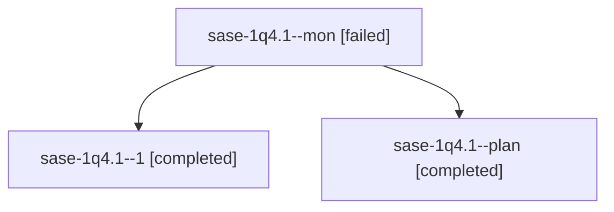

# Session: sase-1q4.1

[Agent Hoods](../README.md) / [bbugyi200](../users/bbugyi200/README.md) / [athena](../users/bbugyi200/machines/athena/README.md) / [sase-1q4](../users/bbugyi200/machines/athena/hoods/sase-1q4/README.md) / sase-1q4.1

Owner: `bbugyi200.athena` · Hood: `sase-1q4` · Members: 3 · Bead: [sase-1q4.1](https://github.com/sase-org/sase--beads/blob/main/pages/sase-1q4/sase-1q4.1.md)

## Lineage

The diagram is an optional enhancement; the ordered table below contains the same lineage in accessible text.

| Role | Agent | State | Model / provider | Timing | Commits | Prompt | Chat |
|---|---|---|---|---|---:|---|---|
| mon | sase-1q4.1--mon | failed | muse-spark-1.3-contributor / muse | 2026-10-30T22:07:56.134449+00:00 → 2026-10-30T22:12:18.891790+00:00 | 0 | — | [Chat](../agents/bbugyi200.athena.sase-1q4.1--mon/chat.md) |
| 1 | sase-1q4.1--1 | completed | muse-spark-1.3-contributor / muse | 2026-10-30T22:14:41.236435+00:00 → 2026-10-30T22:19:47.875559+00:00 | [1](../agents/bbugyi200.athena.sase-1q4.1--1/README.md#commits) | [Prompt](../agents/bbugyi200.athena.sase-1q4.1--1/prompt.md) | [Chat](../agents/bbugyi200.athena.sase-1q4.1--1/chat.md) |
| plan | sase-1q4.1--plan | completed | muse-spark-1.3-contributor / muse | 2026-10-30T21:47:24.811721+00:00 → 2026-10-30T22:08:10.041682+00:00 | 0 | [Prompt](../agents/bbugyi200.athena.sase-1q4.1--plan/prompt.md) | [Chat](../agents/bbugyi200.athena.sase-1q4.1--plan/chat.md) |

## Commits

| Role | Repo | Commit | Subject | Committed |
|---|---|---|---|---|
| 1 | sase | [`167af33`](https://github.com/sase-org/sase/commit/167af335307c8e83fd3994c9f9081c326fbbf6a5) | feat(agent): promotion-aware bare-name fork waits | 2026-10-30 18:18:33 EDT |

## Neighbors

| Agent | Relation | State |
|---|---|---|
| [sase-1q4.10](bbugyi200.athena.sase-1q4.10.md) (session · 5) | sase-1q4 hood | completed 3, failed 2 |
| [sase-1q4.11](../agents/bbugyi200.athena.sase-1q4.11/README.md) | sase-1q4 hood | waiting |
| [sase-1q4.2](../agents/bbugyi200.athena.sase-1q4.2/README.md) | sase-1q4 hood | completed |
| [sase-1q4.3](bbugyi200.athena.sase-1q4.3.md) (session · 3) | sase-1q4 hood | completed 2, failed 1 |
| [sase-1q4.4](../agents/bbugyi200.athena.sase-1q4.4/README.md) | sase-1q4 hood | completed |
| [sase-1q4.5](../agents/bbugyi200.athena.sase-1q4.5/README.md) | sase-1q4 hood | waiting |
| [sase-1q4.6](../agents/bbugyi200.athena.sase-1q4.6/README.md) | sase-1q4 hood | waiting |
| [sase-1q4.7](../agents/bbugyi200.athena.sase-1q4.7/README.md) | sase-1q4 hood | waiting |
| [sase-1q4.8](../agents/bbugyi200.athena.sase-1q4.8/README.md) | sase-1q4 hood | waiting |
| [sase-1q4.9](../agents/bbugyi200.athena.sase-1q4.9/README.md) | sase-1q4 hood | waiting |
| [sase-1q4.land](../agents/bbugyi200.athena.sase-1q4.land/README.md) | sase-1q4 hood | waiting |
