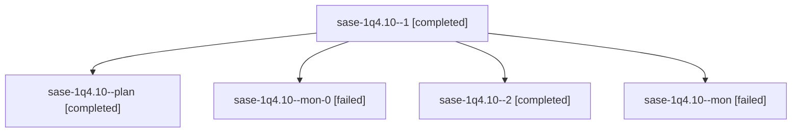

# Session: sase-1q4.10

[Agent Hoods](../README.md) / [bbugyi200](../users/bbugyi200/README.md) / [athena](../users/bbugyi200/machines/athena/README.md) / [sase-1q4](../users/bbugyi200/machines/athena/hoods/sase-1q4/README.md) / sase-1q4.10

Owner: `bbugyi200.athena` · Hood: `sase-1q4` · Members: 5 · Bead: [sase-1q4.10](https://github.com/sase-org/sase--beads/blob/main/pages/sase-1q4/sase-1q4.10.md)

## Lineage

The diagram is an optional enhancement; the ordered table below contains the same lineage in accessible text.

| Role | Agent | State | Model / provider | Timing | Commits | Prompt | Chat |
|---|---|---|---|---|---:|---|---|
| 1 | sase-1q4.10--1 | completed | gpt-6-luna / codex | 2026-10-30T23:31:19.408664+00:00 → 2026-10-30T23:37:13.592812+00:00 | 0 | [Prompt](../agents/bbugyi200.athena.sase-1q4.10--1/prompt.md) | [Chat](../agents/bbugyi200.athena.sase-1q4.10--1/chat.md) |
| plan | sase-1q4.10--plan | completed | gpt-6-luna / codex | 2026-10-30T22:21:33.933001+00:00 → 2026-10-30T23:16:13.597101+00:00 | 0 | [Prompt](../agents/bbugyi200.athena.sase-1q4.10--plan/prompt.md) | [Chat](../agents/bbugyi200.athena.sase-1q4.10--plan/chat.md) |
| mon-0 | sase-1q4.10--mon-0 | failed | gpt-6-luna / codex | 2026-10-30T23:36:59.644488+00:00 → 2026-10-31T00:41:02.202069+00:00 | 0 | — | [Chat](../agents/bbugyi200.athena.sase-1q4.10--mon-0/chat.md) |
| 2 | sase-1q4.10--2 | completed | gpt-6-luna / codex | 2026-10-31T00:45:00.891193+00:00 → 2026-10-31T00:52:10.931531+00:00 | [1](../agents/bbugyi200.athena.sase-1q4.10--2/README.md#commits) | [Prompt](../agents/bbugyi200.athena.sase-1q4.10--2/prompt.md) | [Chat](../agents/bbugyi200.athena.sase-1q4.10--2/chat.md) |
| mon | sase-1q4.10--mon | failed | gpt-6-luna / codex | 2026-10-30T23:15:46.819387+00:00 → 2026-10-30T23:18:46.103642+00:00 | 0 | — | [Chat](../agents/bbugyi200.athena.sase-1q4.10--mon/chat.md) |

## Commits

| Role | Repo | Commit | Subject | Committed |
|---|---|---|---|---|
| 2 | sase | [`3fcb69f`](https://github.com/sase-org/sase/commit/3fcb69fb3ca7ff8caed60edf06fc9da47647e422) | fix(fork): honor bound wait records in injected history | 2026-10-30 20:50:58 EDT |

## Neighbors

| Agent | Relation | State |
|---|---|---|
| [sase-1q4.1](bbugyi200.athena.sase-1q4.1.md) (session · 3) | sase-1q4 hood | completed 2, failed 1 |
| [sase-1q4.11](../agents/bbugyi200.athena.sase-1q4.11/README.md) | sase-1q4 hood | waiting |
| [sase-1q4.2](../agents/bbugyi200.athena.sase-1q4.2/README.md) | sase-1q4 hood | active |
| [sase-1q4.3](bbugyi200.athena.sase-1q4.3.md) (session · 3) | sase-1q4 hood | active 1, completed 1, failed 1 |
| [sase-1q4.4](../agents/bbugyi200.athena.sase-1q4.4/README.md) | sase-1q4 hood | waiting |
| [sase-1q4.5](../agents/bbugyi200.athena.sase-1q4.5/README.md) | sase-1q4 hood | waiting |
| [sase-1q4.6](../agents/bbugyi200.athena.sase-1q4.6/README.md) | sase-1q4 hood | waiting |
| [sase-1q4.7](../agents/bbugyi200.athena.sase-1q4.7/README.md) | sase-1q4 hood | waiting |
| [sase-1q4.8](../agents/bbugyi200.athena.sase-1q4.8/README.md) | sase-1q4 hood | waiting |
| [sase-1q4.9](../agents/bbugyi200.athena.sase-1q4.9/README.md) | sase-1q4 hood | waiting |
| [sase-1q4.land](../agents/bbugyi200.athena.sase-1q4.land/README.md) | sase-1q4 hood | waiting |
