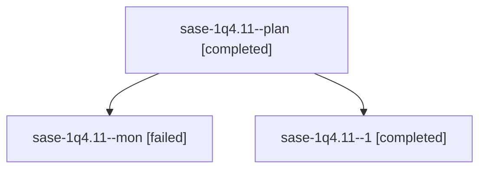

# Session: sase-1q4.11

[Agent Hoods](../README.md) / [bbugyi200](../users/bbugyi200/README.md) / [athena](../users/bbugyi200/machines/athena/README.md) / [sase-1q4](../users/bbugyi200/machines/athena/hoods/sase-1q4/README.md) / sase-1q4.11

Owner: `bbugyi200.athena` · Hood: `sase-1q4` · Members: 3 · Bead: [sase-1q4.11](https://github.com/sase-org/sase--beads/blob/main/pages/sase-1q4/sase-1q4.11.md)

## Lineage

The diagram is an optional enhancement; the ordered table below contains the same lineage in accessible text.

| Role | Agent | State | Model / provider | Timing | Commits | Prompt | Chat |
|---|---|---|---|---|---:|---|---|
| plan | sase-1q4.11--plan | completed | gpt-6-luna / codex | 2026-10-31T06:41:42.980527+00:00 → 2026-10-31T06:56:58.065945+00:00 | 0 | [Prompt](../agents/bbugyi200.athena.sase-1q4.11--plan/prompt.md) | [Chat](../agents/bbugyi200.athena.sase-1q4.11--plan/chat.md) |
| mon | sase-1q4.11--mon | failed | gpt-6-luna / codex | 2026-10-31T06:56:47.539308+00:00 → 2026-10-31T06:59:41.178358+00:00 | 0 | — | [Chat](../agents/bbugyi200.athena.sase-1q4.11--mon/chat.md) |
| 1 | sase-1q4.11--1 | completed | gpt-6-luna / codex | 2026-10-31T07:00:57.445554+00:00 → 2026-10-31T07:59:23.043384+00:00 | [1](../agents/bbugyi200.athena.sase-1q4.11--1/README.md#commits) | [Prompt](../agents/bbugyi200.athena.sase-1q4.11--1/prompt.md) | [Chat](../agents/bbugyi200.athena.sase-1q4.11--1/chat.md) |

## Commits

| Role | Repo | Commit | Subject | Committed |
|---|---|---|---|---|
| 1 | sase | [`dcee7f1`](https://github.com/sase-org/sase/commit/dcee7f11e9342935619dfbd85d670c7dfff1c98e) | feat(fork): bind explicit wait targets and structured refs | 2026-10-31 03:58:25 EDT |

## Neighbors

| Agent | Relation | State |
|---|---|---|
| [sase-1q4.1](bbugyi200.athena.sase-1q4.1.md) (session · 3) | sase-1q4 hood | completed 2, failed 1 |
| [sase-1q4.10](bbugyi200.athena.sase-1q4.10.md) (session · 5) | sase-1q4 hood | completed 3, failed 2 |
| [sase-1q4.2](../agents/bbugyi200.athena.sase-1q4.2/README.md) | sase-1q4 hood | completed |
| [sase-1q4.3](bbugyi200.athena.sase-1q4.3.md) (session · 3) | sase-1q4 hood | completed 2, failed 1 |
| [sase-1q4.4](../agents/bbugyi200.athena.sase-1q4.4/README.md) | sase-1q4 hood | completed |
| [sase-1q4.5](../agents/bbugyi200.athena.sase-1q4.5/README.md) | sase-1q4 hood | completed |
| [sase-1q4.6](../agents/bbugyi200.athena.sase-1q4.6/README.md) | sase-1q4 hood | completed |
| [sase-1q4.7](bbugyi200.athena.sase-1q4.7.md) (session · 3) | sase-1q4 hood | completed 2, failed 1 |
| [sase-1q4.8](../agents/bbugyi200.athena.sase-1q4.8/README.md) | sase-1q4 hood | waiting |
| [sase-1q4.9](../agents/bbugyi200.athena.sase-1q4.9/README.md) | sase-1q4 hood | completed |
| [sase-1q4.land](../agents/bbugyi200.athena.sase-1q4.land/README.md) | sase-1q4 hood | waiting |
