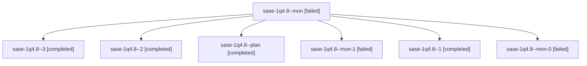

# Session: sase-1q4.8

[Agent Hoods](../README.md) / [bbugyi200](../users/bbugyi200/README.md) / [athena](../users/bbugyi200/machines/athena/README.md) / [sase-1q4](../users/bbugyi200/machines/athena/hoods/sase-1q4/README.md) / sase-1q4.8

Owner: `bbugyi200.athena` · Hood: `sase-1q4` · Members: 7 · Bead: [sase-1q4.8](https://github.com/sase-org/sase--beads/blob/main/pages/sase-1q4/sase-1q4.8.md)

## Lineage

The diagram is an optional enhancement; the ordered table below contains the same lineage in accessible text.

| Role | Agent | State | Model / provider | Timing | Commits | Prompt | Chat |
|---|---|---|---|---|---:|---|---|
| mon | sase-1q4.8--mon | failed | grok-4.6 / grok | 2026-10-31T09:21:49.226966+00:00 → 2026-10-31T09:43:02.540405+00:00 | 0 | — | [Chat](../agents/bbugyi200.athena.sase-1q4.8--mon/chat.md) |
| 3 | sase-1q4.8--3 | completed | grok-4.6 / grok | 2026-10-31T11:01:12.026750+00:00 → 2026-10-31T11:12:51.750919+00:00 | [1](../agents/bbugyi200.athena.sase-1q4.8--3/README.md#commits) | [Prompt](../agents/bbugyi200.athena.sase-1q4.8--3/prompt.md) | [Chat](../agents/bbugyi200.athena.sase-1q4.8--3/chat.md) |
| 2 | sase-1q4.8--2 | completed | grok-4.6 / grok | 2026-10-31T10:24:45.158660+00:00 → 2026-10-31T10:31:35.043747+00:00 | 0 | [Prompt](../agents/bbugyi200.athena.sase-1q4.8--2/prompt.md) | [Chat](../agents/bbugyi200.athena.sase-1q4.8--2/chat.md) |
| plan | sase-1q4.8--plan | completed | grok-4.6 / grok | 2026-10-31T07:46:24.441352+00:00 → 2026-10-31T09:22:00.472069+00:00 | 0 | [Prompt](../agents/bbugyi200.athena.sase-1q4.8--plan/prompt.md) | [Chat](../agents/bbugyi200.athena.sase-1q4.8--plan/chat.md) |
| mon-1 | sase-1q4.8--mon-1 | failed | grok-4.6 / grok | 2026-10-31T10:31:24.354443+00:00 → 2026-10-31T10:59:53.797468+00:00 | 0 | — | [Chat](../agents/bbugyi200.athena.sase-1q4.8--mon-1/chat.md) |
| 1 | sase-1q4.8--1 | completed | grok-4.6 / grok | 2026-10-31T09:44:25.784643+00:00 → 2026-10-31T09:55:18.430766+00:00 | 0 | [Prompt](../agents/bbugyi200.athena.sase-1q4.8--1/prompt.md) | [Chat](../agents/bbugyi200.athena.sase-1q4.8--1/chat.md) |
| mon-0 | sase-1q4.8--mon-0 | failed | grok-4.6 / grok | 2026-10-31T09:55:06.111924+00:00 → 2026-10-31T10:23:26.946392+00:00 | 0 | — | [Chat](../agents/bbugyi200.athena.sase-1q4.8--mon-0/chat.md) |

## Commits

| Role | Repo | Commit | Subject | Committed |
|---|---|---|---|---|
| 3 | sase | [`4a4b6fe`](https://github.com/sase-org/sase/commit/4a4b6fede82aff9cdab6a29a8cfc1d993cf4dadb) | feat(tui): surface and edit bound turn waits | 2026-10-31 07:11:46 EDT |

## Neighbors

| Agent | Relation | State |
|---|---|---|
| [sase-1q4.1](bbugyi200.athena.sase-1q4.1.md) (session · 3) | sase-1q4 hood | completed 2, failed 1 |
| [sase-1q4.10](bbugyi200.athena.sase-1q4.10.md) (session · 5) | sase-1q4 hood | completed 3, failed 2 |
| [sase-1q4.11](bbugyi200.athena.sase-1q4.11.md) (session · 3) | sase-1q4 hood | completed 2, failed 1 |
| [sase-1q4.2](../agents/bbugyi200.athena.sase-1q4.2/README.md) | sase-1q4 hood | completed |
| [sase-1q4.3](bbugyi200.athena.sase-1q4.3.md) (session · 3) | sase-1q4 hood | completed 2, failed 1 |
| [sase-1q4.4](../agents/bbugyi200.athena.sase-1q4.4/README.md) | sase-1q4 hood | completed |
| [sase-1q4.5](../agents/bbugyi200.athena.sase-1q4.5/README.md) | sase-1q4 hood | completed |
| [sase-1q4.6](../agents/bbugyi200.athena.sase-1q4.6/README.md) | sase-1q4 hood | completed |
| [sase-1q4.7](bbugyi200.athena.sase-1q4.7.md) (session · 3) | sase-1q4 hood | completed 2, failed 1 |
| [sase-1q4.9](../agents/bbugyi200.athena.sase-1q4.9/README.md) | sase-1q4 hood | completed |
| [sase-1q4.land](../agents/bbugyi200.athena.sase-1q4.land/README.md) | sase-1q4 hood | waiting |
