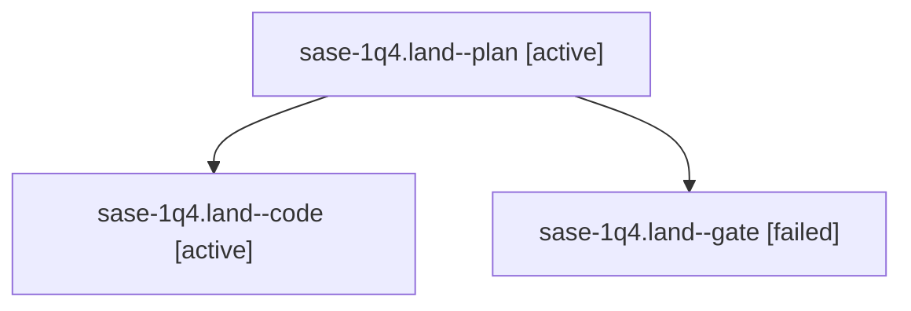

# Session: sase-1q4.land

[Agent Hoods](../README.md) / [bbugyi200](../users/bbugyi200/README.md) / [athena](../users/bbugyi200/machines/athena/README.md) / [sase-1q4](../users/bbugyi200/machines/athena/hoods/sase-1q4/README.md) / sase-1q4.land

Owner: `bbugyi200.athena` · Hood: `sase-1q4` · Members: 3 · Bead: [sase-1q4](https://github.com/sase-org/sase--beads/blob/main/pages/sase-1q4/README.md)

## Lineage

The diagram is an optional enhancement; the ordered table below contains the same lineage in accessible text.

| Role | Agent | State | Model / provider | Timing | Commits | Prompt | Chat |
|---|---|---|---|---|---:|---|---|
| plan | sase-1q4.land--plan | active | opus / claude | 2026-10-31T11:14:37.432358+00:00 | 0 | [Prompt](../agents/bbugyi200.athena.sase-1q4.land--plan/prompt.md) | [Chat](../agents/bbugyi200.athena.sase-1q4.land--plan/chat.md) |
| code | sase-1q4.land--code | active | grok-4.6 / grok | 2026-10-31T11:39:37.178817+00:00 | 0 | — | — |
| gate | sase-1q4.land--gate | failed | opus / claude | 2026-10-31T11:38:15.510791+00:00 → 2026-10-31T11:39:12.934859+00:00 | 0 | — | [Chat](../agents/bbugyi200.athena.sase-1q4.land--gate/chat.md) |

## Neighbors

| Agent | Relation | State |
|---|---|---|
| [sase-1q4.1](bbugyi200.athena.sase-1q4.1.md) (session · 3) | sase-1q4 hood | completed 2, failed 1 |
| [sase-1q4.10](bbugyi200.athena.sase-1q4.10.md) (session · 5) | sase-1q4 hood | completed 3, failed 2 |
| [sase-1q4.11](bbugyi200.athena.sase-1q4.11.md) (session · 3) | sase-1q4 hood | completed 2, failed 1 |
| [sase-1q4.2](../agents/bbugyi200.athena.sase-1q4.2/README.md) | sase-1q4 hood | completed |
| [sase-1q4.3](bbugyi200.athena.sase-1q4.3.md) (session · 3) | sase-1q4 hood | completed 2, failed 1 |
| [sase-1q4.4](../agents/bbugyi200.athena.sase-1q4.4/README.md) | sase-1q4 hood | completed |
| [sase-1q4.5](../agents/bbugyi200.athena.sase-1q4.5/README.md) | sase-1q4 hood | completed |
| [sase-1q4.6](../agents/bbugyi200.athena.sase-1q4.6/README.md) | sase-1q4 hood | completed |
| [sase-1q4.7](bbugyi200.athena.sase-1q4.7.md) (session · 3) | sase-1q4 hood | completed 2, failed 1 |
| [sase-1q4.8](bbugyi200.athena.sase-1q4.8.md) (session · 7) | sase-1q4 hood | completed 4, failed 3 |
| [sase-1q4.9](../agents/bbugyi200.athena.sase-1q4.9/README.md) | sase-1q4 hood | completed |
