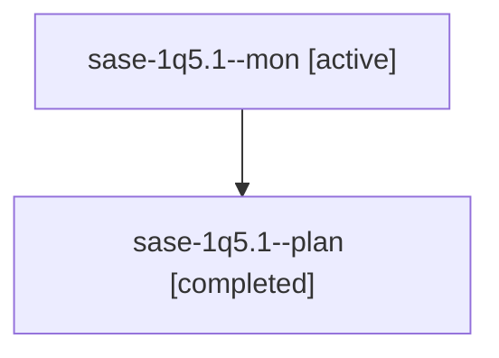

# Session: sase-1q5.1

[Agent Hoods](../README.md) / [bbugyi200](../users/bbugyi200/README.md) / [athena](../users/bbugyi200/machines/athena/README.md) / [sase-1q5](../users/bbugyi200/machines/athena/hoods/sase-1q5/README.md) / sase-1q5.1

Owner: `bbugyi200.athena` · Hood: `sase-1q5` · Members: 2 · Bead: [sase-1q5.1](https://github.com/sase-org/sase--beads/blob/main/pages/sase-1q5/sase-1q5.1.md)

## Lineage

The diagram is an optional enhancement; the ordered table below contains the same lineage in accessible text.

| Role | Agent | State | Model / provider | Timing | Commits | Prompt | Chat |
|---|---|---|---|---|---:|---|---|
| mon | sase-1q5.1--mon | active | muse-spark-1.3-contributor / muse | 2026-10-30T23:20:36.204480+00:00 | 0 | — | — |
| plan | sase-1q5.1--plan | completed | muse-spark-1.3-contributor / muse | 2026-10-30T22:45:45.019517+00:00 → 2026-10-30T23:20:49.345665+00:00 | 0 | [Prompt](../agents/bbugyi200.athena.sase-1q5.1--plan/prompt.md) | [Chat](../agents/bbugyi200.athena.sase-1q5.1--plan/chat.md) |

## Neighbors

| Agent | Relation | State |
|---|---|---|
| [sase-1q5.2](bbugyi200.athena.sase-1q5.2.md) (session · 3) | sase-1q5 hood | active 1, completed 1, failed 1 |
| [sase-1q5.3](../agents/bbugyi200.athena.sase-1q5.3/README.md) | sase-1q5 hood | completed |
| [sase-1q5.4](../agents/bbugyi200.athena.sase-1q5.4/README.md) | sase-1q5 hood | waiting |
| [sase-1q5.5](../agents/bbugyi200.athena.sase-1q5.5/README.md) | sase-1q5 hood | waiting |
| [sase-1q5.6](../agents/bbugyi200.athena.sase-1q5.6/README.md) | sase-1q5 hood | active |
| [sase-1q5.7](../agents/bbugyi200.athena.sase-1q5.7/README.md) | sase-1q5 hood | waiting |
| [sase-1q5.8](../agents/bbugyi200.athena.sase-1q5.8/README.md) | sase-1q5 hood | waiting |
| [sase-1q5.land](../agents/bbugyi200.athena.sase-1q5.land/README.md) | sase-1q5 hood | waiting |
