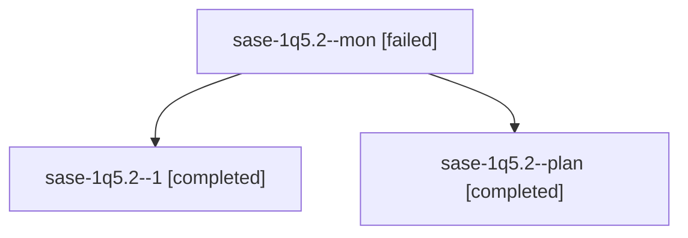

# Session: sase-1q5.2

[Agent Hoods](../README.md) / [bbugyi200](../users/bbugyi200/README.md) / [athena](../users/bbugyi200/machines/athena/README.md) / [sase-1q5](../users/bbugyi200/machines/athena/hoods/sase-1q5/README.md) / sase-1q5.2

Owner: `bbugyi200.athena` · Hood: `sase-1q5` · Members: 3 · Bead: [sase-1q5.2](https://github.com/sase-org/sase--beads/blob/main/pages/sase-1q5/sase-1q5.2.md)

## Lineage

The diagram is an optional enhancement; the ordered table below contains the same lineage in accessible text.

| Role | Agent | State | Model / provider | Timing | Commits | Prompt | Chat |
|---|---|---|---|---|---:|---|---|
| mon | sase-1q5.2--mon | failed | gpt-6-luna / codex | 2026-10-30T23:28:33.522237+00:00 → 2026-10-31T00:07:32.594736+00:00 | 0 | — | [Chat](../agents/bbugyi200.athena.sase-1q5.2--mon/chat.md) |
| 1 | sase-1q5.2--1 | completed | gpt-6-luna / codex | 2026-10-31T00:09:03.170637+00:00 → 2026-10-31T00:13:39.274583+00:00 | [1](../agents/bbugyi200.athena.sase-1q5.2--1/README.md#commits) | [Prompt](../agents/bbugyi200.athena.sase-1q5.2--1/prompt.md) | [Chat](../agents/bbugyi200.athena.sase-1q5.2--1/chat.md) |
| plan | sase-1q5.2--plan | completed | gpt-6-luna / codex | 2026-10-30T22:44:21.167468+00:00 → 2026-10-30T23:28:50.486933+00:00 | 0 | [Prompt](../agents/bbugyi200.athena.sase-1q5.2--plan/prompt.md) | [Chat](../agents/bbugyi200.athena.sase-1q5.2--plan/chat.md) |

## Commits

| Role | Repo | Commit | Subject | Committed |
|---|---|---|---|---|
| 1 | sase | [`ad6e4d4`](https://github.com/sase-org/sase/commit/ad6e4d4c153316088c866b04e99652826ae00e1d) | perf(ace): throttle stranded report refreshes | 2026-10-30 20:12:35 EDT |

## Neighbors

| Agent | Relation | State |
|---|---|---|
| [sase-1q5.1](bbugyi200.athena.sase-1q5.1.md) (session · 3) | sase-1q5 hood | completed 2, failed 1 |
| [sase-1q5.3](../agents/bbugyi200.athena.sase-1q5.3/README.md) | sase-1q5 hood | completed |
| [sase-1q5.4](bbugyi200.athena.sase-1q5.4.md) (session · 9) | sase-1q5 hood | completed 5, failed 4 |
| [sase-1q5.5](bbugyi200.athena.sase-1q5.5.md) (session · 5) | sase-1q5 hood | completed 3, failed 2 |
| [sase-1q5.6](../agents/bbugyi200.athena.sase-1q5.6/README.md) | sase-1q5 hood | completed |
| [sase-1q5.7](bbugyi200.athena.sase-1q5.7.md) (session · 3) | sase-1q5 hood | completed 2, failed 1 |
| [sase-1q5.8](bbugyi200.athena.sase-1q5.8.md) (session · 5) | sase-1q5 hood | completed 3, failed 2 |
| [sase-1q5.land](bbugyi200.athena.sase-1q5.land.md) (session · 5) | sase-1q5 hood | completed 3, failed 2 |
