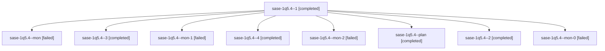

# Session: sase-1q5.4

[Agent Hoods](../README.md) / [bbugyi200](../users/bbugyi200/README.md) / [athena](../users/bbugyi200/machines/athena/README.md) / [sase-1q5](../users/bbugyi200/machines/athena/hoods/sase-1q5/README.md) / sase-1q5.4

Owner: `bbugyi200.athena` · Hood: `sase-1q5` · Members: 9 · Bead: [sase-1q5.4](https://github.com/sase-org/sase--beads/blob/main/pages/sase-1q5/sase-1q5.4.md)

## Lineage

The diagram is an optional enhancement; the ordered table below contains the same lineage in accessible text.

| Role | Agent | State | Model / provider | Timing | Commits | Prompt | Chat |
|---|---|---|---|---|---:|---|---|
| 1 | sase-1q5.4--1 | completed | muse-spark-1.3-contributor / muse | 2026-10-31T01:20:59.485529+00:00 → 2026-10-31T01:32:44.136321+00:00 | 0 | [Prompt](../agents/bbugyi200.athena.sase-1q5.4--1/prompt.md) | [Chat](../agents/bbugyi200.athena.sase-1q5.4--1/chat.md) |
| mon | sase-1q5.4--mon | failed | muse-spark-1.3-contributor / muse | 2026-10-31T01:14:29.803746+00:00 → 2026-10-31T01:16:21.239818+00:00 | 0 | — | [Chat](../agents/bbugyi200.athena.sase-1q5.4--mon/chat.md) |
| 3 | sase-1q5.4--3 | completed | muse-spark-1.3-contributor / muse | 2026-10-31T02:08:52.467813+00:00 → 2026-10-31T02:19:53.138270+00:00 | 0 | [Prompt](../agents/bbugyi200.athena.sase-1q5.4--3/prompt.md) | [Chat](../agents/bbugyi200.athena.sase-1q5.4--3/chat.md) |
| mon-1 | sase-1q5.4--mon-1 | failed | muse-spark-1.3-contributor / muse | 2026-10-31T01:59:28.836097+00:00 → 2026-10-31T02:07:27.319049+00:00 | 0 | — | [Chat](../agents/bbugyi200.athena.sase-1q5.4--mon-1/chat.md) |
| 4 | sase-1q5.4--4 | completed | muse-spark-1.3-contributor / muse | 2026-10-31T02:35:34.372804+00:00 → 2026-10-31T02:39:16.119987+00:00 | 0 | [Prompt](../agents/bbugyi200.athena.sase-1q5.4--4/prompt.md) | [Chat](../agents/bbugyi200.athena.sase-1q5.4--4/chat.md) |
| mon-2 | sase-1q5.4--mon-2 | failed | muse-spark-1.3-contributor / muse | 2026-10-31T02:19:37.420106+00:00 → 2026-10-31T02:33:51.842541+00:00 | 0 | — | — |
| plan | sase-1q5.4--plan | completed | muse-spark-1.3-contributor / muse | 2026-10-31T00:32:22.276741+00:00 → 2026-10-31T01:14:41.626429+00:00 | 0 | [Prompt](../agents/bbugyi200.athena.sase-1q5.4--plan/prompt.md) | [Chat](../agents/bbugyi200.athena.sase-1q5.4--plan/chat.md) |
| 2 | sase-1q5.4--2 | completed | muse-spark-1.3-contributor / muse | 2026-10-31T01:47:58.458129+00:00 → 2026-10-31T01:59:49.588757+00:00 | 0 | [Prompt](../agents/bbugyi200.athena.sase-1q5.4--2/prompt.md) | [Chat](../agents/bbugyi200.athena.sase-1q5.4--2/chat.md) |
| mon-0 | sase-1q5.4--mon-0 | failed | muse-spark-1.3-contributor / muse | 2026-10-31T01:32:35.046159+00:00 → 2026-10-31T01:45:55.427334+00:00 | 0 | — | [Chat](../agents/bbugyi200.athena.sase-1q5.4--mon-0/chat.md) |

## Neighbors

| Agent | Relation | State |
|---|---|---|
| [sase-1q5.1](bbugyi200.athena.sase-1q5.1.md) (session · 3) | sase-1q5 hood | completed 2, failed 1 |
| [sase-1q5.2](bbugyi200.athena.sase-1q5.2.md) (session · 3) | sase-1q5 hood | completed 2, failed 1 |
| [sase-1q5.3](../agents/bbugyi200.athena.sase-1q5.3/README.md) | sase-1q5 hood | completed |
| [sase-1q5.5](bbugyi200.athena.sase-1q5.5.md) (session · 5) | sase-1q5 hood | completed 3, failed 2 |
| [sase-1q5.6](../agents/bbugyi200.athena.sase-1q5.6/README.md) | sase-1q5 hood | completed |
| [sase-1q5.7](bbugyi200.athena.sase-1q5.7.md) (session · 3) | sase-1q5 hood | completed 2, failed 1 |
| [sase-1q5.8](bbugyi200.athena.sase-1q5.8.md) (session · 5) | sase-1q5 hood | completed 3, failed 2 |
| [sase-1q5.land](bbugyi200.athena.sase-1q5.land.md) (session · 4) | sase-1q5 hood | active 1, completed 2, failed 1 |
