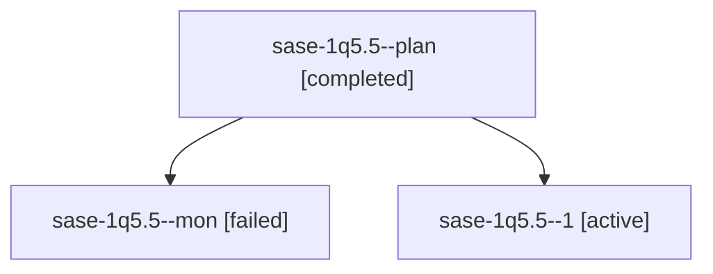

# Session: sase-1q5.5

[Agent Hoods](../README.md) / [bbugyi200](../users/bbugyi200/README.md) / [athena](../users/bbugyi200/machines/athena/README.md) / [sase-1q5](../users/bbugyi200/machines/athena/hoods/sase-1q5/README.md) / sase-1q5.5

Owner: `bbugyi200.athena` · Hood: `sase-1q5` · Members: 3 · Bead: [sase-1q5.5](https://github.com/sase-org/sase--beads/blob/main/pages/sase-1q5/sase-1q5.5.md)

## Lineage

The diagram is an optional enhancement; the ordered table below contains the same lineage in accessible text.

| Role | Agent | State | Model / provider | Timing | Commits | Prompt | Chat |
|---|---|---|---|---|---:|---|---|
| plan | sase-1q5.5--plan | completed | gpt-6-luna / codex | 2026-10-31T00:15:52.719529+00:00 → 2026-10-31T00:20:11.438066+00:00 | 0 | [Prompt](../agents/bbugyi200.athena.sase-1q5.5--plan/prompt.md) | [Chat](../agents/bbugyi200.athena.sase-1q5.5--plan/chat.md) |
| mon | sase-1q5.5--mon | failed | gpt-6-luna / codex | 2026-10-31T00:19:59.901154+00:00 → 2026-10-31T00:22:21.716143+00:00 | 0 | — | [Chat](../agents/bbugyi200.athena.sase-1q5.5--mon/chat.md) |
| 1 | sase-1q5.5--1 | active | gpt-6-luna / codex | 2026-10-31T00:24:59.373256+00:00 | 0 | [Prompt](../agents/bbugyi200.athena.sase-1q5.5--1/prompt.md) | — |

## Neighbors

| Agent | Relation | State |
|---|---|---|
| [sase-1q5.1](bbugyi200.athena.sase-1q5.1.md) (session · 3) | sase-1q5 hood | completed 2, failed 1 |
| [sase-1q5.2](bbugyi200.athena.sase-1q5.2.md) (session · 3) | sase-1q5 hood | completed 2, failed 1 |
| [sase-1q5.3](../agents/bbugyi200.athena.sase-1q5.3/README.md) | sase-1q5 hood | completed |
| [sase-1q5.4](../agents/bbugyi200.athena.sase-1q5.4/README.md) | sase-1q5 hood | waiting |
| [sase-1q5.6](../agents/bbugyi200.athena.sase-1q5.6/README.md) | sase-1q5 hood | completed |
| [sase-1q5.7](../agents/bbugyi200.athena.sase-1q5.7/README.md) | sase-1q5 hood | waiting |
| [sase-1q5.8](../agents/bbugyi200.athena.sase-1q5.8/README.md) | sase-1q5 hood | waiting |
| [sase-1q5.land](../agents/bbugyi200.athena.sase-1q5.land/README.md) | sase-1q5 hood | waiting |
