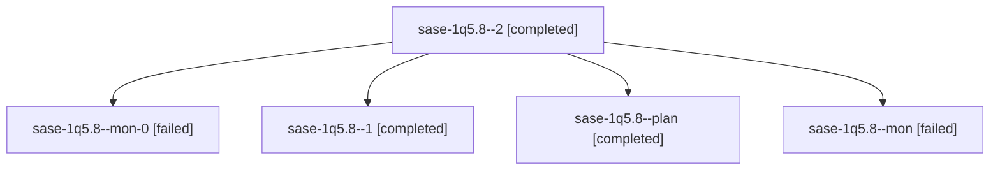

# Session: sase-1q5.8

[Agent Hoods](../README.md) / [bbugyi200](../users/bbugyi200/README.md) / [athena](../users/bbugyi200/machines/athena/README.md) / [sase-1q5](../users/bbugyi200/machines/athena/hoods/sase-1q5/README.md) / sase-1q5.8

Owner: `bbugyi200.athena` · Hood: `sase-1q5` · Members: 5 · Bead: [sase-1q5.8](https://github.com/sase-org/sase--beads/blob/main/pages/sase-1q5/sase-1q5.8.md)

## Lineage

The diagram is an optional enhancement; the ordered table below contains the same lineage in accessible text.

| Role | Agent | State | Model / provider | Timing | Commits | Prompt | Chat |
|---|---|---|---|---|---:|---|---|
| 2 | sase-1q5.8--2 | completed | grok-4.6 / grok | 2026-10-31T04:05:03.540061+00:00 → 2026-10-31T04:14:37.059661+00:00 | [1](../agents/bbugyi200.athena.sase-1q5.8--2/README.md#commits) | [Prompt](../agents/bbugyi200.athena.sase-1q5.8--2/prompt.md) | [Chat](../agents/bbugyi200.athena.sase-1q5.8--2/chat.md) |
| mon-0 | sase-1q5.8--mon-0 | failed | grok-4.6 / grok | 2026-10-31T03:21:23.524797+00:00 → 2026-10-31T04:02:31.719006+00:00 | 0 | — | [Chat](../agents/bbugyi200.athena.sase-1q5.8--mon-0/chat.md) |
| 1 | sase-1q5.8--1 | completed | grok-4.6 / grok | 2026-10-31T03:14:25.295612+00:00 → 2026-10-31T03:21:30.591182+00:00 | 0 | [Prompt](../agents/bbugyi200.athena.sase-1q5.8--1/prompt.md) | [Chat](../agents/bbugyi200.athena.sase-1q5.8--1/chat.md) |
| plan | sase-1q5.8--plan | completed | grok-4.6 / grok | 2026-10-31T02:40:49.178612+00:00 → 2026-10-31T02:56:53.381490+00:00 | 0 | [Prompt](../agents/bbugyi200.athena.sase-1q5.8--plan/prompt.md) | [Chat](../agents/bbugyi200.athena.sase-1q5.8--plan/chat.md) |
| mon | sase-1q5.8--mon | failed | grok-4.6 / grok | 2026-10-31T02:56:46.198470+00:00 → 2026-10-31T03:12:49.675470+00:00 | 0 | — | [Chat](../agents/bbugyi200.athena.sase-1q5.8--mon/chat.md) |

## Commits

| Role | Repo | Commit | Subject | Committed |
|---|---|---|---|---|
| 2 | sase | [`1db087e`](https://github.com/sase-org/sase/commit/1db087e108345f1f353be7f1303ec6e6d7439734) | feat(tools): summarize slow agent loads in freeze report | 2026-10-31 00:13:15 EDT |

## Neighbors

| Agent | Relation | State |
|---|---|---|
| [sase-1q5.1](bbugyi200.athena.sase-1q5.1.md) (session · 3) | sase-1q5 hood | completed 2, failed 1 |
| [sase-1q5.2](bbugyi200.athena.sase-1q5.2.md) (session · 3) | sase-1q5 hood | completed 2, failed 1 |
| [sase-1q5.3](../agents/bbugyi200.athena.sase-1q5.3/README.md) | sase-1q5 hood | completed |
| [sase-1q5.4](bbugyi200.athena.sase-1q5.4.md) (session · 9) | sase-1q5 hood | completed 5, failed 4 |
| [sase-1q5.5](bbugyi200.athena.sase-1q5.5.md) (session · 5) | sase-1q5 hood | completed 3, failed 2 |
| [sase-1q5.6](../agents/bbugyi200.athena.sase-1q5.6/README.md) | sase-1q5 hood | completed |
| [sase-1q5.7](bbugyi200.athena.sase-1q5.7.md) (session · 3) | sase-1q5 hood | completed 2, failed 1 |
| [sase-1q5.land](bbugyi200.athena.sase-1q5.land.md) (session · 5) | sase-1q5 hood | completed 3, failed 2 |
