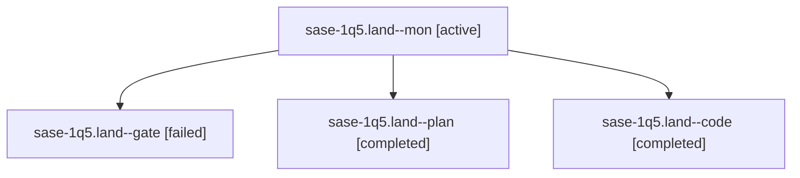

# Session: sase-1q5.land

[Agent Hoods](../README.md) / [bbugyi200](../users/bbugyi200/README.md) / [athena](../users/bbugyi200/machines/athena/README.md) / [sase-1q5](../users/bbugyi200/machines/athena/hoods/sase-1q5/README.md) / sase-1q5.land

Owner: `bbugyi200.athena` · Hood: `sase-1q5` · Members: 4 · Bead: [sase-1q5](https://github.com/sase-org/sase--beads/blob/main/pages/sase-1q5/README.md)

## Lineage

The diagram is an optional enhancement; the ordered table below contains the same lineage in accessible text.

| Role | Agent | State | Model / provider | Timing | Commits | Prompt | Chat |
|---|---|---|---|---|---:|---|---|
| mon | sase-1q5.land--mon | active | gpt-6-luna / codex | 2026-10-31T04:48:50.034586+00:00 | 0 | — | — |
| gate | sase-1q5.land--gate | failed | opus / claude | 2026-10-31T04:44:01.455860+00:00 → 2026-10-31T04:45:13.694952+00:00 | 0 | — | [Chat](../agents/bbugyi200.athena.sase-1q5.land--gate/chat.md) |
| plan | sase-1q5.land--plan | completed | opus / claude | 2026-10-31T04:16:20.779634+00:00 → 2026-10-31T04:49:07.846799+00:00 | 0 | [Prompt](../agents/bbugyi200.athena.sase-1q5.land--plan/prompt.md) | [Chat](../agents/bbugyi200.athena.sase-1q5.land--plan/chat.md) |
| code | sase-1q5.land--code | completed | gpt-6-luna / codex | 2026-10-31T04:45:47.439449+00:00 → 2026-10-31T04:49:07.846799+00:00 | 0 | — | [Chat](../agents/bbugyi200.athena.sase-1q5.land--code/chat.md) |

## Neighbors

| Agent | Relation | State |
|---|---|---|
| [sase-1q5.1](bbugyi200.athena.sase-1q5.1.md) (session · 3) | sase-1q5 hood | completed 2, failed 1 |
| [sase-1q5.2](bbugyi200.athena.sase-1q5.2.md) (session · 3) | sase-1q5 hood | completed 2, failed 1 |
| [sase-1q5.3](../agents/bbugyi200.athena.sase-1q5.3/README.md) | sase-1q5 hood | completed |
| [sase-1q5.4](bbugyi200.athena.sase-1q5.4.md) (session · 9) | sase-1q5 hood | completed 5, failed 4 |
| [sase-1q5.5](bbugyi200.athena.sase-1q5.5.md) (session · 5) | sase-1q5 hood | completed 3, failed 2 |
| [sase-1q5.6](../agents/bbugyi200.athena.sase-1q5.6/README.md) | sase-1q5 hood | completed |
| [sase-1q5.7](bbugyi200.athena.sase-1q5.7.md) (session · 3) | sase-1q5 hood | completed 2, failed 1 |
| [sase-1q5.8](bbugyi200.athena.sase-1q5.8.md) (session · 5) | sase-1q5 hood | completed 3, failed 2 |
