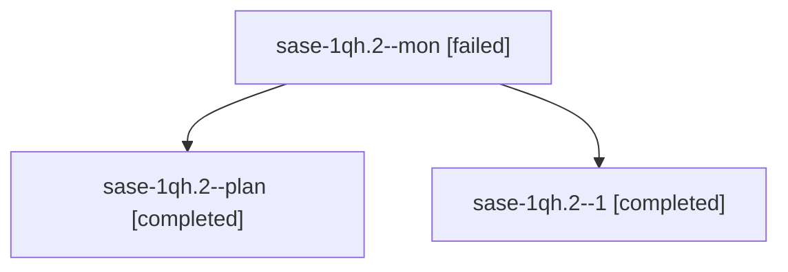

# Session: sase-1qh.2

[Agent Hoods](../README.md) / [bbugyi200](../users/bbugyi200/README.md) / [athena](../users/bbugyi200/machines/athena/README.md) / [sase-1qh](../users/bbugyi200/machines/athena/hoods/sase-1qh/README.md) / sase-1qh.2

Owner: `bbugyi200.athena` · Hood: `sase-1qh` · Members: 3 · Bead: [sase-1qh.2](https://github.com/sase-org/sase--beads/blob/main/pages/sase-1qh/sase-1qh.2.md)

## Lineage

The diagram is an optional enhancement; the ordered table below contains the same lineage in accessible text.

| Role | Agent | State | Model / provider | Timing | Commits | Prompt | Chat |
|---|---|---|---|---|---:|---|---|
| mon | sase-1qh.2--mon | failed | muse-spark-1.3-contributor / muse | 2026-10-31T17:48:30.392797+00:00 → 2026-10-31T18:13:33.519722+00:00 | 0 | — | [Chat](../agents/bbugyi200.athena.sase-1qh.2--mon/chat.md) |
| plan | sase-1qh.2--plan | completed | muse-spark-1.3-contributor / muse | 2026-10-31T17:21:56.369727+00:00 → 2026-10-31T17:48:42.150099+00:00 | 0 | [Prompt](../agents/bbugyi200.athena.sase-1qh.2--plan/prompt.md) | [Chat](../agents/bbugyi200.athena.sase-1qh.2--plan/chat.md) |
| 1 | sase-1qh.2--1 | completed | muse-spark-1.3-contributor / muse | 2026-10-31T18:16:05.985343+00:00 → 2026-10-31T18:21:21.042654+00:00 | [1](../agents/bbugyi200.athena.sase-1qh.2--1/README.md#commits) | [Prompt](../agents/bbugyi200.athena.sase-1qh.2--1/prompt.md) | [Chat](../agents/bbugyi200.athena.sase-1qh.2--1/chat.md) |

## Commits

| Role | Repo | Commit | Subject | Committed |
|---|---|---|---|---|
| 1 | sase | [`ae2c65d`](https://github.com/sase-org/sase/commit/ae2c65dd293f5f73513c1baccb08e313b1c53346) | feat(agents-sync): report real refusal reason and retire repeated refusals | 2026-10-31 14:20:21 EDT |

## Neighbors

| Agent | Relation | State |
|---|---|---|
| [sase-1qh.1](../agents/bbugyi200.athena.sase-1qh.1/README.md) | sase-1qh hood | completed |
| [sase-1qh.3](bbugyi200.athena.sase-1qh.3.md) (session · 11) | sase-1qh hood | completed 6, failed 5 |
| [sase-1qh.4](../agents/bbugyi200.athena.sase-1qh.4/README.md) | sase-1qh hood | completed |
| [sase-1qh.5](../agents/bbugyi200.athena.sase-1qh.5/README.md) | sase-1qh hood | completed |
| [sase-1qh.6](../agents/bbugyi200.athena.sase-1qh.6/README.md) | sase-1qh hood | waiting |
| [sase-1qh.7](../agents/bbugyi200.athena.sase-1qh.7/README.md) | sase-1qh hood | waiting |
| [sase-1qh.land](../agents/bbugyi200.athena.sase-1qh.land/README.md) | sase-1qh hood | waiting |
