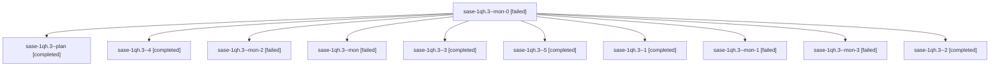

# Session: sase-1qh.3

[Agent Hoods](../README.md) / [bbugyi200](../users/bbugyi200/README.md) / [athena](../users/bbugyi200/machines/athena/README.md) / [sase-1qh](../users/bbugyi200/machines/athena/hoods/sase-1qh/README.md) / sase-1qh.3

Owner: `bbugyi200.athena` · Hood: `sase-1qh` · Members: 11 · Bead: [sase-1qh.3](https://github.com/sase-org/sase--beads/blob/main/pages/sase-1qh/sase-1qh.3.md)

## Lineage

The diagram is an optional enhancement; the ordered table below contains the same lineage in accessible text.

| Role | Agent | State | Model / provider | Timing | Commits | Prompt | Chat |
|---|---|---|---|---|---:|---|---|
| mon-0 | sase-1qh.3--mon-0 | failed | gpt-6-luna / codex | 2026-10-31T16:24:15.909814+00:00 → 2026-10-31T16:26:11.194020+00:00 | 0 | — | [Chat](../agents/bbugyi200.athena.sase-1qh.3--mon-0/chat.md) |
| plan | sase-1qh.3--plan | completed | gpt-6-luna / codex | 2026-10-31T16:07:27.946204+00:00 → 2026-10-31T16:11:28.918909+00:00 | 0 | [Prompt](../agents/bbugyi200.athena.sase-1qh.3--plan/prompt.md) | [Chat](../agents/bbugyi200.athena.sase-1qh.3--plan/chat.md) |
| 4 | sase-1qh.3--4 | completed | gpt-6-luna / codex | 2026-10-31T16:45:41.356162+00:00 → 2026-10-31T16:47:58.706761+00:00 | 0 | [Prompt](../agents/bbugyi200.athena.sase-1qh.3--4/prompt.md) | [Chat](../agents/bbugyi200.athena.sase-1qh.3--4/chat.md) |
| mon-2 | sase-1qh.3--mon-2 | failed | gpt-6-luna / codex | 2026-10-31T16:40:39.416649+00:00 → 2026-10-31T16:43:39.402235+00:00 | 0 | — | [Chat](../agents/bbugyi200.athena.sase-1qh.3--mon-2/chat.md) |
| mon | sase-1qh.3--mon | failed | gpt-6-luna / codex | 2026-10-31T16:11:20.217577+00:00 → 2026-10-31T16:14:23.279550+00:00 | 0 | — | [Chat](../agents/bbugyi200.athena.sase-1qh.3--mon/chat.md) |
| 3 | sase-1qh.3--3 | completed | gpt-6-luna / codex | 2026-10-31T16:37:06.695619+00:00 → 2026-10-31T16:40:51.283893+00:00 | 0 | [Prompt](../agents/bbugyi200.athena.sase-1qh.3--3/prompt.md) | [Chat](../agents/bbugyi200.athena.sase-1qh.3--3/chat.md) |
| 5 | sase-1qh.3--5 | completed | gpt-6-luna / codex | 2026-10-31T17:11:13.606194+00:00 → 2026-10-31T17:16:14.486391+00:00 | [1](../agents/bbugyi200.athena.sase-1qh.3--5/README.md#commits) | [Prompt](../agents/bbugyi200.athena.sase-1qh.3--5/prompt.md) | [Chat](../agents/bbugyi200.athena.sase-1qh.3--5/chat.md) |
| 1 | sase-1qh.3--1 | completed | gpt-6-luna / codex | 2026-10-31T16:23:16.915531+00:00 → 2026-10-31T16:24:27.570771+00:00 | 0 | [Prompt](../agents/bbugyi200.athena.sase-1qh.3--1/prompt.md) | [Chat](../agents/bbugyi200.athena.sase-1qh.3--1/chat.md) |
| mon-1 | sase-1qh.3--mon-1 | failed | gpt-6-luna / codex | 2026-10-31T16:29:21.138925+00:00 → 2026-10-31T16:34:14.750762+00:00 | 0 | — | [Chat](../agents/bbugyi200.athena.sase-1qh.3--mon-1/chat.md) |
| mon-3 | sase-1qh.3--mon-3 | failed | gpt-6-luna / codex | 2026-10-31T16:47:35.601039+00:00 → 2026-10-31T17:09:26.458488+00:00 | 0 | — | [Chat](../agents/bbugyi200.athena.sase-1qh.3--mon-3/chat.md) |
| 2 | sase-1qh.3--2 | completed | gpt-6-luna / codex | 2026-10-31T16:28:08.579949+00:00 → 2026-10-31T16:29:29.445338+00:00 | 0 | [Prompt](../agents/bbugyi200.athena.sase-1qh.3--2/prompt.md) | [Chat](../agents/bbugyi200.athena.sase-1qh.3--2/chat.md) |

## Commits

| Role | Repo | Commit | Subject | Committed |
|---|---|---|---|---|
| 5 | sase | [`30e012b`](https://github.com/sase-org/sase/commit/30e012baaad77f98f9c68f494a73cf48565970c4) | perf(agents-sync): reuse published protection scans | 2026-10-31 13:15:14 EDT |

## Neighbors

| Agent | Relation | State |
|---|---|---|
| [sase-1qh.1](../agents/bbugyi200.athena.sase-1qh.1/README.md) | sase-1qh hood | completed |
| [sase-1qh.2](../agents/bbugyi200.athena.sase-1qh.2/README.md) | sase-1qh hood | active |
| [sase-1qh.4](../agents/bbugyi200.athena.sase-1qh.4/README.md) | sase-1qh hood | active |
| [sase-1qh.5](../agents/bbugyi200.athena.sase-1qh.5/README.md) | sase-1qh hood | completed |
| [sase-1qh.6](../agents/bbugyi200.athena.sase-1qh.6/README.md) | sase-1qh hood | waiting |
| [sase-1qh.7](../agents/bbugyi200.athena.sase-1qh.7/README.md) | sase-1qh hood | waiting |
| [sase-1qh.land](../agents/bbugyi200.athena.sase-1qh.land/README.md) | sase-1qh hood | waiting |
