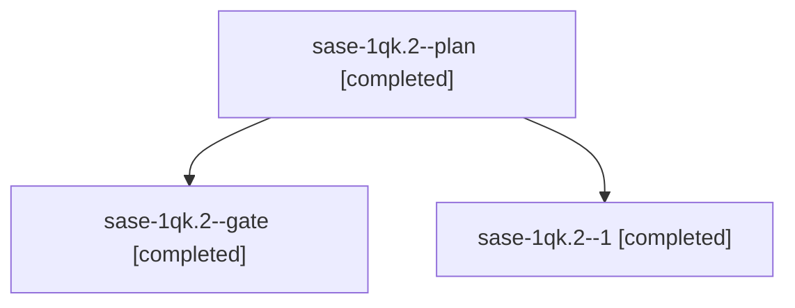

# Session: sase-1qk.2

[Agent Hoods](../README.md) / [bbugyi200](../users/bbugyi200/README.md) / [athena](../users/bbugyi200/machines/athena/README.md) / [sase-1qk](../users/bbugyi200/machines/athena/hoods/sase-1qk/README.md) / sase-1qk.2

Owner: `bbugyi200.athena` · Hood: `sase-1qk` · Members: 3 · Bead: [sase-1qk.2](https://github.com/sase-org/sase--beads/blob/main/pages/sase-1qk/sase-1qk.2.md)

## Lineage

The diagram is an optional enhancement; the ordered table below contains the same lineage in accessible text.

| Role | Agent | State | Model / provider | Timing | Commits | Prompt | Chat |
|---|---|---|---|---|---:|---|---|
| plan | sase-1qk.2--plan | completed | gpt-6-luna / codex | 2026-11-01T17:06:32.622455+00:00 → 2026-11-01T17:34:58.533814+00:00 | 0 | [Prompt](../agents/bbugyi200.athena.sase-1qk.2--plan/prompt.md) | [Chat](../agents/bbugyi200.athena.sase-1qk.2--plan/chat.md) |
| gate | sase-1qk.2--gate | completed | gpt-6-luna / codex | 2026-11-01T18:16:29.017493+00:00 → 2026-11-01T18:18:23.329096+00:00 | 0 | — | [Chat](../agents/bbugyi200.athena.sase-1qk.2--gate/chat.md) |
| 1 | sase-1qk.2--1 | completed | gpt-6-luna / codex | 2026-11-01T18:21:38.229313+00:00 → 2026-11-01T18:50:22.083809+00:00 | 0 | [Prompt](../agents/bbugyi200.athena.sase-1qk.2--1/prompt.md) | [Chat](../agents/bbugyi200.athena.sase-1qk.2--1/chat.md) |

## Neighbors

| Agent | Relation | State |
|---|---|---|
| [sase-1qk.1](../agents/bbugyi200.athena.sase-1qk.1/README.md) | sase-1qk hood | completed |
| [sase-1qk.3](bbugyi200.athena.sase-1qk.3.md) (session · 17) | sase-1qk hood | completed 10, failed 7 |
| [sase-1qk.4](bbugyi200.athena.sase-1qk.4.md) (session · 3) | sase-1qk hood | completed 2, failed 1 |
| [sase-1qk.5](bbugyi200.athena.sase-1qk.5.md) (session · 3) | sase-1qk hood | completed 3 |
| [sase-1qk.6](bbugyi200.athena.sase-1qk.6.md) (session · 5) | sase-1qk hood | completed 4, failed 1 |
| [sase-1qk.land](../agents/bbugyi200.athena.sase-1qk.land/README.md) | sase-1qk hood | waiting |
