# Session: sase-1qk.3

[Agent Hoods](../README.md) / [bbugyi200](../users/bbugyi200/README.md) / [athena](../users/bbugyi200/machines/athena/README.md) / [sase-1qk](../users/bbugyi200/machines/athena/hoods/sase-1qk/README.md) / sase-1qk.3

Owner: `bbugyi200.athena` · Hood: `sase-1qk` · Members: 17 · Bead: [sase-1qk.3](https://github.com/sase-org/sase--beads/blob/main/pages/sase-1qk/sase-1qk.3.md)

## Lineage

```mermaid
flowchart TD
  n0["sase-1qk.3--4 [completed]"]
  n1["sase-1qk.3--mon-0 [failed]"]
  n0 --> n1
  n2["sase-1qk.3--mon [failed]"]
  n0 --> n2
  n3["sase-1qk.3--7 [completed]"]
  n0 --> n3
  n4["sase-1qk.3--3 [completed]"]
  n0 --> n4
  n5["sase-1qk.3--1 [completed]"]
  n0 --> n5
  n6["sase-1qk.3--mon-6 [completed]"]
  n0 --> n6
  n7["sase-1qk.3--mon-1 [failed]"]
  n0 --> n7
  n8["sase-1qk.3--mon-3 [failed]"]
  n0 --> n8
  n9["sase-1qk.3--2 [completed]"]
  n0 --> n9
  n10["sase-1qk.3--plan [completed]"]
  n0 --> n10
  n11["sase-1qk.3--6 [completed]"]
  n0 --> n11
  n12["sase-1qk.3--mon-2 [failed]"]
  n0 --> n12
  n13["sase-1qk.3--mon-5 [failed]"]
  n0 --> n13
  n14["sase-1qk.3--8 [completed]"]
  n0 --> n14
  n15["sase-1qk.3--5 [completed]"]
  n0 --> n15
  n16["sase-1qk.3--mon-4 [failed]"]
  n0 --> n16
```

The diagram is an optional enhancement; the ordered table below contains the same lineage in accessible text.

| Role | Agent | State | Model / provider | Timing | Commits | Prompt | Chat |
|---|---|---|---|---|---:|---|---|
| 4 | sase-1qk.3--4 | completed | grok-4.6 / grok | 2026-11-01T20:26:00.987037+00:00 → 2026-11-01T20:34:01.628784+00:00 | 0 | [Prompt](../agents/bbugyi200.athena.sase-1qk.3--4/prompt.md) | [Chat](../agents/bbugyi200.athena.sase-1qk.3--4/chat.md) |
| mon-0 | sase-1qk.3--mon-0 | failed | grok-4.6 / grok | 2026-11-01T18:34:28.130990+00:00 → 2026-11-01T19:17:30.140811+00:00 | 0 | — | [Chat](../agents/bbugyi200.athena.sase-1qk.3--mon-0/chat.md) |
| mon | sase-1qk.3--mon | failed | grok-4.6 / grok | 2026-11-01T17:20:03.768798+00:00 → 2026-11-01T18:07:09.720184+00:00 | 0 | — | [Chat](../agents/bbugyi200.athena.sase-1qk.3--mon/chat.md) |
| 7 | sase-1qk.3--7 | completed | grok-4.6 / grok | 2026-11-01T22:51:42.464499+00:00 → 2026-11-01T22:56:24.309960+00:00 | 0 | [Prompt](../agents/bbugyi200.athena.sase-1qk.3--7/prompt.md) | [Chat](../agents/bbugyi200.athena.sase-1qk.3--7/chat.md) |
| 3 | sase-1qk.3--3 | completed | grok-4.6 / grok | 2026-11-01T19:34:21.565533+00:00 → 2026-11-01T19:43:02.664037+00:00 | 0 | [Prompt](../agents/bbugyi200.athena.sase-1qk.3--3/prompt.md) | [Chat](../agents/bbugyi200.athena.sase-1qk.3--3/chat.md) |
| 1 | sase-1qk.3--1 | completed | grok-4.6 / grok | 2026-11-01T18:08:34.658887+00:00 → 2026-11-01T18:34:38.811361+00:00 | 0 | [Prompt](../agents/bbugyi200.athena.sase-1qk.3--1/prompt.md) | [Chat](../agents/bbugyi200.athena.sase-1qk.3--1/chat.md) |
| mon-6 | sase-1qk.3--mon-6 | completed | grok-4.6 / grok | 2026-11-01T22:56:17.860663+00:00 → 2026-11-01T23:09:11.196050+00:00 | 0 | — | [Chat](../agents/bbugyi200.athena.sase-1qk.3--mon-6/chat.md) |
| mon-1 | sase-1qk.3--mon-1 | failed | grok-4.6 / grok | 2026-11-01T19:27:30.834754+00:00 → 2026-11-01T19:32:37.750050+00:00 | 0 | — | [Chat](../agents/bbugyi200.athena.sase-1qk.3--mon-1/chat.md) |
| mon-3 | sase-1qk.3--mon-3 | failed | grok-4.6 / grok | 2026-11-01T20:33:49.785274+00:00 → 2026-11-01T21:37:34.152268+00:00 | 0 | — | [Chat](../agents/bbugyi200.athena.sase-1qk.3--mon-3/chat.md) |
| 2 | sase-1qk.3--2 | completed | grok-4.6 / grok | 2026-11-01T19:20:01.736226+00:00 → 2026-11-01T19:27:37.077620+00:00 | 0 | [Prompt](../agents/bbugyi200.athena.sase-1qk.3--2/prompt.md) | [Chat](../agents/bbugyi200.athena.sase-1qk.3--2/chat.md) |
| plan | sase-1qk.3--plan | completed | grok-4.6 / grok | 2026-11-01T17:07:24.814395+00:00 → 2026-11-01T17:20:23.825704+00:00 | 0 | [Prompt](../agents/bbugyi200.athena.sase-1qk.3--plan/prompt.md) | [Chat](../agents/bbugyi200.athena.sase-1qk.3--plan/chat.md) |
| 6 | sase-1qk.3--6 | completed | grok-4.6 / grok | 2026-11-01T22:30:48.260335+00:00 → 2026-11-01T22:37:26.225068+00:00 | 0 | [Prompt](../agents/bbugyi200.athena.sase-1qk.3--6/prompt.md) | [Chat](../agents/bbugyi200.athena.sase-1qk.3--6/chat.md) |
| mon-2 | sase-1qk.3--mon-2 | failed | grok-4.6 / grok | 2026-11-01T19:42:56.173412+00:00 → 2026-11-01T20:10:46.959574+00:00 | 0 | — | [Chat](../agents/bbugyi200.athena.sase-1qk.3--mon-2/chat.md) |
| mon-5 | sase-1qk.3--mon-5 | failed | grok-4.6 / grok | 2026-11-01T22:37:19.680300+00:00 → 2026-11-01T22:50:15.126213+00:00 | 0 | — | [Chat](../agents/bbugyi200.athena.sase-1qk.3--mon-5/chat.md) |
| 8 | sase-1qk.3--8 | completed | grok-4.6 / grok | 2026-11-01T23:10:25.186441+00:00 → 2026-11-01T23:16:33.144887+00:00 | [1](../agents/bbugyi200.athena.sase-1qk.3--8/README.md#commits) | [Prompt](../agents/bbugyi200.athena.sase-1qk.3--8/prompt.md) | [Chat](../agents/bbugyi200.athena.sase-1qk.3--8/chat.md) |
| 5 | sase-1qk.3--5 | completed | grok-4.6 / grok | 2026-11-01T21:39:40.509449+00:00 → 2026-11-01T21:45:20.134452+00:00 | 0 | [Prompt](../agents/bbugyi200.athena.sase-1qk.3--5/prompt.md) | [Chat](../agents/bbugyi200.athena.sase-1qk.3--5/chat.md) |
| mon-4 | sase-1qk.3--mon-4 | failed | grok-4.6 / grok | 2026-11-01T21:45:14.067965+00:00 → 2026-11-01T22:29:17.408272+00:00 | 0 | — | [Chat](../agents/bbugyi200.athena.sase-1qk.3--mon-4/chat.md) |

## Commits

| Role | Repo | Commit | Subject | Committed |
|---|---|---|---|---|
| 8 | sase | [`a792079`](https://github.com/sase-org/sase/commit/a79207993c4e619c235c3325e351e8610a2a0168) | fix(staged-handoff): reclaim dead-owner reservations before monitor spawn | 2026-11-01 18:15:37 EST |

## Neighbors

| Agent | Relation | State |
|---|---|---|
| [sase-1qk.1](../agents/bbugyi200.athena.sase-1qk.1/README.md) | sase-1qk hood | completed |
| [sase-1qk.2](bbugyi200.athena.sase-1qk.2.md) (session · 3) | sase-1qk hood | completed 3 |
| [sase-1qk.4](bbugyi200.athena.sase-1qk.4.md) (session · 3) | sase-1qk hood | completed 2, failed 1 |
| [sase-1qk.5](bbugyi200.athena.sase-1qk.5.md) (session · 3) | sase-1qk hood | completed 3 |
| [sase-1qk.6](bbugyi200.athena.sase-1qk.6.md) (session · 5) | sase-1qk hood | completed 4, failed 1 |
| [sase-1qk.land](../agents/bbugyi200.athena.sase-1qk.land/README.md) | sase-1qk hood | waiting |
