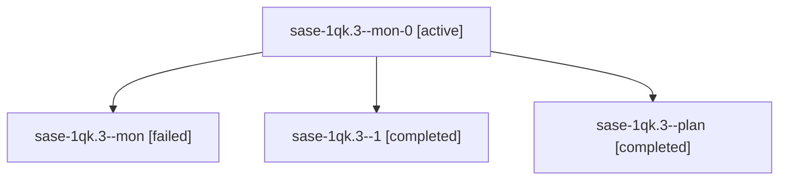

# Session: sase-1qk.3

[Agent Hoods](../README.md) / [bbugyi200](../users/bbugyi200/README.md) / [athena](../users/bbugyi200/machines/athena/README.md) / [sase-1qk](../users/bbugyi200/machines/athena/hoods/sase-1qk/README.md) / sase-1qk.3

Owner: `bbugyi200.athena` · Hood: `sase-1qk` · Members: 4 · Bead: [sase-1qk.3](https://github.com/sase-org/sase--beads/blob/main/pages/sase-1qk/sase-1qk.3.md)

## Lineage

The diagram is an optional enhancement; the ordered table below contains the same lineage in accessible text.

| Role | Agent | State | Model / provider | Timing | Commits | Prompt | Chat |
|---|---|---|---|---|---:|---|---|
| mon-0 | sase-1qk.3--mon-0 | active | grok-4.6 / grok | 2026-11-01T18:34:28.130990+00:00 | 0 | — | — |
| mon | sase-1qk.3--mon | failed | grok-4.6 / grok | 2026-11-01T17:20:03.768798+00:00 → 2026-11-01T18:07:09.720184+00:00 | 0 | — | [Chat](../agents/bbugyi200.athena.sase-1qk.3--mon/chat.md) |
| 1 | sase-1qk.3--1 | completed | grok-4.6 / grok | 2026-11-01T18:08:34.658887+00:00 → 2026-11-01T18:34:38.811361+00:00 | 0 | [Prompt](../agents/bbugyi200.athena.sase-1qk.3--1/prompt.md) | [Chat](../agents/bbugyi200.athena.sase-1qk.3--1/chat.md) |
| plan | sase-1qk.3--plan | completed | grok-4.6 / grok | 2026-11-01T17:07:24.814395+00:00 → 2026-11-01T17:20:23.825704+00:00 | 0 | [Prompt](../agents/bbugyi200.athena.sase-1qk.3--plan/prompt.md) | [Chat](../agents/bbugyi200.athena.sase-1qk.3--plan/chat.md) |

## Neighbors

| Agent | Relation | State |
|---|---|---|
| [sase-1qk.1](../agents/bbugyi200.athena.sase-1qk.1/README.md) | sase-1qk hood | completed |
| [sase-1qk.2](bbugyi200.athena.sase-1qk.2.md) (session · 3) | sase-1qk hood | completed 3 |
| [sase-1qk.4](bbugyi200.athena.sase-1qk.4.md) (session · 3) | sase-1qk hood | completed 2, failed 1 |
| [sase-1qk.5](bbugyi200.athena.sase-1qk.5.md) (session · 3) | sase-1qk hood | completed 3 |
| [sase-1qk.6](../agents/bbugyi200.athena.sase-1qk.6/README.md) | sase-1qk hood | active |
| [sase-1qk.land](../agents/bbugyi200.athena.sase-1qk.land/README.md) | sase-1qk hood | waiting |
