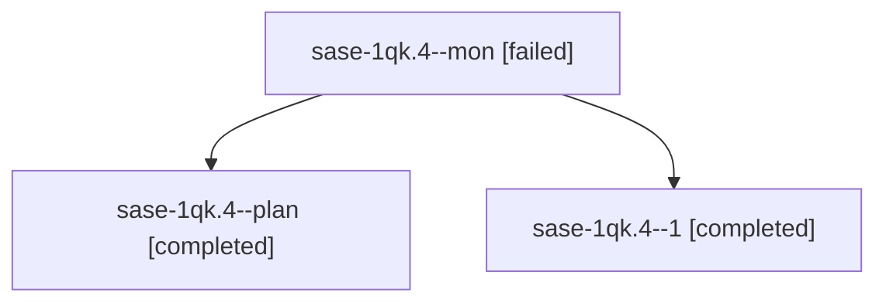

# Session: sase-1qk.4

[Agent Hoods](../README.md) / [bbugyi200](../users/bbugyi200/README.md) / [athena](../users/bbugyi200/machines/athena/README.md) / [sase-1qk](../users/bbugyi200/machines/athena/hoods/sase-1qk/README.md) / sase-1qk.4

Owner: `bbugyi200.athena` · Hood: `sase-1qk` · Members: 3 · Bead: [sase-1qk.4](https://github.com/sase-org/sase--beads/blob/main/pages/sase-1qk/sase-1qk.4.md)

## Lineage

The diagram is an optional enhancement; the ordered table below contains the same lineage in accessible text.

| Role | Agent | State | Model / provider | Timing | Commits | Prompt | Chat |
|---|---|---|---|---|---:|---|---|
| mon | sase-1qk.4--mon | failed | muse-spark-1.3-contributor / muse | 2026-11-01T17:44:46.921092+00:00 → 2026-11-01T17:54:10.434440+00:00 | 0 | — | — |
| plan | sase-1qk.4--plan | completed | muse-spark-1.3-contributor / muse | 2026-11-01T17:07:58.207012+00:00 → 2026-11-01T17:45:13.783116+00:00 | 0 | [Prompt](../agents/bbugyi200.athena.sase-1qk.4--plan/prompt.md) | [Chat](../agents/bbugyi200.athena.sase-1qk.4--plan/chat.md) |
| 1 | sase-1qk.4--1 | completed | muse-spark-1.3-contributor / muse | 2026-11-01T17:56:06.992743+00:00 → 2026-11-01T18:03:51.261833+00:00 | [1](../agents/bbugyi200.athena.sase-1qk.4--1/README.md#commits) | [Prompt](../agents/bbugyi200.athena.sase-1qk.4--1/prompt.md) | [Chat](../agents/bbugyi200.athena.sase-1qk.4--1/chat.md) |

## Commits

| Role | Repo | Commit | Subject | Committed |
|---|---|---|---|---|
| 1 | sase | [`17d8fe5`](https://github.com/sase-org/sase/commit/17d8fe593726e4691972f17b5c8aaeb8635a86d7) | feat(gate-turn): make gate entry signal-safe and withdraw lost gates | 2026-11-01 13:02:47 EST |

## Neighbors

| Agent | Relation | State |
|---|---|---|
| [sase-1qk.1](../agents/bbugyi200.athena.sase-1qk.1/README.md) | sase-1qk hood | completed |
| [sase-1qk.2](bbugyi200.athena.sase-1qk.2.md) (session · 3) | sase-1qk hood | completed 3 |
| [sase-1qk.3](bbugyi200.athena.sase-1qk.3.md) (session · 17) | sase-1qk hood | completed 10, failed 7 |
| [sase-1qk.5](bbugyi200.athena.sase-1qk.5.md) (session · 3) | sase-1qk hood | completed 3 |
| [sase-1qk.6](bbugyi200.athena.sase-1qk.6.md) (session · 5) | sase-1qk hood | completed 4, failed 1 |
| [sase-1qk.land](../agents/bbugyi200.athena.sase-1qk.land/README.md) | sase-1qk hood | waiting |
